> **This is Part 1 of "How to Build a Good Personal Agent."** It covers what a personal agent is, the eight principles behind a good one, and how to build it: the team, the product, and the tech. Part 2 covers business model and strategy: whether the platform tax gets competed away, whether hardware or software becomes the entry point, and how big companies and startups each win.

Last month in San Francisco, right before returning my rental car, I texted Instinct: "How do I get to the SFO rental car return?"

The answer was direct. It knew which company I'd rented from, when the car was due, where the last gas station on the way into the airport was, and which terminal to head to after drop-off. I never told it I was returning a car that day. Two weeks earlier I had mentioned the rental in passing, and it remembered. My flight was on my calendar, and it saw that too.

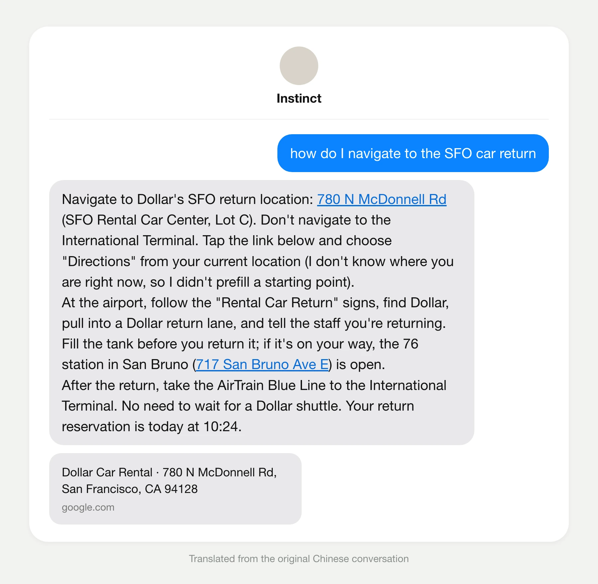

One question about the SFO car return. It pulled in my rental booking, my flight, and a gas station on the way, then told me how to get to my terminal.

That was the moment I realized this was different from every AI product I had used. It felt less like software and more like a person who was always around and knew what I was up to.

I've sent it more than 1,000 messages since August 19. This essay tries to explain, from the ground up, what makes a personal agent good: the eight principles it should follow, what sets its ceiling, and what it takes in team, product, and tech to build one. Everything comes back to one idea: **a personal agent is a way of living.**

In the second half of this year, Silicon Valley's AI products converged on this almost at once: Instinct in iMessage, Meta's Muse, OpenAI's Dots, Manus's Cue. **The form is converging**: always on, running in the cloud, with an identity of its own. **The split is the entry point**: a contact in your phone, or a standalone app. Three things matured at the same time to make this possible: cloud infrastructure for always-on agents, models that are fast and cheap enough, and the demand that this year's wave of open-source agents proved.

## 1. Definition: a personal agent is a way of living

2024 was the year of the chatbot. Our relationship with AI was **asking**. 2025 was the year of agents that do work, mostly writing code, and the relationship was **supervising**. Both were still tools, each solving one kind of problem. 2026 is the year of the personal agent, and it is starting to **change how people live**.

Tools are defined by use case: a writing tool, a translation tool, a booking tool. You have a task first, then you go find the tool. A personal agent is hard to define that way.

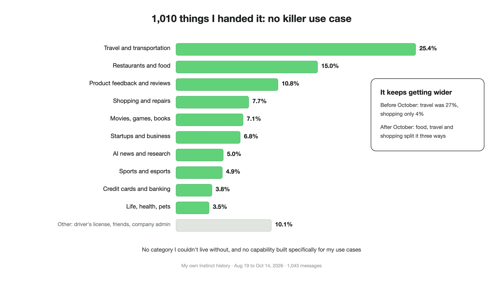

The 1,010 things I've handed it, spread across every corner of my life, and the range keeps widening

When I look back at those thousand-plus messages, the first impression is how scattered they are. Travel and transportation make up a quarter. Food is over a tenth. The rest is shopping, credit cards, my driver's license, sports, news, and small talk. It replaced my search engine first. Then hotel and restaurant bookings. Then signing up for accounts and dealing with bills. **None of these is a killer use case**, and I don't need it for any single one. But one small thing at a time, it became a habit I can't replace. So here is how I'd define it:

With a tool, **you have a task, then decide what to use**. With a way of living, **everything goes to it by default, and you only step in if it can't handle it**.

How does that default form? Delegating anything has two costs: **explaining it** and **watching it get done**. When the two add up to more than doing it yourself, you do it yourself. That's why most AI products stall at "I use it sometimes." A personal agent pushes both costs down. Memory makes explaining shorter every time, and being able to finish the job makes watching unnecessary. Once the cost drops past a threshold, your default flips. Trust builds the same way, one level at a time: from answering questions and giving advice, to placing orders for you and handling errands that need identity checks, and eventually to helping you keep up your relationships.

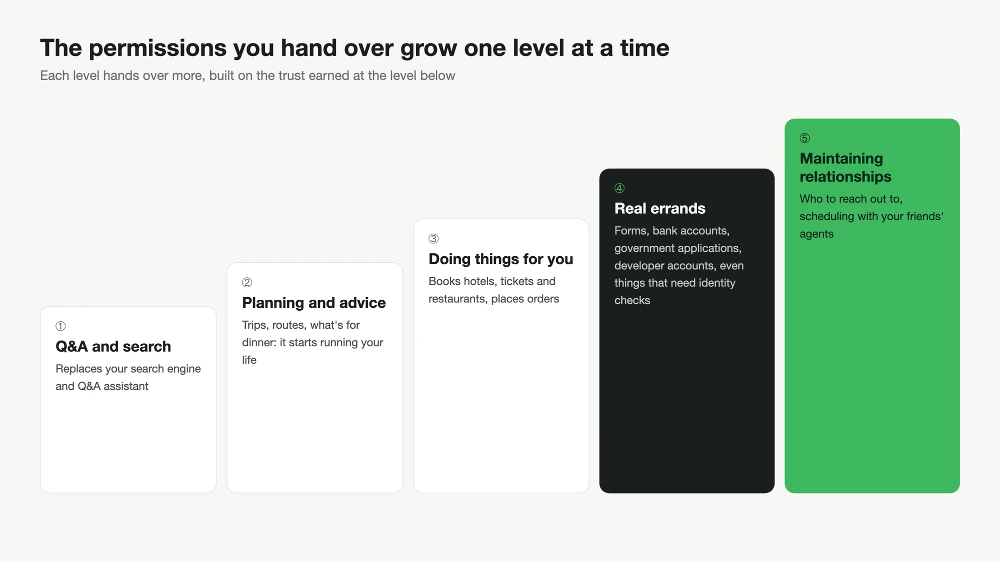

The permissions you hand over grow one level at a time

## 2. A good personal agent: the 8P principles

I came up with these eight principles after using every major personal agent on the market, heavily. Only two stuck and are now part of my day: Instinct and Muse. **Every one I dropped broke at least two of these principles.**

The eight principles are about one thing: how to get people to hand over their lives, one level at a time. Each one is a precondition for the next.

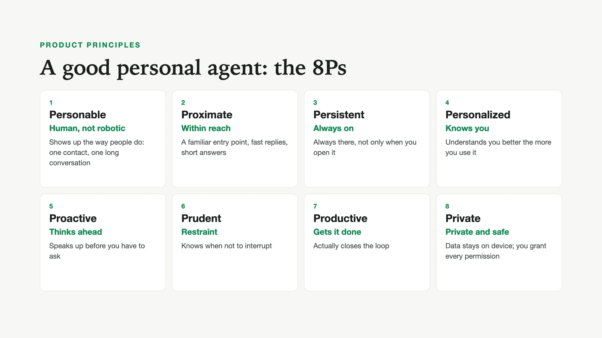

A good personal agent: the 8Ps

### Principle 1 · Personable: a person, not a program

**To the user, it is a person.** It talks like a person and interacts like one.

It's a contact in your phone, one long conversation with no sessions. You can interrupt it, or switch to something else mid-thread, the way you would with a friend.

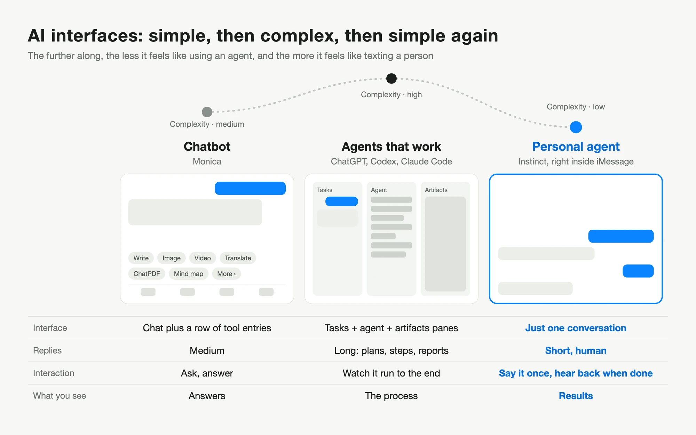

Three generations of AI interfaces: the further along, the less it feels like using an agent and the more it feels like texting a person

Two common counterexamples:

- **Tool products with many entry points**: writing, translating, image generation, and PDF reading each get their own button, so the user has to figure out which one to tap first.
- **The robotic voice of coding agents**: even a one-line reply comes with headers, bullet points, and bold text, like a report.

So the first principle is simple: **the entry point is the one people already use, and the interaction is person to person.** Treat it the way you'd treat a person.

### Principle 2 · Proximate: always within reach

**Close enough to you: a nearby entry point, fast replies, short messages.**

Three things decide the distance.

**Where the entry point is.** Instinct is a contact in iMessage. Messages live on your phone, so tapping it opens it, with no app to load. A standalone app adds one step, and usage drops a lot. For a product that has to become a habit, every extra step is friction.

On the other end, some products open to five tabs, each with its own row of categories and buttons. The farther a product is from the user, the less the user shows up.

**How fast it replies.** Speed comes first. The product itself has to be fast: open it and start talking, no splash screen, no loading. Then the replies have to be fast. Instinct and Muse are both very, very fast. Part of that is using small, fast models for the conversation. The other part is architecture: separating interaction from execution (more in Section 6). When you hand it something, it should reply right away with "Got it, on it," then do the work in the background, so you're not staring at a spinner. You can hand it several things in a row and it works through them one by one.

**Whether it talks like a person.** Many agents reply like they're writing a report: headers, bullets, bold, and a lot of words. The reason is easy to see. Today's smartest models are optimized for coding and complex tasks, where longer and more complete output is better. That isn't how people text each other. A good personal agent is short and direct, like a reliable friend texting you back.

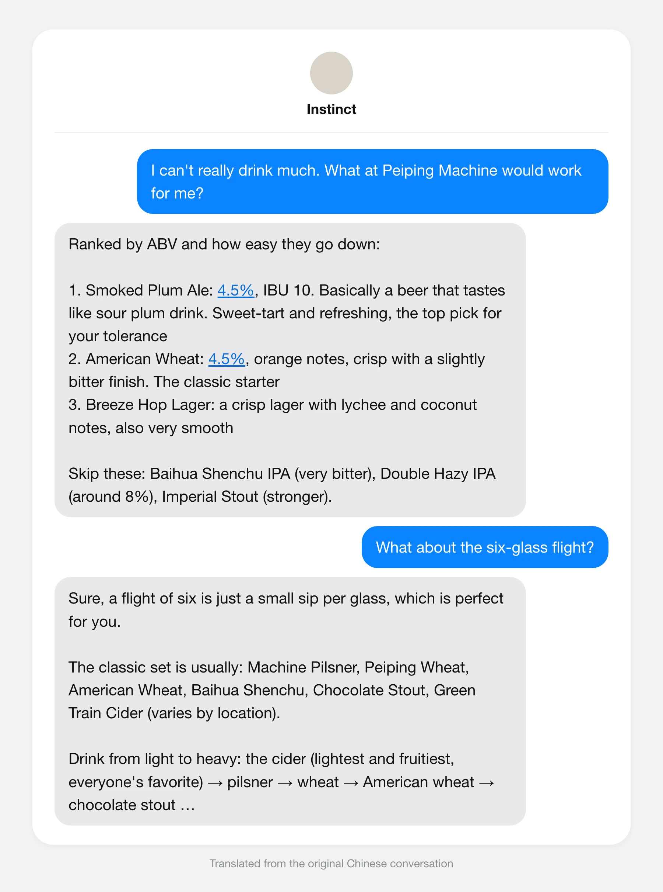

A good reply: short, direct, and human

### Principle 3 · Persistent: always on

**It's the one who's always there, even when you're not talking to it.**

AI used to exist only when you called on it. One session, one task. Close the tab and the work stops, and it forgets.

A personal agent is online 24/7. Your phone is off and it's still working in the background. It keeps going on what you asked last week, and it remembers what you need to do tomorrow.

Being always on is the precondition for the principles that follow. It has to be there before it can know you, act first, or get things done.

### Principle 4 · Personalized: it knows you, and keeps learning

The rental car story is this principle. I asked one question, "how do I get there," and it used my booking, my flight, my location, and my habits.

When it books a restaurant, it knows what I like and picks for me. With my daily news digest, I said "fewer of these" once and it adjusted the next day. I never configured anything.

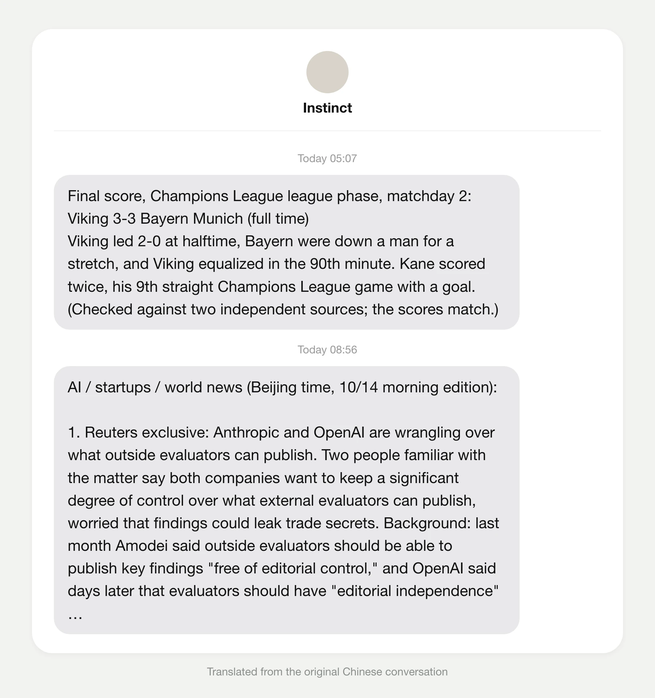

My daily news digest: one offhand comment and it gets more accurate

It works a bit like a recommendation system. Every interaction is feedback, and its understanding of you keeps accumulating and getting corrected.

Section 3 explains why this matters so much: the value of context grows exponentially. The more completely it knows you, the more it can get done.

### Principle 5 · Proactive: it speaks up first

After using it for a while, most of the moments when I felt "it gets me" were moments when it spoke first.

A service alert landed in my inbox before I'd seen it, and it flagged it for me.

Proactive doesn't mean pushy. When you open it, you see what it has already thought about for you: today's weather, something it can take off your plate. When you don't open it, it leaves you alone. The best kind of proactive only speaks up about things that really matter.

The best triggers are notifications that are already happening in your life: email, orders, bills, your calendar. These already need someone to deal with them. The agent just sees them before you do.

### Principle 6 · Prudent: restraint

The most common failure of restraint is being too proactive: trying too hard to show off, constantly guessing what the user wants, pushing suggestions that don't really apply, guessing wrong more often than right, until the user just wants to turn it off. A good personal agent does the opposite. It sees most of what happens in your day, notes it, and quietly takes care of it, without bothering you. It only speaks up when something actually changes your plans.

That's restraint: no promotions, no bragging about what it did, no interruptions when it isn't sure, and speaking up only when it's worth it.

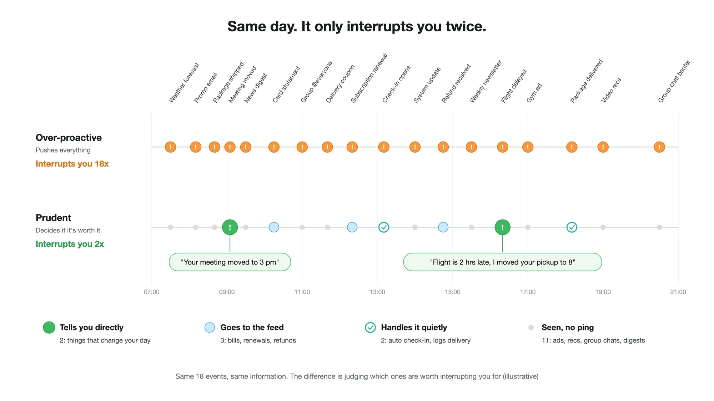

The same 18 events: an over-proactive agent pings you about every one, a prudent agent speaks up about two

While its judgment is still imperfect, there's a middle ground. Muse's feed works this way. The main screen holds only what matters most, and less important reminders and suggestions go into a feed. If you go looking, it's there. If you don't, it doesn't interrupt you.

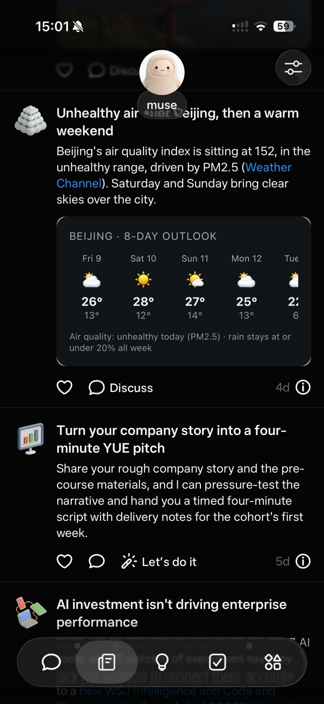

Muse's feed: the less important stuff waits here until you look

Being proactive and showing restraint are really the same skill: **judging whether something is worth interrupting you for.** Done well, it feels like someone with good judgment. Done badly, it's an annoying salesperson.

That judgment depends on a strong, recommendation-style personalization system. It has to know you very well to know when to step in and when to hold back, what to bring to you and what to skip. That makes proactivity, restraint, and Principle 4's "knowing you" two sides of the same coin: **the deeper it knows you, the better its judgment.**

### Principle 7 · Productive: it finishes the job

I asked Instinct to help me register an Apple Developer account. That used to take forever: company details, a D-U-N-S number, form after form. It walked through every step and only left payment and identity verification to me.

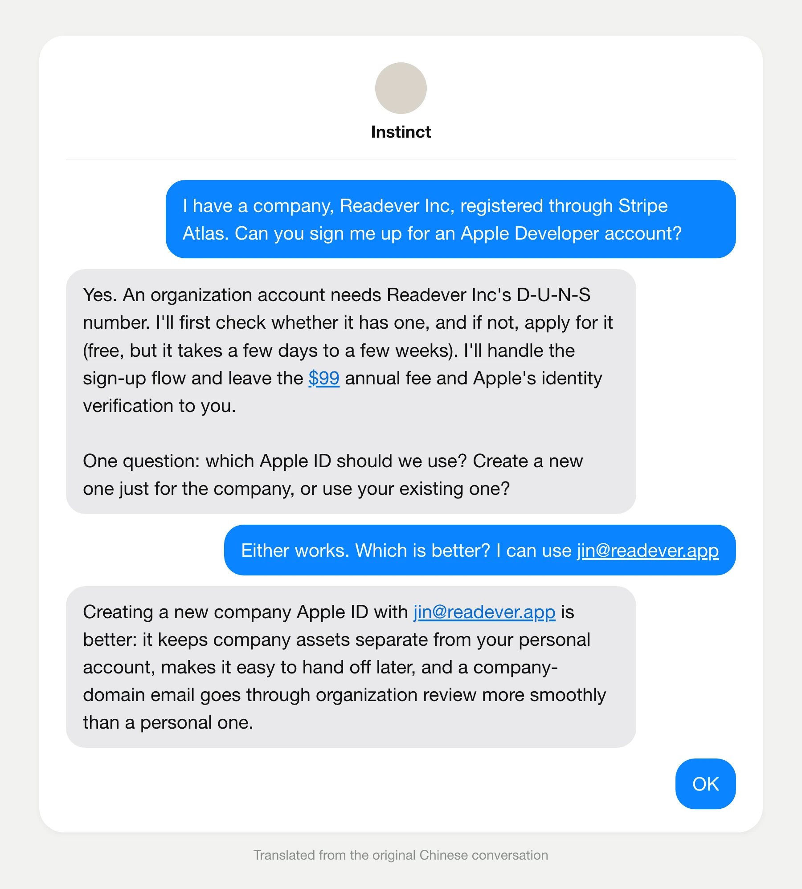

One message, and it walked through the Apple Developer account step by step

When I asked it to plan a route, it gave me a map I could use right away, no written directions needed.

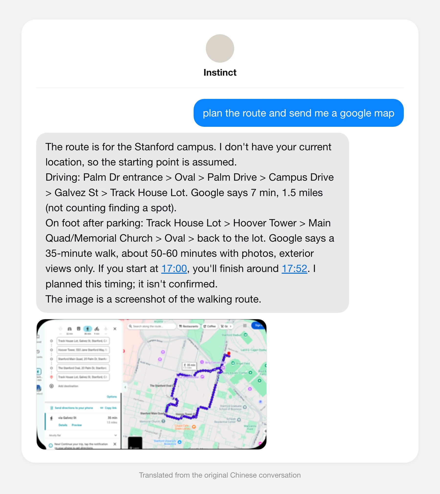

Route planning: it just hands you a map you can use

What's interesting is that none of these were features built for me. Nobody sat down and thought "users might want to register for an Apple Developer account" and built a feature. It worked because it has a set of general capabilities (search, a browser, email, payments, an execution environment) and figured out how to combine them on its own.

This leads to the most counterintuitive part of building a personal agent: **don't design features, design the environment.**

Traditional product managers start from use cases and build one feature per use case. A personal agent faces an endless long tail of needs. You'll never finish building the scenarios you can imagine, and the more features you build, the more complex the product gets and the weaker its general capability becomes.

The right approach is abstract first, then specific; general first, then specialized. Take a hundred needs, group them, pull out the few general capabilities underneath, give those to the agent, and let the uses emerge on their own. The product team defines the **types**. Users generate the **instances**.

People's underlying needs come down to a few: laziness, wanting control, wanting information, wanting company. What meets those needs is capability and environment.

### Principle 8 · Private: privacy and safety

The more you hand it, and the more important those things are, the more you need to feel safe.

Being trustworthy means at least four things:

- **Data stays on the device.** The most private data, like your message history, is processed locally on your phone and never uploaded.
- **Permission item by item.** Each capability and each piece of data is something the user turns on. Out of the box, it takes nothing.
- **It never touches your card.** You confirm every payment. Only then is a single-use credential issued, and the agent never sees your card number.
- **Traceable and reversible.** Everything it does is logged, and mistakes can be rolled back.

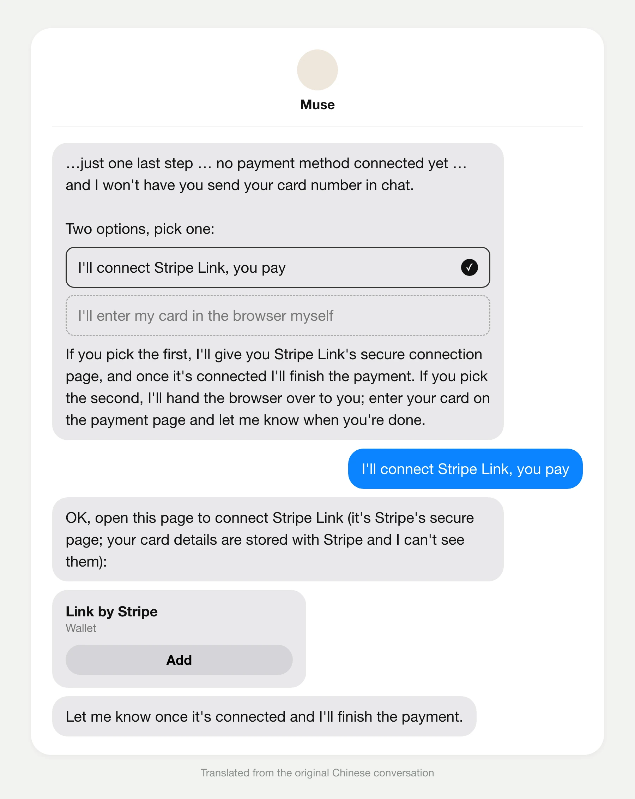

Paying in Muse: the user connects Stripe Link, the card stays with Stripe, and the agent never sees it

Privacy decides how far trust can go. Without it, no matter how well the other seven are done, people will only trust it with small things.

## 3. What sets the ceiling: context and closed loops

### More context, exponentially more value

A personal agent's value comes from combining context. Combinations aren't just pairs; any number of pieces can come together. With n kinds of information you get 2ⁿ combinations, so every new kind doubles the total. An agent with half the context gets far less than half the value. The gap is exponential. That's why people will concentrate their context in one agent.

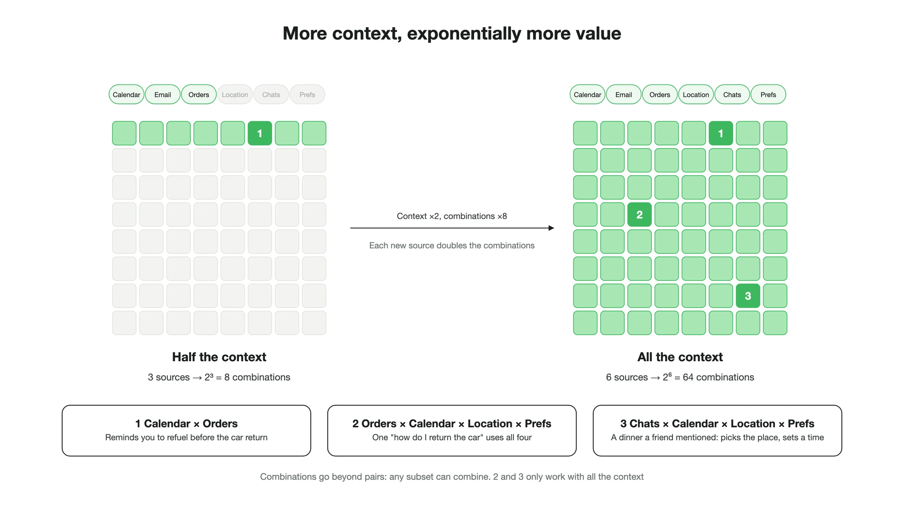

Double the information and the combinations grow eightfold: it's not just pairs, any set of pieces can combine

### The model sets the floor, the closed loop sets the ceiling

How strong a personal agent can get depends on how complete its context is and how closed its loop is: the entry point, personal context, execution, payments, and social relationships. Are they in one place, and do they reinforce each other?

Look at how the current wave in the US is pieced together. The entry point is borrowed from iMessage or WhatsApp. Personal context is stitched together from Gmail, Calendar, and other services, one permission at a time. Execution relies on a browser clicking around like a person. Payments come from plugging in Stripe. Social relationships are scattered across platforms. Every piece is borrowed, and every seam is friction.

So the same model, given fuller context and a more complete loop, becomes a stronger agent. **The model sets the floor. The closed loop sets the ceiling.**

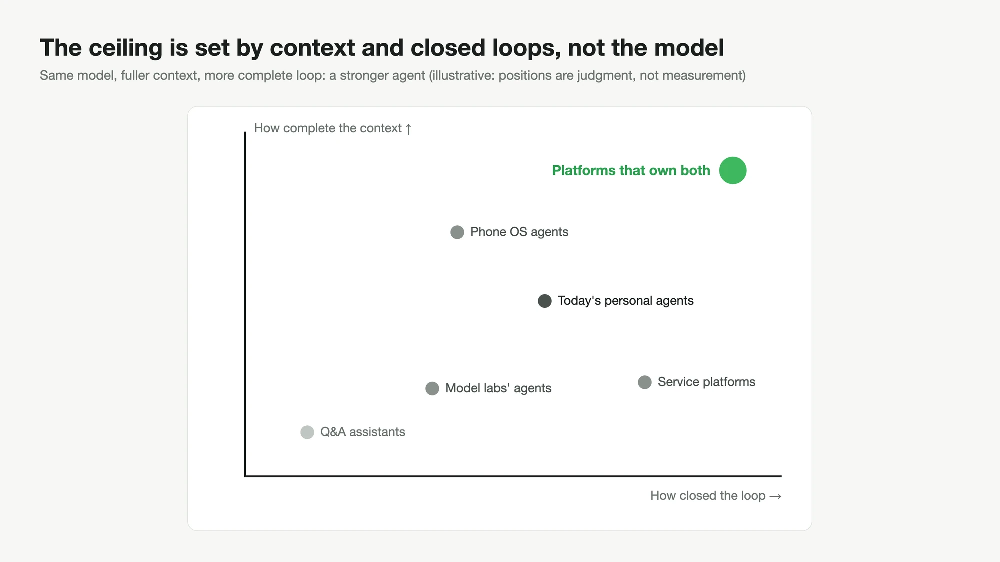

The ceiling is set by context and closed loops

## 4. Team: last generation's playbook can't build a personal agent

### Three common traps

**Trap 1: Building the agent as a stack of features.** The experience comes from general capabilities layered with context, so features don't add up to it. This generation should design the environment and let capabilities emerge.

**Trap 2: Every business unit builds its own agent.** Context gets fragmented, and the investment only adds up linearly. This generation should build one hub that every business contributes to.

**Trap 3: Product, engineering, and models each own their own piece.** Deciding "can we build this?" spans three layers, and the handoffs become the bottleneck. This generation needs one full-stack owner and atomic teams.

The problem is that last generation's product methods and org structures don't fit agents. It has nothing to do with how good any particular team is. Startups are small and full-stack by nature, so they're less likely to fall into these traps. The bigger the company, the more likely it is to use familiar methods for an unfamiliar job.

### The owner should understand models, engineering, and product

In AI products, deciding "can we build this?" spans three layers: change the prompt, change the harness, or do post-training. If those three layers sit with three different people, a feature bounces between product, engineering, and the model team, and no one can make the call. Every extra handoff slows iteration by a beat.

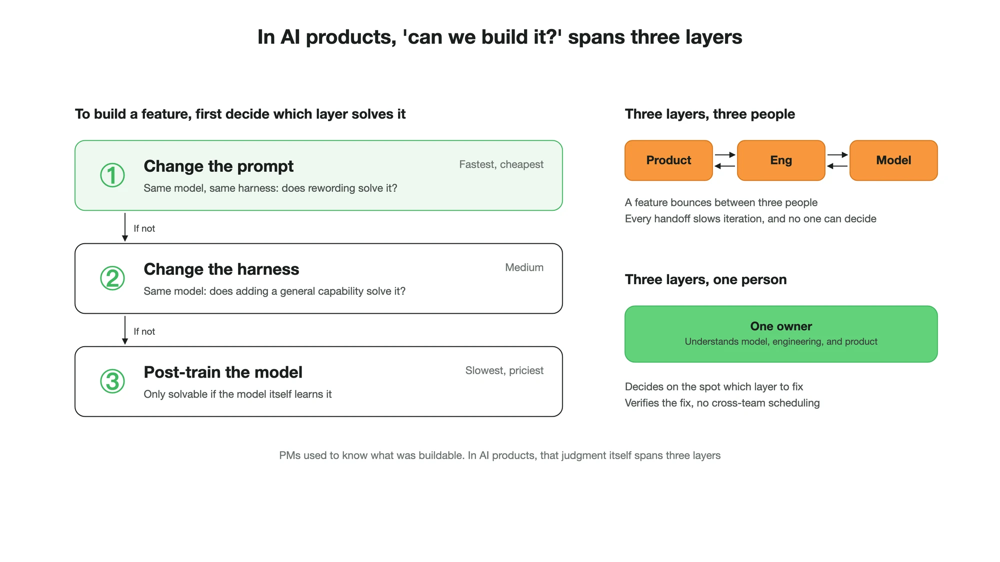

PMs used to know what was possible. In AI products, that call spans prompt, harness, and model

So **the owner should understand models, engineering, and product**, so they can decide which layer a problem belongs to and make the call on the spot. That person also needs two things:

- **Product taste**: restraint, invisibility, simplicity. Some teams building personal agents end up with a progress dashboard. Others end up with a row of tabs and templates. A good personal agent opens to a conversation.
- **Learning extremely fast**: agent techniques turn over every few months. Judgment can only come from the front line: using it every day and changing it yourself.

### Atomic teams: evals, engineering, and model close the loop

The basic unit of the org is a small atomic team, replacing the split into product, engineering, and research groups. Each team has three roles:

- **Evals**: set benchmarks, watch metrics, and find problems in real usage.
- **Engineering**: build the harness, integrations, and infrastructure that make capabilities real.
- **Model**: do post-training so the model fits the harness and the use cases.

Evals finds a problem, engineering and model fix it together, evals verifies, and nothing waits on another team's roadmap. The hub is made of a few of these teams: few people, high density, each owning one capability or one class of use cases: entry point and interaction, harness, memory, proactivity, model. Everyone works with agents. Nobody scales by adding headcount.

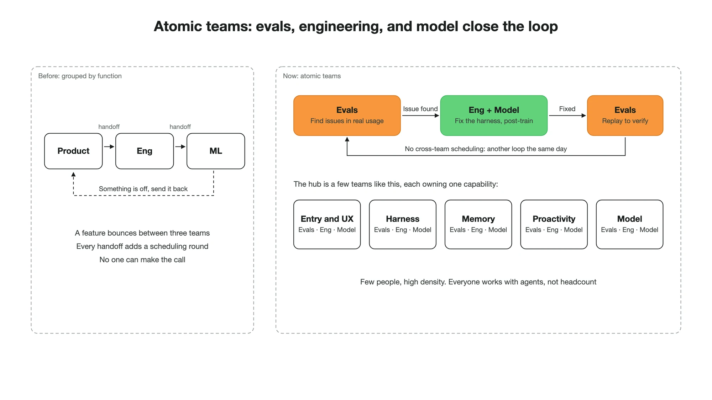

Teams used to be split by function, with features handed back and forth. Now each small team closes the loop on evals, engineering, and model

### Design product, harness, and model together

The three form a flywheel:

- New product features become new skills in the harness. Problems users hit drive the harness to improve itself.
- Harness improvements directly improve the user experience.
- User data flows back into model training. Traces and environments from the harness become post-training tasks.
- Model improvements unlock new product use cases.

Every turn makes the product more useful and better at understanding people.

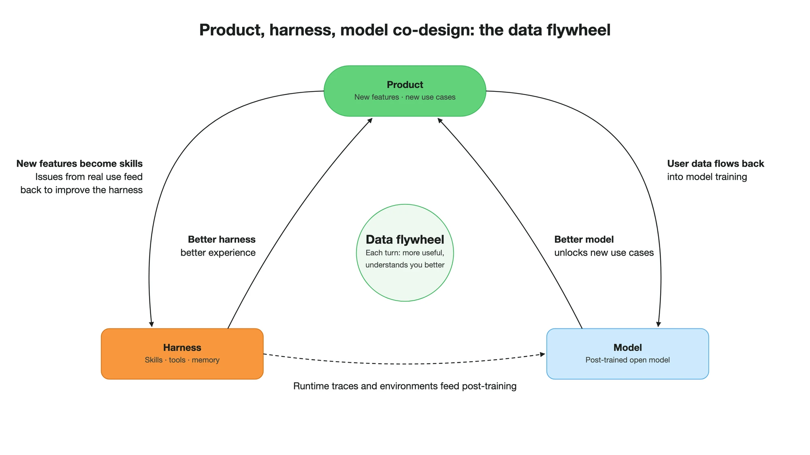

The data flywheel linking product, harness, and model

## 5. Product: design for the agent

### For people, the more human the better. For the agent, the more general the environment the better.

In practice, that means six things:

1. **Treat it as a person**: it's a contact in your phone and talks in chat. No new app, no new tab.
2. **Be fast**: reply in seconds, keep it short. Slow work goes to the background, and it tells you when it's done.
3. **Design the product for the agent**: anything a person can do in the product, the agent can do.
4. **Design the environment, not features**: give it general capabilities instead of custom UI for single use cases.
5. **Abstract, don't integrate one by one**: we define the types, users generate the instances.
6. **Let features emerge**: only basic capabilities generalize, and only what generalizes lets new uses emerge.

Look at a few things I've used it for. None was a purpose-built feature. Each was a few general capabilities that the model combined on its own:

- **Register an Apple Developer account**: search to find the process, a browser to fill out forms, email to receive verification, and payment left for me to confirm.
- **"How do I get to the SFO rental car return?"**: the rental booking from memory, the flight from my calendar, my current location, and a search for a gas station on the way.
- **Plan a route**: search, plus an artifact: a map I can use right away.
- **A daily news digest**: a scheduled trigger, search, and memory. One offhand "fewer of these" changes it.

The product team's job is to make the basics solid (search, browser, email, payments, artifacts, scheduling) and leave the combining to the model. Once something works, the approach is saved as a skill, so next time it's faster and more reliable.

### Don't design UX, design AX

Every agent product has two interfaces: one for people and one for the agent. They should be the same.

The agent is a user just like a person. Anything a person can do, it can do, with the same set of capabilities. However a person sends messages, pays, or checks notifications, that's how the agent does it too. Don't build custom UI for the agent. Custom UI means you're imagining scenarios on the user's behalf, and you'll never finish imagining them.

Good UX means people don't have to think. Good AX means the agent doesn't have to guess.

### Context should also be earned one level at a time

User trust builds one level at a time, and context should be collected the same way, starting with what's least sensitive before touching what's private:

1. **What the user gives it**: what they say in chat, and the files and links they forward.
2. **What the user has already made public**: posts and content they already share with friends.
3. **Interest signals the platform already uses**: the ones its recommendations already rely on.
4. **What the user grants item by item**: notifications, orders, calendar, each turned on by the user.
5. **The most private**: message history, read only on the device and never uploaded. Or not used at all.

The first four levels barely touch privacy and are already enough to do a great job of getting things done for you. Only when a use case moves up a level does the context it needs move up a level.

### A2A: it serves more than just you

The next step for a personal agent is dealing with other people on your behalf.

- **Talking to a business's AI**: refunds, flight changes, customer support. Your agent talks directly to the business's AI agent. Both sides are agents, so once things are clear, it's done.
- **Joining a group chat**: planning dinner with friends or a family trip. Add it to the group, it helps everyone decide, and then it books it.

Both will feel most natural on platforms that already carry relationships between people, and between businesses and their customers.

## 6. Tech: models and the harness

### Overview: a different kind of system from past agents

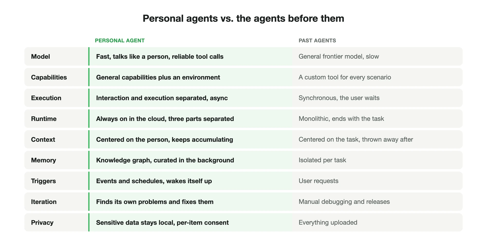

Personal agents vs. the agents before them

In one line: **a personal agent is a long-running process.** Here's each piece.

### Model: it needs almost the opposite of a coding agent

Today's smartest models are optimized for coding: the more complex the task the better, the longer and more complete the output the better, and they talk like they're writing a report. A personal agent needs four other things:

- **Fast**: the interaction layer has to be low latency.
- **Talks like a person**: short and natural, no reports.
- **Reliable tool calls**: it doesn't need to be brilliant, but it can't get calls wrong.
- **Cheap**: it's always on.

So the most sensible route is to start from a fast, cheap open-weight model and do your own post-training on two kinds of tasks:

- **Harness capability tasks**: tool calls, operating inside apps and web pages, reading and writing memory, talking like a person.
- **Scenario tasks**: booking restaurants, doctor's appointments, changing flights, planning trips, running errands for family.

Stage one uses SFT for cold start and distillation: a strong model works through tasks in the environment, high-quality trajectories are filtered out, and the model learns to use tools and talk like a person. Stage two uses RL: the model works through tasks in a simulated environment and is rewarded for finishing the task, calling tools correctly, and being short and human. After launch, real traces and user feedback flow back in as new tasks. Capabilities are the foundation. Scenarios are the exam.

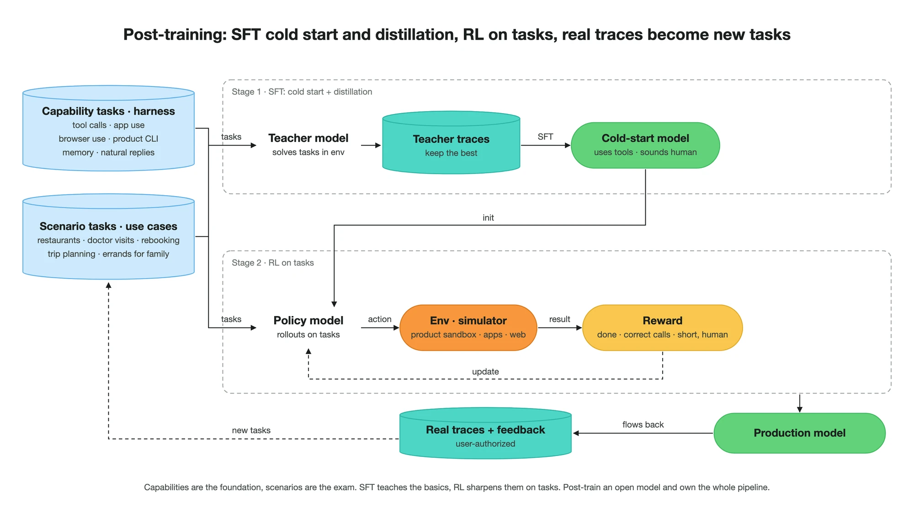

Post-training: SFT for cold start and distillation, RL on tasks, real traces become new tasks

### Harness: give it general capabilities and let the uses emerge

The agent needs a general enough environment. Abstracted from a large set of real needs, it looks roughly like this:

- **Search**: access the web and look anything up.
- **Browser**: operate web pages like a person: appointments, reservations, orders.
- **In-app actions**: use services that already exist on the platform: ordering, booking, paying bills.
- **Payments**: pay on your behalf once authorized, without touching your card.
- **Multimodal**: voice conversations, phone calls, understanding images.
- **Artifacts**: deliver something usable, like a web page or a route map.
- **Execution environment**: a bash shell, the lowest-level foundation that can run anything.
- **External connectors**: calendar, documents, and other outside services.

A few key design choices:

**A minimal harness.** One agent loop and a set of general tools. Weak models need a heavy harness. Good models only need a light one. Every time the model improves, you should delete something from the harness.

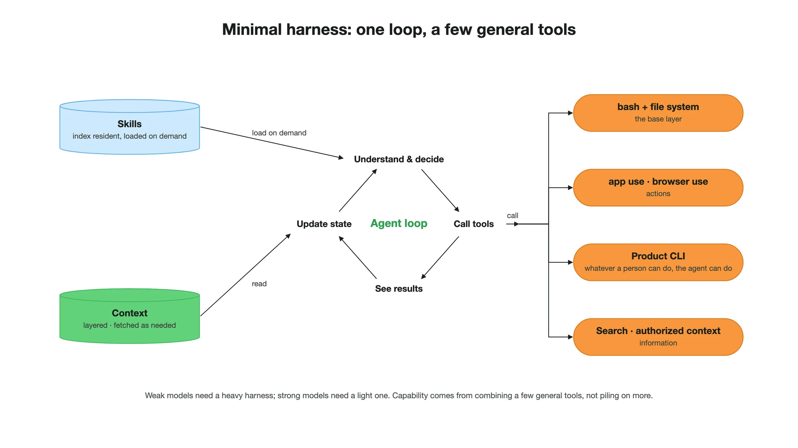

Minimal harness: one loop, a few general tools

**Mirror every product action as a command the agent can use.** Every action a person can take in the product (send a message, look up history, check notifications, pay) becomes a command-line instruction. Reveal them progressively and grant them one by one, instead of dumping hundreds of tools on the model at once.

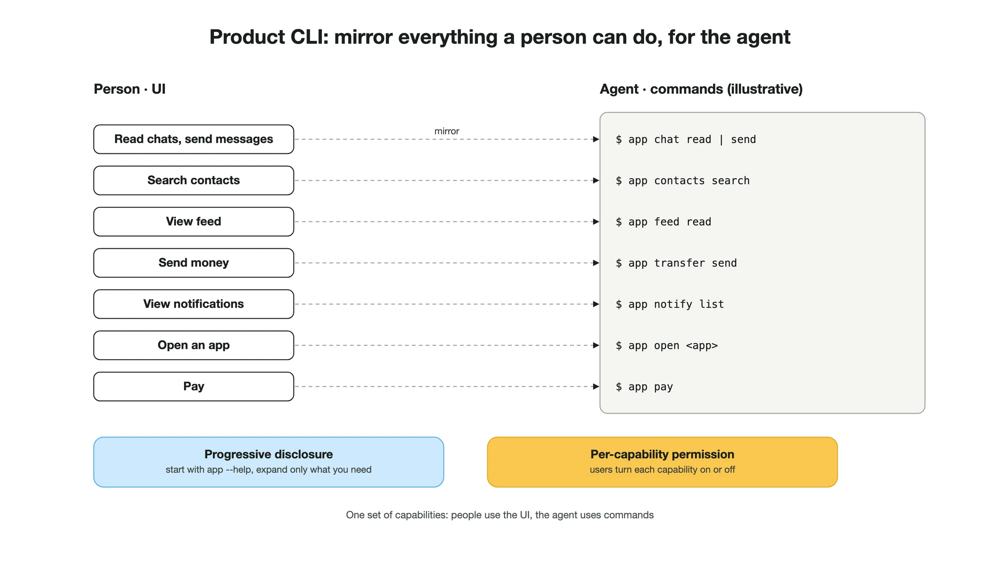

Mirror every action a person can take as a command for the agent

**Load skills on demand.** Write up "how to get something done" as a guide. The index stays in context, and the full text is read only when needed. After a task succeeds, what was learned becomes a new skill.

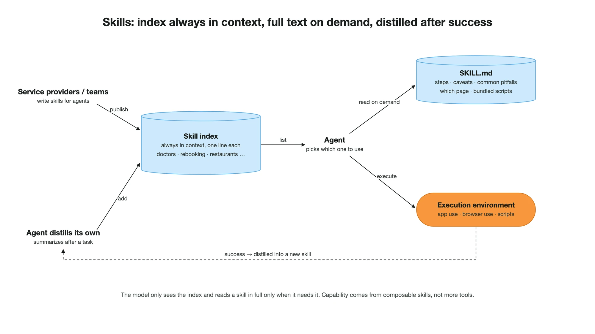

Skills: index always in context, full text on demand, distilled after success

**External services: first-party integrations for the important ones, browser use and computer use for the rest.** High-frequency, important services like rides, food delivery, and shopping integrate directly, exposing capabilities through an API or MCP. That's fastest and most reliable. The long tail doesn't need an API: the agent uses computer use inside apps and browser use on the web, the way a person would. Both paths share the same identity and payment authorization.

For service providers, the deeper the integration, the more likely the agent picks them. Beyond exposing capabilities, they can push events (order status, arrival reminders) to the agent through webhooks, and bring their own UI into the conversation as cards.

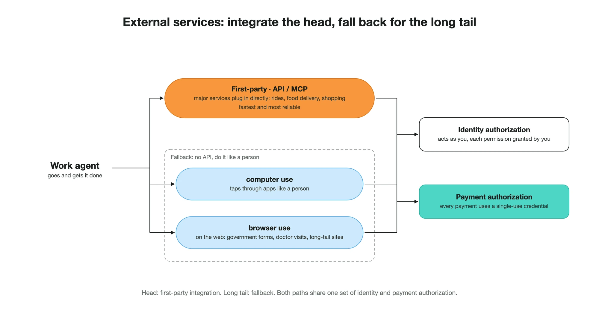

External services: first-party integration for the head, computer use and browser use for the long tail

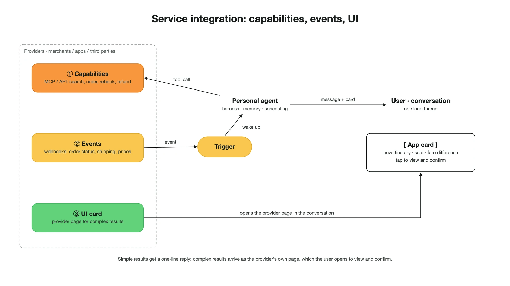

Service integration: capabilities, events, UI

**Payments use single-use credentials only.** Authorize, payment request, user confirms, single-use credential issued, merchant charges, transaction logged. The agent never touches the user's card at any point.

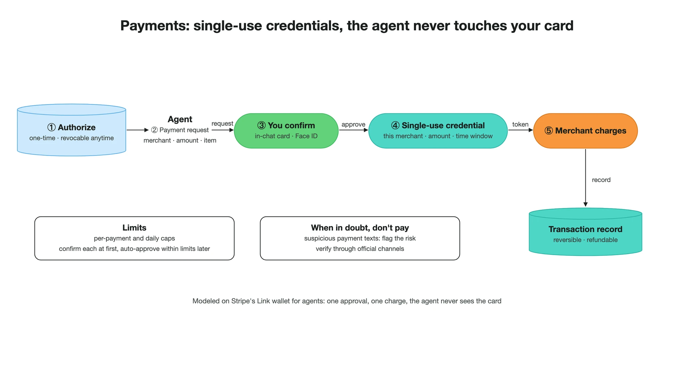

Payments: single-use credentials, the agent never touches your card

### Separate interaction from execution

A personal agent has to reply in seconds and also finish complicated work. In a single synchronous loop, those two goals conflict. The fix is to split it into two layers:

- **Interaction agent**: a low-latency model that only handles conversation and dispatches tasks, replying right away with "Got it, on it."
- **Work agents**: pull tasks from a queue and run them asynchronously and in parallel, each in its own sandbox. They record progress and delivery status, then report back to the user through the interaction agent. If there's nothing worth saying, they stay quiet.

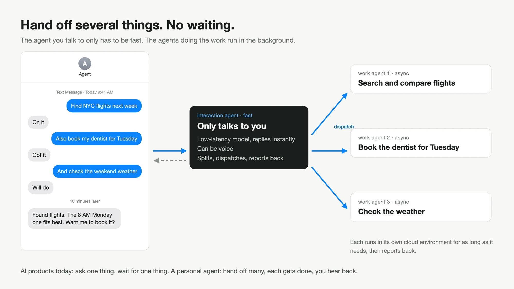

Hand off several things, no waiting

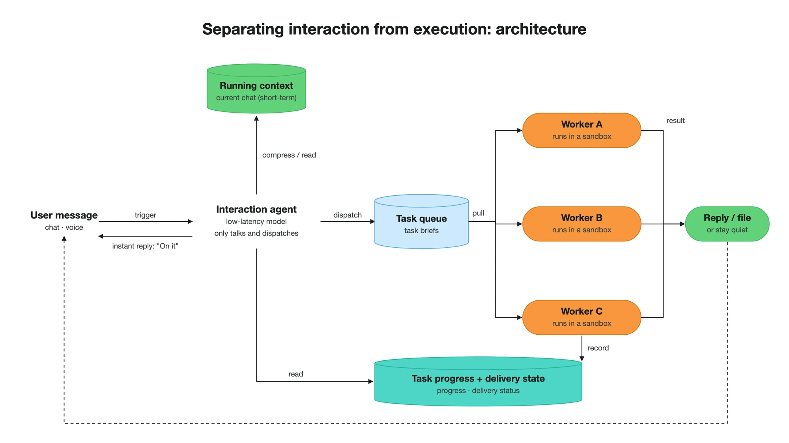

Separating interaction from execution: the architecture

### Runtime: harness, sandbox, and filesystem, separated

Past agents ran in a single execution environment whose lifetime equaled one task. A personal agent has to stay online, so the **agent runtime, execution environment, and storage** need to be separated. The agent's state is persistent (durable execution). Execution environments can be scheduled on demand in the cloud or on the device. Storage is independent of any single run. If any piece goes down, it still remembers you and picks up where it left off.

The most direct benefit of this split is **cost**. Giving every user an always-on cloud computer costs around $10 a month. Once the three are separated, the agent's state lives in durable storage, and execution environments spin up only when there's real work and shut down when it's done. That brings the cost to under $1 per user per month. For a product that has to stay always on for a huge number of users, that's the difference between possible and not.

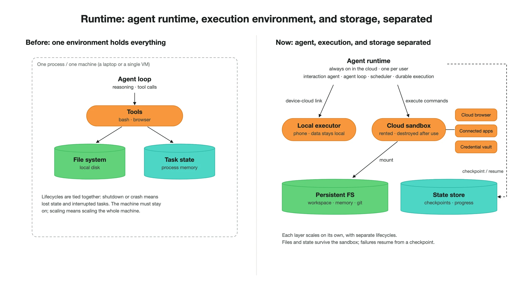

Agent runtime, execution environment, and storage, separated

### Context: layered around the person

A personal agent manages one conversation that never ends, so context can't be "stuff in all the history." It should be layered: persona, tools, the skills index, what it knows about you, relevant memories, what's in progress, the current conversation, and task instructions. The interaction agent and the work agents each take what they need.

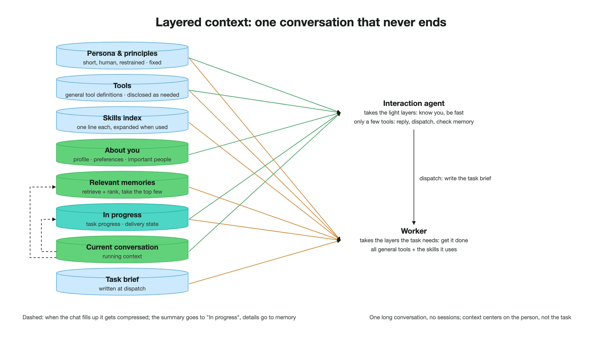

Layered context

### Memory: a knowledge graph of people and relationships

The old approach was memory isolated by task, plus one big file about the user. A personal agent needs a knowledge graph built around people and relationships: you, your family and friends, what you're working on, your preferences, all connected. A background process keeps curating it: merging, correcting, and forgetting.

Memory is really a recommendation problem: at this moment, what about you is most worth remembering?

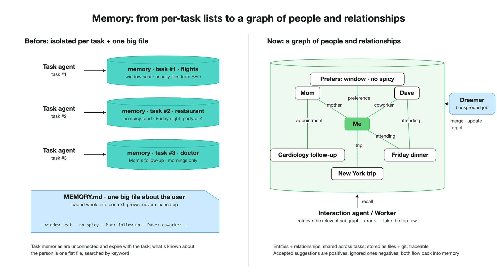

From memory isolated by task to a knowledge graph of people and relationships

### Proactivity: two-tier triggers

Proactivity can't mean having a big model watch everything all the time. That's too expensive and too noisy. Use two tiers of triggers:

1. **Fast rule filtering**: events (new email, new orders, new notifications) and scheduled jobs come in, and cheap rules decide whether to handle them.
2. **The agent decides when needed**: only what passes the filter goes to the agent, which decides whether to remind you, ask you, or stay quiet, and records its progress.

This is also how restraint is implemented in the tech: for most events, the final decision should be "don't interrupt."

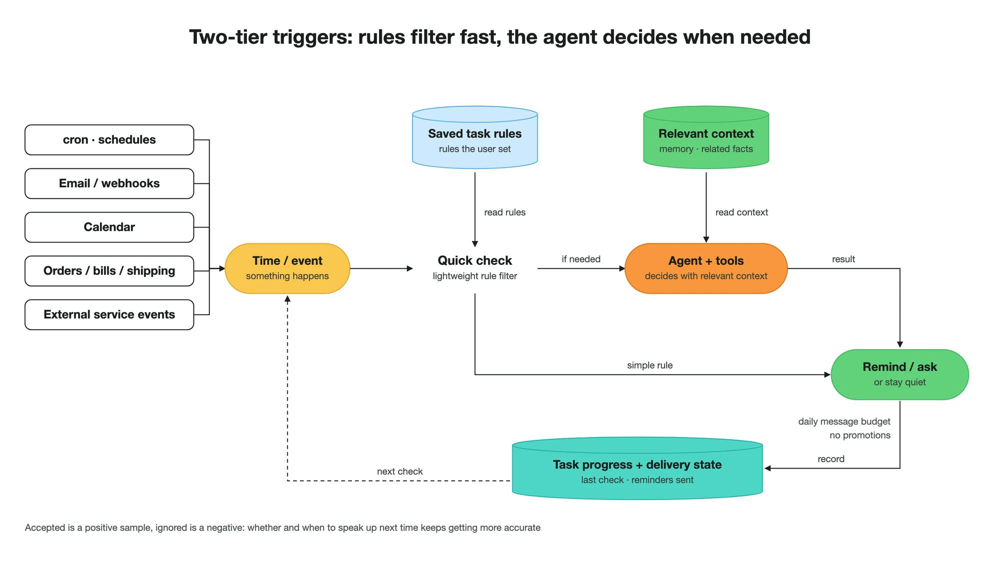

Two-tier triggers: rules filter, the agent decides when needed

### Self-improvement

Users run into small problems every day, and triaging them by hand can't keep up. So give the personal agent its own tool for reporting problems. When it can't do something well, it reports the issue with its context. A separate coding agent reads these issues and the run traces, then changes the harness. Changes are replayed against historical traces, and only those that pass go out in a staged rollout.

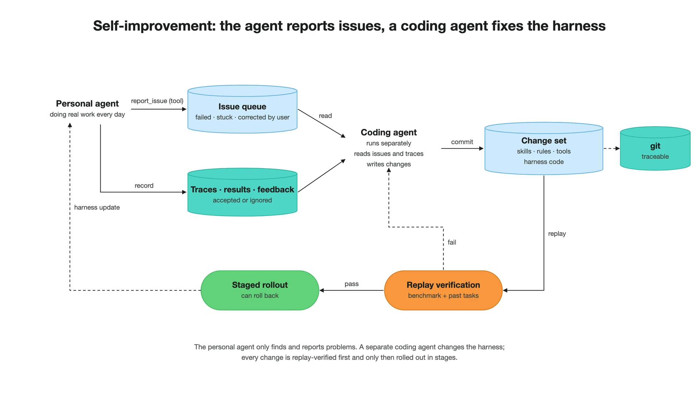

Self-improvement: report issues, a coding agent fixes, replay to verify, staged rollout

### Privacy: draw a clear line

The agent loop runs in the cloud. The most sensitive data, like message history, stays in a local execution environment on the phone and never crosses that line. The cloud only gets what the user has granted, item by item. The clearer the line, the more people are willing to hand over.

Muse's approach is a good reference (based on what Meta has published):

- **A separate review process**: a Sentinel isolated from the agent checks every outbound action against what the user authorized, and allows it, blocks it, or asks the user to confirm.
- **Credentials never enter the model**: account tokens and passwords live in a separate credential service and are issued to the execution environment only when needed. The model never sees them.
- **Sensitive actions ask first**: sending an email or placing an order needs the user's confirmation.
- **Users can see and revoke**: each connection can be read-only or read-write and revoked at any time, everything it did is logged and reviewable, and you can ask it to forget what it remembered.

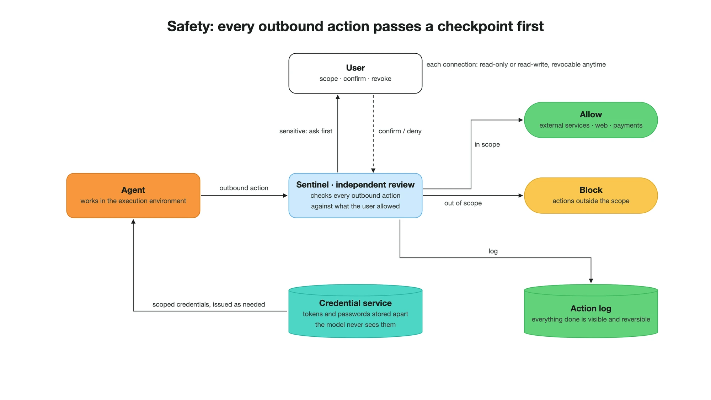

Safety: every outbound action passes a checkpoint first

## Conclusion

1. **Definition**: a personal agent is a way of living. Tools are defined by use case. A personal agent has no killer use case. It becomes an irreplaceable habit through many small things: everything goes to it first, by default.
2. **The 8P principles**: a good personal agent behaves like a person. It shows up like a person, talks like a person, is always around, knows you, thinks ahead, has judgment, gets things done, and can be trusted.
3. **The ceiling**: intelligence is already in surplus. The model sets the floor, and context and closed loops set the ceiling. The value of context grows exponentially.
4. **Team**: last generation's playbook can't build a personal agent. The owner should understand models, engineering, and product, and the org is made of atomic teams where evals, engineering, and model close the loop together.
5. **Product**: design the environment, not features. Give the agent general capabilities and let uses grow out of real usage. Design AX, not just UX.
6. **Tech**: separate interaction from execution, separate the runtime into three parts, layer the context, build memory as a knowledge graph, use two-tier triggers, let it improve itself, and draw a clear line for privacy.

So the hardest part isn't the tech. It's restraint in the product and an AI-native org: having the nerve to build only the environment, and letting one person who understands all three layers, with a small full-stack team, design the product, harness, and model together.

**When you stop feeling like you're using an AI product, it has worked.**

**Coming next.** This was Part 1 of "How to Build a Good Personal Agent," on product, team, and tech. Part 2 covers business model and strategy: whether the platform tax gets competed away, whether hardware or software becomes the entry point, and how big companies and startups each win.
