> **This is Part 1 of "How to Build a Good Personal Agent."** It covers what a personal agent is, the eight principles behind a good one, and how to build it: the team, the product, and the tech. Part 2 covers business model and strategy: whether the platform tax gets competed away, whether hardware or software becomes the entry point, and how big companies and startups each win.

Last month in San Francisco, right before returning my rental car, I texted Instinct: "How do I get to the SFO rental car return?"

The answer was direct. It knew which company I'd rented from, when the car was due, where the last gas station on the way into the airport was, and which terminal to head to after drop-off. I never told it I was returning a car that day. Two weeks earlier I had mentioned the rental in passing, and it remembered. My flight was on my calendar, and it saw that too.

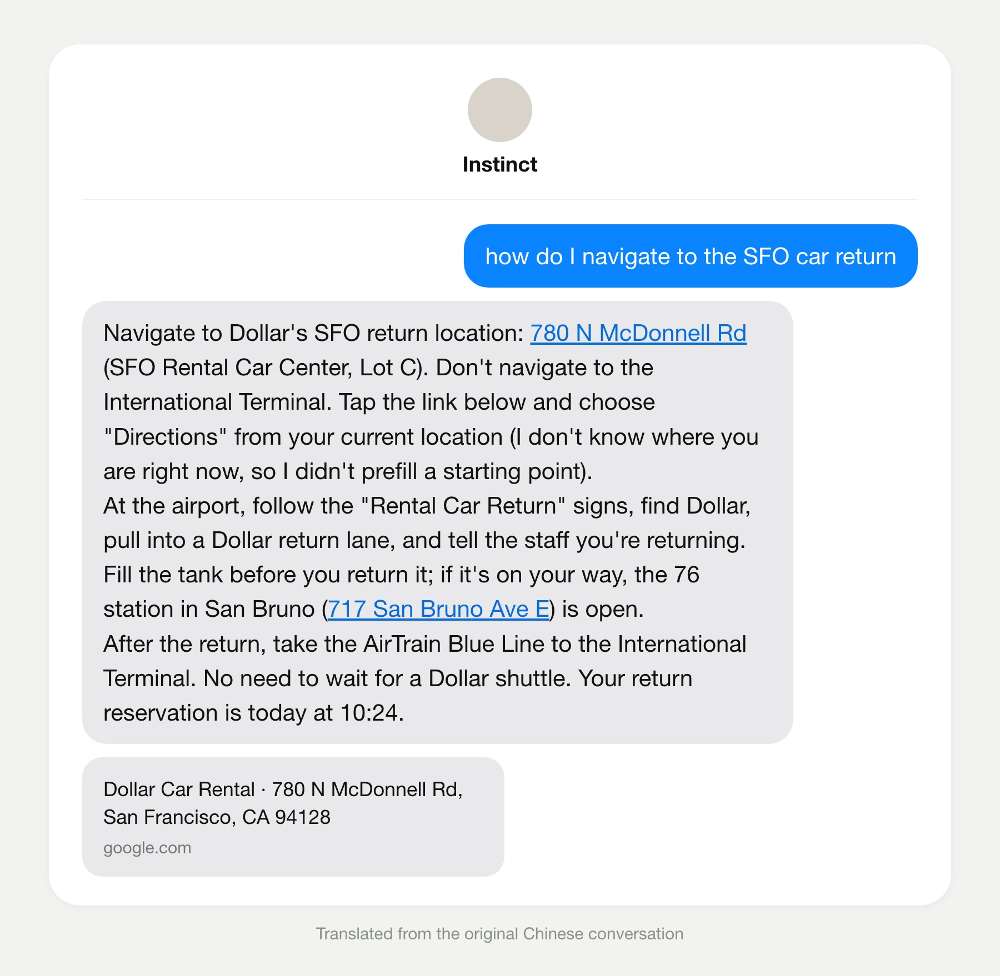

One question about the SFO car return. It pulled in my rental booking, my flight, and a gas station on the way, then told me how to get to my terminal.

That was the moment I realized this was different from every AI product I had used. It felt less like software and more like a person who was always around and knew what I was up to.

I've sent it more than 1,000 messages since August 19. This essay tries to explain, from the ground up, what makes a personal agent good: the eight principles it should follow, what sets its ceiling, and what it takes in team, product, and tech to build one. Everything comes back to one idea: **a personal agent is a way of living.**

In the second half of this year, Silicon Valley's AI products converged on this almost at once: Instinct in iMessage, Meta's Muse, OpenAI's Dots, Manus's Cue. **The form is converging**: always on, running in the cloud, with an identity of its own. **The split is the entry point**: a contact in your phone, or a standalone app. Three things matured at the same time to make this possible: cloud infrastructure for always-on agents, models that are fast and cheap enough, and the demand that this year's wave of open-source agents proved.

## 1. Definition: a personal agent is a way of living

2024 was the year of the chatbot. Our relationship with AI was **asking**. 2025 was the year of agents that do work, mostly writing code, and the relationship was **supervising**. Both were still tools, each solving one kind of problem. 2026 is the year of the personal agent, and it is starting to **change how people live**.

Tools are defined by use case: a writing tool, a translation tool, a booking tool. You have a task first, then you go find the tool. A personal agent is hard to define that way.

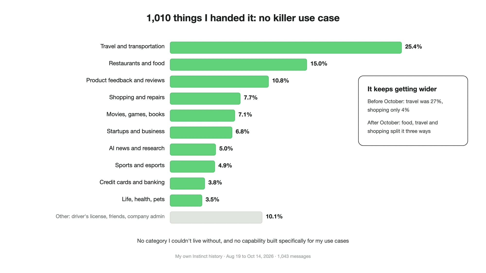

The 1,010 things I've handed it, spread across every corner of my life, and the range keeps widening

When I look back at those thousand-plus messages, the first impression is how scattered they are. Travel and transportation make up a quarter. Food is over a tenth. The rest is shopping, credit cards, my driver's license, sports, news, and small talk. It replaced my search engine first. Then hotel and restaurant bookings. Then signing up for accounts and dealing with bills. **None of these is a killer use case**, and I don't need it for any single one. But one small thing at a time, it became a habit I can't replace. So here is how I'd define it:

With a tool, **you have a task, then decide what to use**. With a way of living, **everything goes to it by default, and you only step in if it can't handle it**.

How does that default form? Delegating anything has two costs: **explaining it** and **watching it get done**. When the two add up to more than doing it yourself, you do it yourself. That's why most AI products stall at "I use it sometimes." A personal agent pushes both costs down. Memory makes explaining shorter every time, and being able to finish the job makes watching unnecessary. Once the cost drops past a threshold, your default flips. Trust builds the same way, one level at a time: from answering questions and giving advice, to placing orders for you and handling errands that need identity checks, and eventually to helping you keep up your relationships.

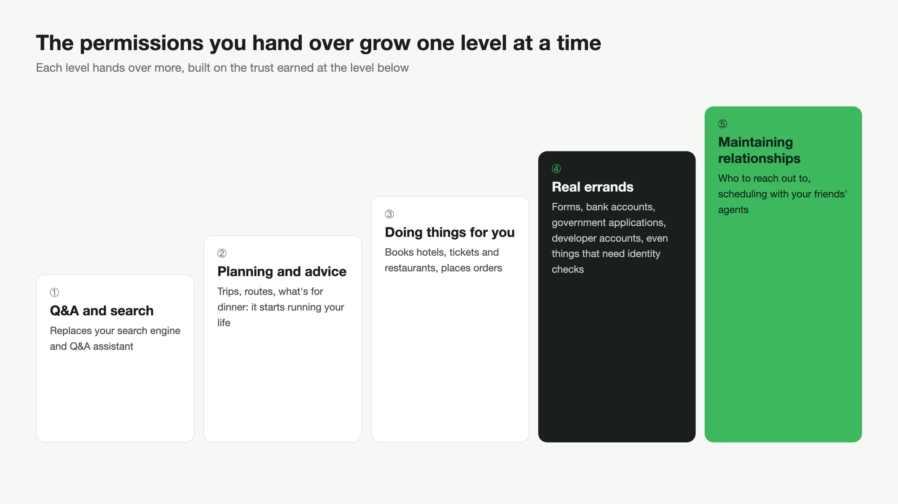

The permissions you hand over grow one level at a time

## 2. A good personal agent: the 8P principles

I came up with these eight principles after using every major personal agent on the market, heavily. Only two stuck and are now part of my day: Instinct and Muse. **Every one I dropped broke at least two of these principles.**

The eight principles are about one thing: how to get people to hand over their lives, one level at a time. Each one is a precondition for the next.

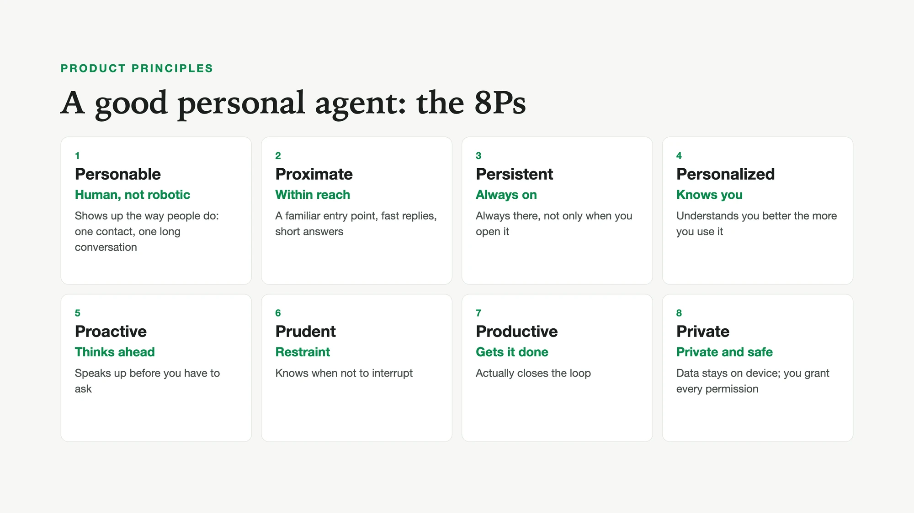

A good personal agent: the 8Ps

### Principle 1 · Personable: a person, not a program

**To the user, it is a person.** It talks like a person and interacts like one.

It's a contact in your phone, one long conversation with no sessions. You can interrupt it, or switch to something else mid-thread, the way you would with a friend.

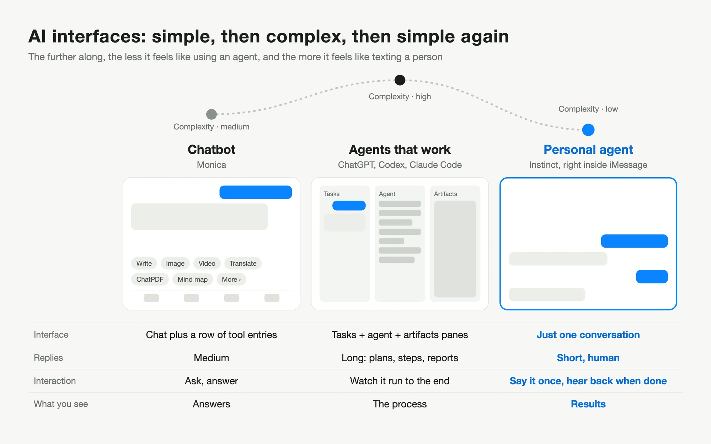

Three generations of AI interfaces: the further along, the less it feels like using an agent and the more it feels like texting a person

Two common counterexamples:

- **Tool products with many entry points**: writing, translating, image generation, and PDF reading each get their own button, so the user has to figure out which one to tap first.
- **The robotic voice of coding agents**: even a one-line reply comes with headers, bullet points, and bold text, like a report.

So the first principle is simple: **the entry point is the one people already use, and the interaction is person to person.** Treat it the way you'd treat a person.

### Principle 2 · Proximate: always within reach

**Close enough to you: a nearby entry point, fast replies, short messages.**

Three things decide the distance.

**Where the entry point is.** Instinct is a contact in iMessage. Messages live on your phone, so tapping it opens it, with no app to load. A standalone app adds one step, and usage drops a lot. For a product that has to become a habit, every extra step is friction.

On the other end, some products open to five tabs, each with its own row of categories and buttons. The farther a product is from the user, the less the user shows up.

**How fast it replies.** Speed comes first. The product itself has to be fast: open it and start talking, no splash screen, no loading. Then the replies have to be fast. Instinct and Muse are both very, very fast. Part of that is using small, fast models for the conversation. The other part is architecture: separating interaction from execution (more in Section 6). When you hand it something, it should reply right away with "Got it, on it," then do the work in the background, so you're not staring at a spinner. You can hand it several things in a row and it works through them one by one.

**Whether it talks like a person.** Many agents reply like they're writing a report: headers, bullets, bold, and a lot of words. The reason is easy to see. Today's smartest models are optimized for coding and complex tasks, where longer and more complete output is better. That isn't how people text each other. A good personal agent is short and direct, like a reliable friend texting you back.

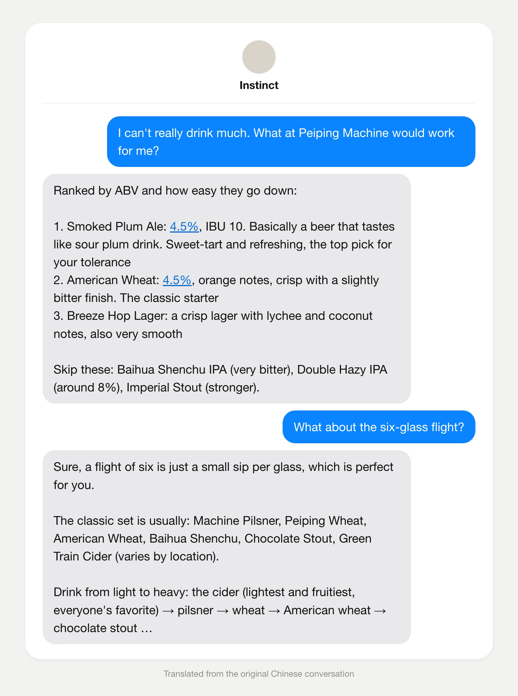

A good reply: short, direct, and human

### Principle 3 · Persistent: always on

**It's the one who's always there, even when you're not talking to it.**

AI used to exist only when you called on it. One session, one task. Close the tab and the work stops, and it forgets.

A personal agent is online 24/7. Your phone is off and it's still working in the background. It keeps going on what you asked last week, and it remembers what you need to do tomorrow.

Being always on is the precondition for the principles that follow. It has to be there before it can know you, act first, or get things done.

### Principle 4 · Personalized: it knows you, and keeps learning

The rental car story is this principle. I asked one question, "how do I get there," and it used my booking, my flight, my location, and my habits.

When it books a restaurant, it knows what I like and picks for me. With my daily news digest, I said "fewer of these" once and it adjusted the next day. I never configured anything.

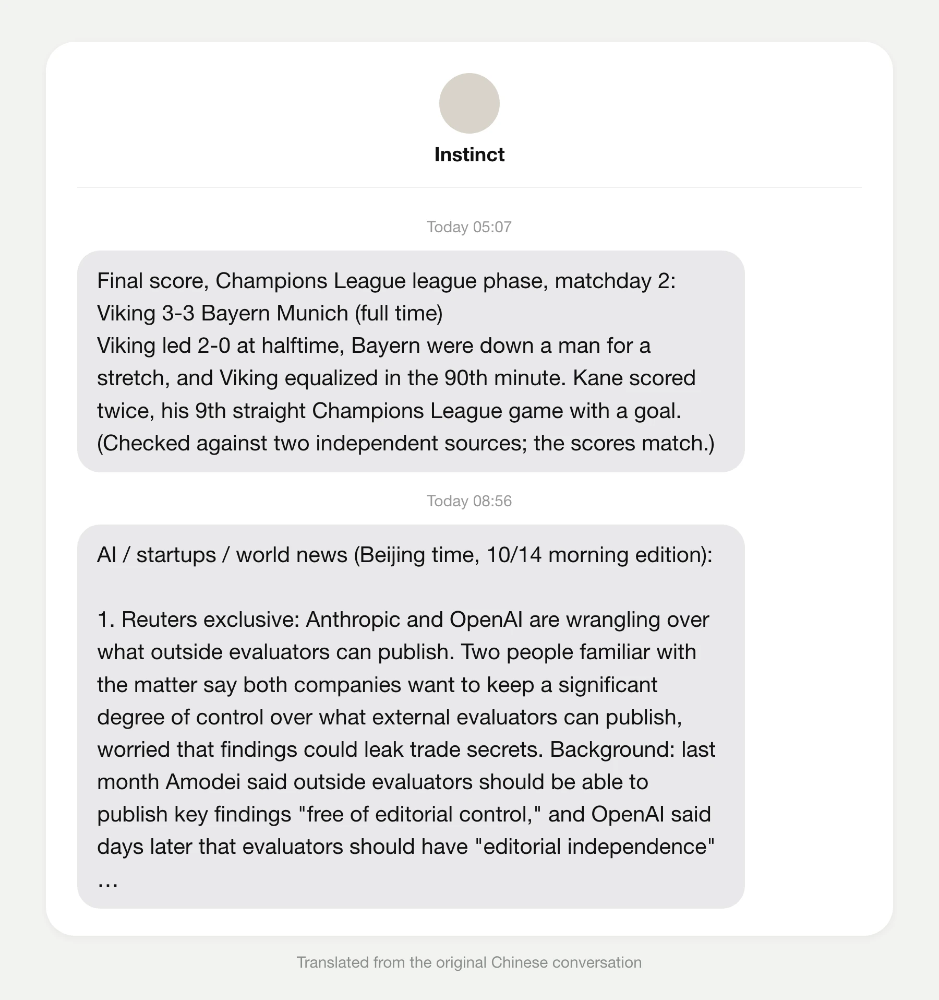

My daily news digest: one offhand comment and it gets more accurate

It works a bit like a recommendation system. Every interaction is feedback, and its understanding of you keeps accumulating and getting corrected.

Section 3 explains why this matters so much: the value of context grows exponentially. The more completely it knows you, the more it can get done.

### Principle 5 · Proactive: it speaks up first

After using it for a while, most of the moments when I felt "it gets me" were moments when it spoke first.

A service alert landed in my inbox before I'd seen it, and it flagged it for me.

Proactive doesn't mean pushy. When you open it, you see what it has already thought about for you: today's weather, something it can take off your plate. When you don't open it, it leaves you alone. The best kind of proactive only speaks up about things that really matter.

The best triggers are notifications that are already happening in your life: email, orders, bills, your calendar. These already need someone to deal with them. The agent just sees them before you do.

### Principle 6 · Prudent: restraint

The most common failure of restraint is being too proactive: trying too hard to show off, constantly guessing what the user wants, pushing suggestions that don't really apply, guessing wrong more often than right, until the user just wants to turn it off. A good personal agent does the opposite. It sees most of what happens in your day, notes it, and quietly takes care of it, without bothering you. It only speaks up when something actually changes your plans.

That's restraint: no promotions, no bragging about what it did, no interruptions when it isn't sure, and speaking up only when it's worth it.

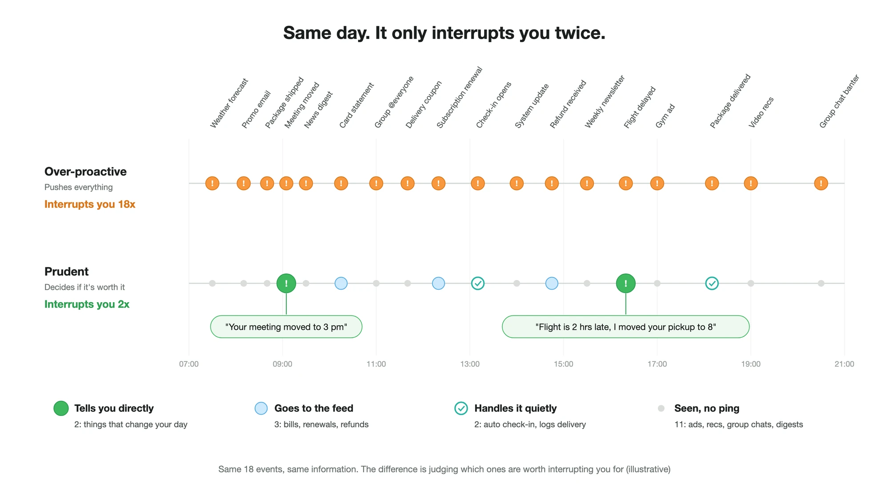

The same 18 events: an over-proactive agent pings you about every one, a prudent agent speaks up about two

While its judgment is still imperfect, there's a middle ground. Muse's feed works this way. The main screen holds only what matters most, and less important reminders and suggestions go into a feed. If you go looking, it's there. If you don't, it doesn't interrupt you.

Muse's feed: the less important stuff waits here until you look

Being proactive and showing restraint are really the same skill: **judging whether something is worth interrupting you for.** Done well, it feels like someone with good judgment. Done badly, it's an annoying salesperson.

That judgment depends on a strong, recommendation-style personalization system. It has to know you very well to know when to step in and when to hold back, what to bring to you and what to skip. That makes proactivity, restraint, and Principle 4's "knowing you" two sides of the same coin: **the deeper it knows you, the better its judgment.**

### Principle 7 · Productive: it finishes the job

I asked Instinct to help me register an Apple Developer account. That used to take forever: company details, a D-U-N-S number, form after form. It walked through every step and only left payment and identity verification to me.

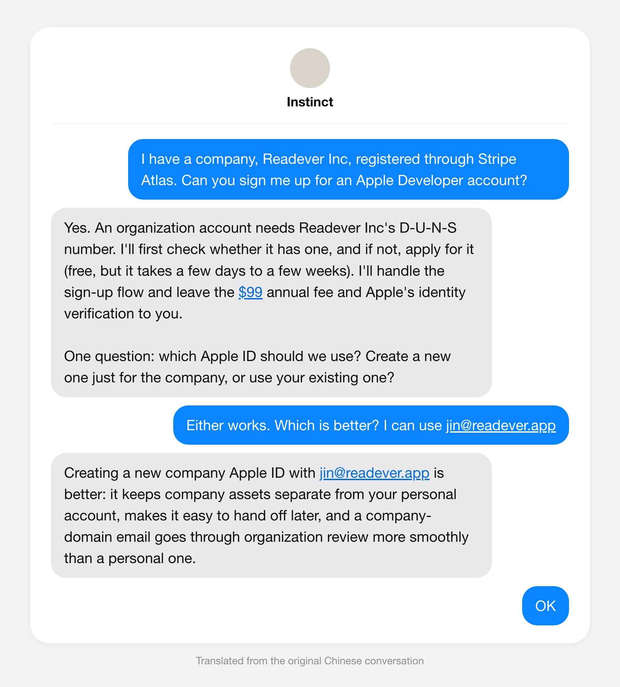

One message, and it walked through the Apple Developer account step by step

When I asked it to plan a route, it gave me a map I could use right away, no written directions needed.

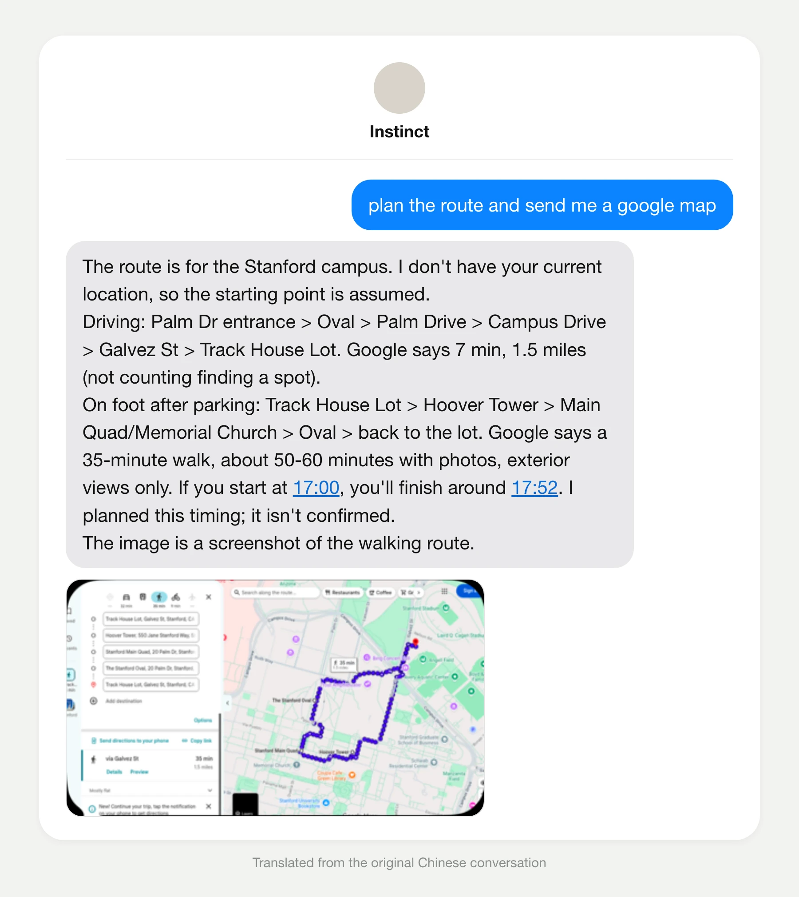

Route planning: it just hands you a map you can use

What's interesting is that none of these were features built for me. Nobody sat down and thought "users might want to register for an Apple Developer account" and built a feature. It worked because it has a set of general capabilities (search, a browser, email, payments, an execution environment) and figured out how to combine them on its own.

This leads to the most counterintuitive part of building a personal agent: **don't design features, design the environment.**

Traditional product managers start from use cases and build one feature per use case. A personal agent faces an endless long tail of needs. You'll never finish building the scenarios you can imagine, and the more features you build, the more complex the product gets and the weaker its general capability becomes.

The right approach is abstract first, then specific; general first, then specialized. Take a hundred needs, group them, pull out the few general capabilities underneath, give those to the agent, and let the uses emerge on their own. The product team defines the **types**. Users generate the **instances**.

People's underlying needs come down to a few: laziness, wanting control, wanting information, wanting company. What meets those needs is capability and environment.

### Principle 8 · Private: privacy and safety

The more you hand it, and the more important those things are, the more you need to feel safe.

Being trustworthy means at least four things:

- **Data stays on the device.** The most private data, like your message history, is processed locally on your phone and never uploaded.
- **Permission item by item.** Each capability and each piece of data is something the user turns on. Out of the box, it takes nothing.
- **It never touches your card.** You confirm every payment. Only then is a single-use credential issued, and the agent never sees your card number.
- **Traceable and reversible.** Everything it does is logged, and mistakes can be rolled back.

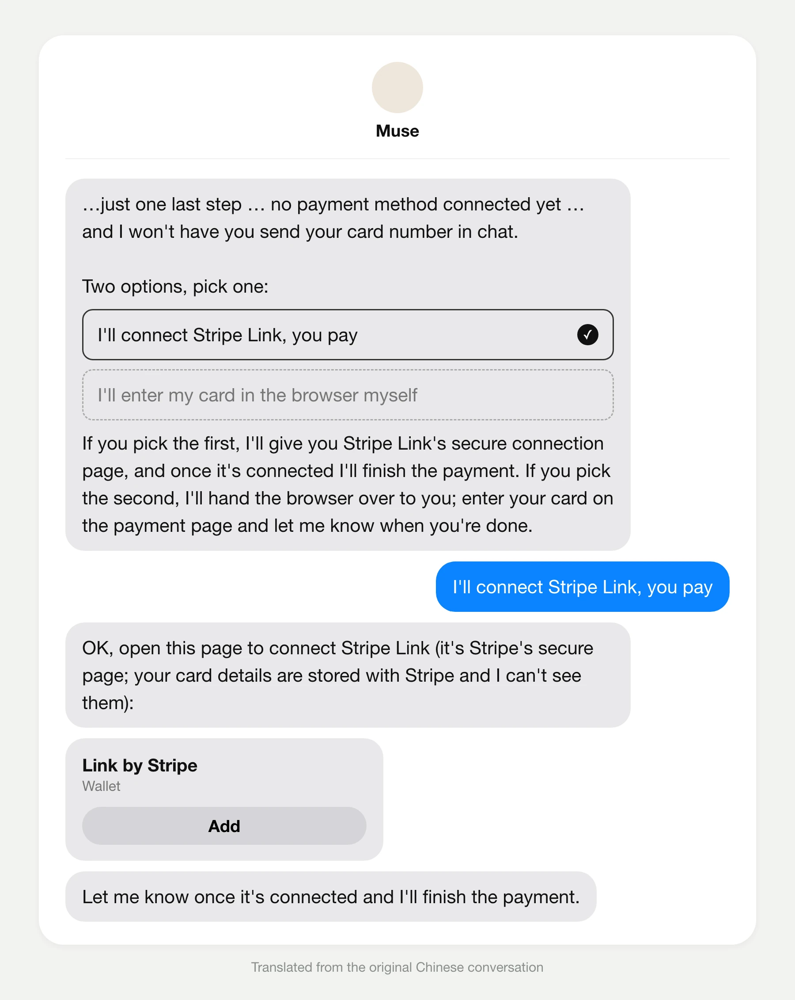

Paying in Muse: the user connects Stripe Link, the card stays with Stripe, and the agent never sees it

Privacy decides how far trust can go. Without it, no matter how well the other seven are done, people will only trust it with small things.

## 3. What sets the ceiling: context and closed loops

### More context, exponentially more value

A personal agent's value comes from combining context. Combinations aren't just pairs; any number of pieces can come together. With n kinds of information you get 2ⁿ combinations, so every new kind doubles the total. An agent with half the context gets far less than half the value. The gap is exponential. That's why people will concentrate their context in one agent.

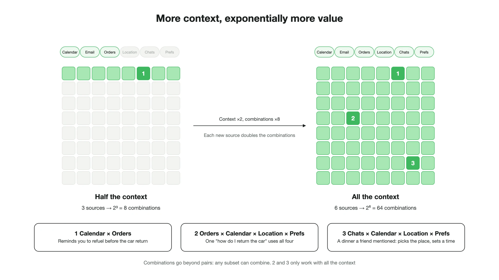

Double the information and the combinations grow eightfold: it's not just pairs, any set of pieces can combine

### The model sets the floor, the closed loop sets the ceiling

How strong a personal agent can get depends on how complete its context is and how closed its loop is: the entry point, personal context, execution, payments, and social relationships. Are they in one place, and do they reinforce each other?

Look at how the current wave in the US is pieced together. The entry point is borrowed from iMessage or WhatsApp. Personal context is stitched together from Gmail, Calendar, and other services, one permission at a time. Execution relies on a browser clicking around like a person. Payments come from plugging in Stripe. Social relationships are scattered across platforms. Every piece is borrowed, and every seam is friction.

So the same model, given fuller context and a more complete loop, becomes a stronger agent. **The model sets the floor. The closed loop sets the ceiling.**

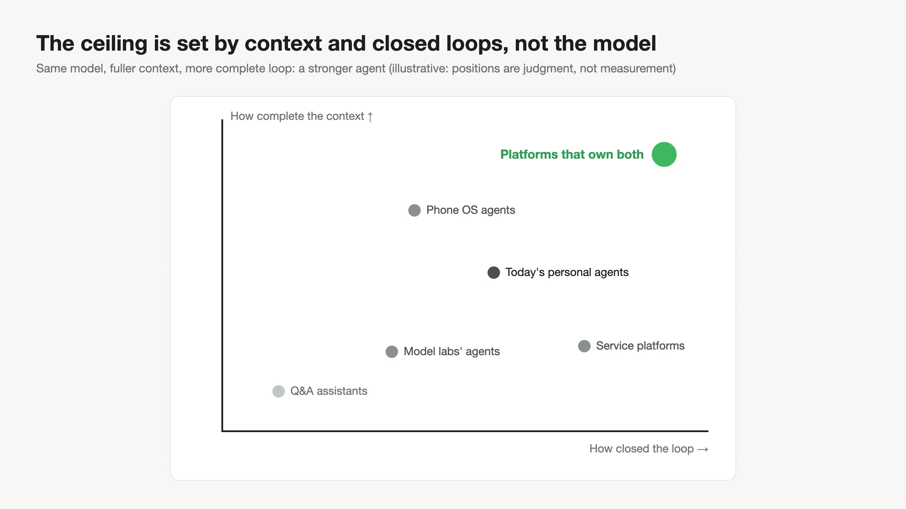

The ceiling is set by context and closed loops

## 4. Team: last generation's playbook can't build a personal agent

### Three common traps

**Trap 1: Building the agent as a stack of features.** The experience comes from general capabilities layered with context, so features don't add up to it. This generation should design the environment and let capabilities emerge.

**Trap 2: Every business unit builds its own agent.** Context gets fragmented, and the investment only adds up linearly. This generation should build one hub that every business contributes to.

**Trap 3: Product, engineering, and models each own their own piece.** Deciding "can we build this?" spans three layers, and the handoffs become the bottleneck. This generation needs one full-stack owner and atomic teams.

The problem is that last generation's product methods and org structures don't fit agents. It has nothing to do with how good any particular team is. Startups are small and full-stack by nature, so they're less likely to fall into these traps. The bigger the company, the more likely it is to use familiar methods for an unfamiliar job.

### The owner should understand models, engineering, and product

In AI products, deciding "can we build this?" spans three layers: change the prompt, change the harness, or do post-training. If those three layers sit with three different people, a feature bounces between product, engineering, and the model team, and no one can make the call. Every extra handoff slows iteration by a beat.

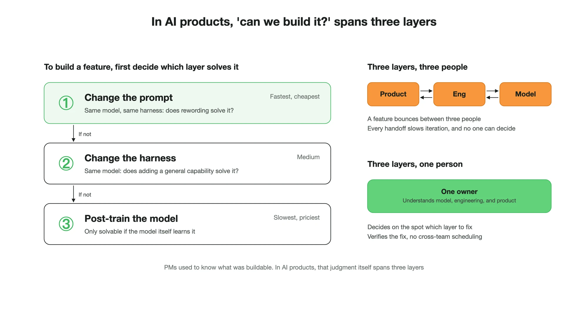

PMs used to know what was possible. In AI products, that call spans prompt, harness, and model

So **the owner should understand models, engineering, and product**, so they can decide which layer a problem belongs to and make the call on the spot. That person also needs two things:

- **Product taste**: restraint, invisibility, simplicity. Some teams building personal agents end up with a progress dashboard. Others end up with a row of tabs and templates. A good personal agent opens to a conversation.
- **Learning extremely fast**: agent techniques turn over every few months. Judgment can only come from the front line: using it every day and changing it yourself.

### Atomic teams: evals, engineering, and model close the loop

The basic unit of the org is a small atomic team, replacing the split into product, engineering, and research groups. Each team has three roles:

- **Evals**: set benchmarks, watch metrics, and find problems in real usage.
- **Engineering**: build the harness, integrations, and infrastructure that make capabilities real.
- **Model**: do post-training so the model fits the harness and the use cases.

Evals finds a problem, engineering and model fix it together, evals verifies, and nothing waits on another team's roadmap. The hub is made of a few of these teams: few people, high density, each owning one capability or one class of use cases: entry point and interaction, harness, memory, proactivity, model. Everyone works with agents. Nobody scales by adding headcount.

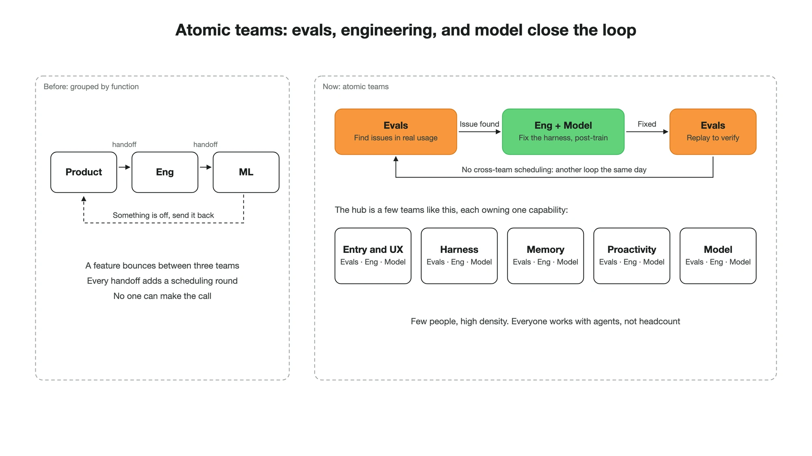

Teams used to be split by function, with features handed back and forth. Now each small team closes the loop on evals, engineering, and model

### Design product, harness, and model together

The three form a flywheel:

- New product features become new skills in the harness. Problems users hit drive the harness to improve itself.
- Harness improvements directly improve the user experience.
- User data flows back into model training. Traces and environments from the harness become post-training tasks.
- Model improvements unlock new product use cases.

Every turn makes the product more useful and better at understanding people.

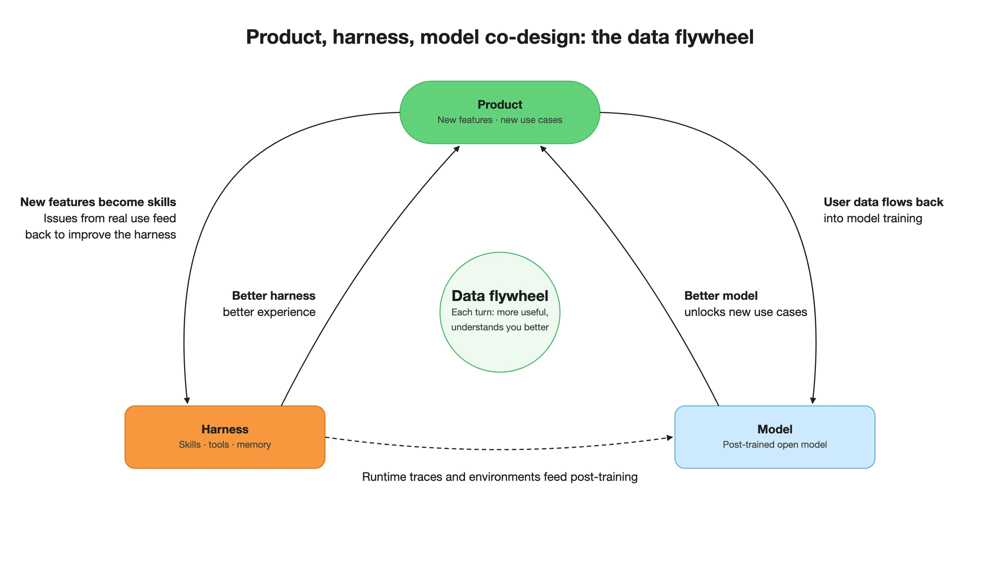

The data flywheel linking product, harness, and model

## 5. Product: design for the agent

### For people, the more human the better. For the agent, the more general the environment the better.

In practice, that means six things:

1. **Treat it as a person**: it's a contact in your phone and talks in chat. No new app, no new tab.
2. **Be fast**: reply in seconds, keep it short. Slow work goes to the background, and it tells you when it's done.
3. **Design the product for the agent**: anything a person can do in the product, the agent can do.
4. **Design the environment, not features**: give it general capabilities instead of custom UI for single use cases.
5. **Abstract, don't integrate one by one**: we define the types, users generate the instances.
6. **Let features emerge**: only basic capabilities generalize, and only what generalizes lets new uses emerge.

Look at a few things I've used it for. None was a purpose-built feature. Each was a few general capabilities that the model combined on its own:

- **Register an Apple Developer account**: search to find the process, a browser to fill out forms, email to receive verification, and payment left for me to confirm.
- **"How do I get to the SFO rental car return?"**: the rental booking from memory, the flight from my calendar, my current location, and a search for a gas station on the way.
- **Plan a route**: search, plus an artifact: a map I can use right away.
- **A daily news digest**: a scheduled trigger, search, and memory. One offhand "fewer of these" changes it.

The product team's job is to make the basics solid (search, browser, email, payments, artifacts, scheduling) and leave the combining to the model. Once something works, the approach is saved as a skill, so next time it's faster and more reliable.

### Don't design UX, design AX

Every agent product has two interfaces: one for people and one for the agent. They should be the same.

The agent is a user just like a person. Anything a person can do, it can do, with the same set of capabilities. However a person sends messages, pays, or checks notifications, that's how the agent does it too. Don't build custom UI for the agent. Custom UI means you're imagining scenarios on the user's behalf, and you'll never finish imagining them.

Good UX means people don't have to think. Good AX means the agent doesn't have to guess.

### Context should also be earned one level at a time

User trust builds one level at a time, and context should be collected the same way, starting with what's least sensitive before touching what's private:

1. **What the user gives it**: what they say in chat, and the files and links they forward.
2. **What the user has already made public**: posts and content they already share with friends.
3. **Interest signals the platform already uses**: the ones its recommendations already rely on.
4. **What the user grants item by item**: notifications, orders, calendar, each turned on by the user.
5. **The most private**: message history, read only on the device and never uploaded. Or not used at all.

The first four levels barely touch privacy and are already enough to do a great job of getting things done for you. Only when a use case moves up a level does the context it needs move up a level.

### A2A: it serves more than just you

The next step for a personal agent is dealing with other people on your behalf.

- **Talking to a business's AI**: refunds, flight changes, customer support. Your agent talks directly to the business's AI agent. Both sides are agents, so once things are clear, it's done.
- **Joining a group chat**: planning dinner with friends or a family trip. Add it to the group, it helps everyone decide, and then it books it.

Both will feel most natural on platforms that already carry relationships between people, and between businesses and their customers.

## 6. Tech: models and the harness

### Overview: a different kind of system from past agents

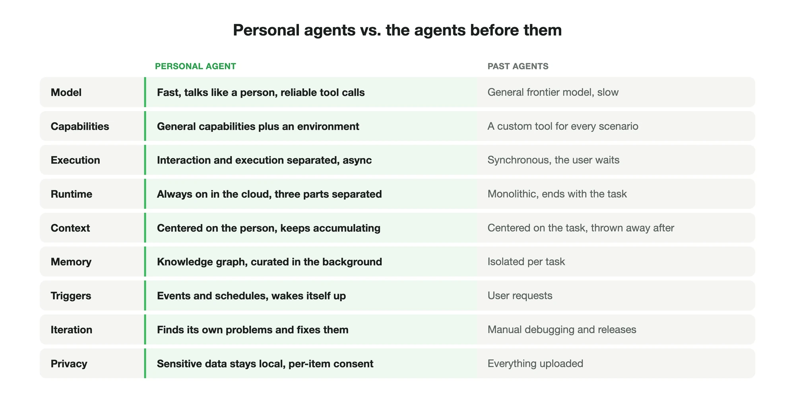

Personal agents vs. the agents before them

In one line: **a personal agent is a long-running process.** Here's each piece.

### Model: it needs almost the opposite of a coding agent

Today's smartest models are optimized for coding: the more complex the task the better, the longer and more complete the output the better, and they talk like they're writing a report. A personal agent needs four other things:

- **Fast**: the interaction layer has to be low latency.
- **Talks like a person**: short and natural, no reports.
- **Reliable tool calls**: it doesn't need to be brilliant, but it can't get calls wrong.
- **Cheap**: it's always on.

So the most sensible route is to start from a fast, cheap open-weight model and do your own post-training on two kinds of tasks:

- **Harness capability tasks**: tool calls, operating inside apps and web pages, reading and writing memory, talking like a person.
- **Scenario tasks**: booking restaurants, doctor's appointments, changing flights, planning trips, running errands for family.

Stage one uses SFT for cold start and distillation: a strong model works through tasks in the environment, high-quality trajectories are filtered out, and the model learns to use tools and talk like a person. Stage two uses RL: the model works through tasks in a simulated environment and is rewarded for finishing the task, calling tools correctly, and being short and human. After launch, real traces and user feedback flow back in as new tasks. Capabilities are the foundation. Scenarios are the exam.

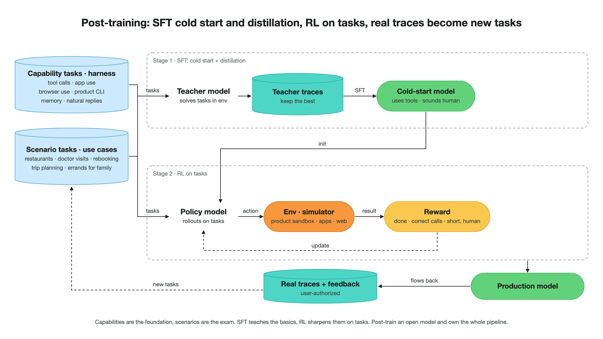

Post-training: SFT for cold start and distillation, RL on tasks, real traces become new tasks

### Harness: give it general capabilities and let the uses emerge

The agent needs a general enough environment. Abstracted from a large set of real needs, it looks roughly like this:

- **Search**: access the web and look anything up.
- **Browser**: operate web pages like a person: appointments, reservations, orders.
- **In-app actions**: use services that already exist on the platform: ordering, booking, paying bills.
- **Payments**: pay on your behalf once authorized, without touching your card.
- **Multimodal**: voice conversations, phone calls, understanding images.
- **Artifacts**: deliver something usable, like a web page or a route map.
- **Execution environment**: a bash shell, the lowest-level foundation that can run anything.
- **External connectors**: calendar, documents, and other outside services.

A few key design choices:

**A minimal harness.** One agent loop and a set of general tools. Weak models need a heavy harness. Good models only need a light one. Every time the model improves, you should delete something from the harness.

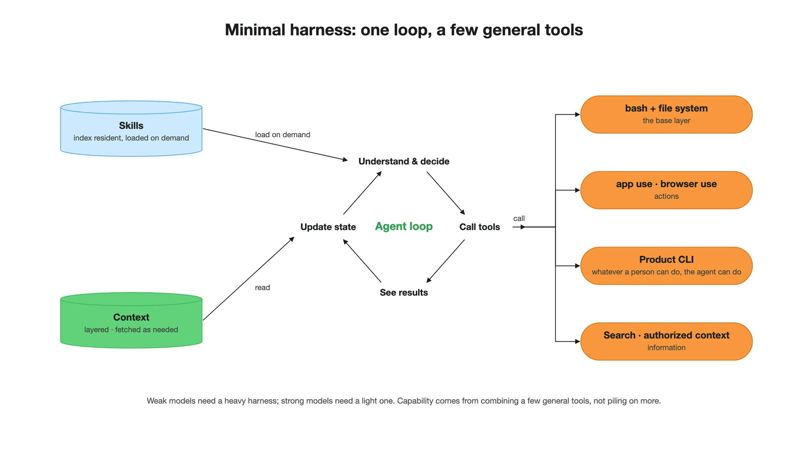

Minimal harness: one loop, a few general tools

**Mirror every product action as a command the agent can use.** Every action a person can take in the product (send a message, look up history, check notifications, pay) becomes a command-line instruction. Reveal them progressively and grant them one by one, instead of dumping hundreds of tools on the model at once.

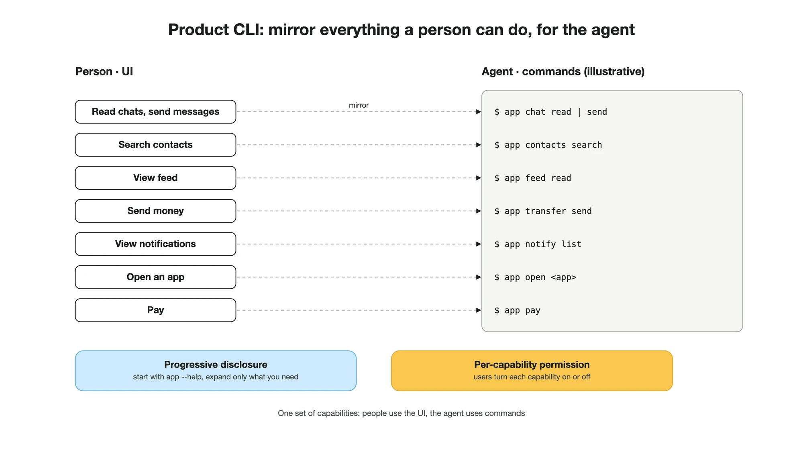

Mirror every action a person can take as a command for the agent

**Load skills on demand.** Write up "how to get something done" as a guide. The index stays in context, and the full text is read only when needed. After a task succeeds, what was learned becomes a new skill.

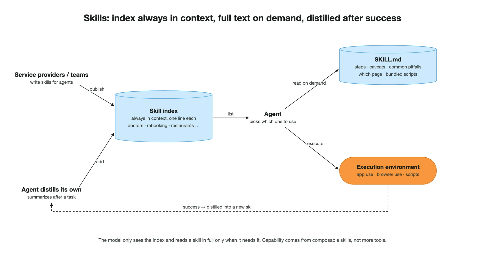

Skills: index always in context, full text on demand, distilled after success

**External services: first-party integrations for the important ones, browser use and computer use for the rest.** High-frequency, important services like rides, food delivery, and shopping integrate directly, exposing capabilities through an API or MCP. That's fastest and most reliable. The long tail doesn't need an API: the agent uses computer use inside apps and browser use on the web, the way a person would. Both paths share the same identity and payment authorization.

For service providers, the deeper the integration, the more likely the agent picks them. Beyond exposing capabilities, they can push events (order status, arrival reminders) to the agent through webhooks, and bring their own UI into the conversation as cards.

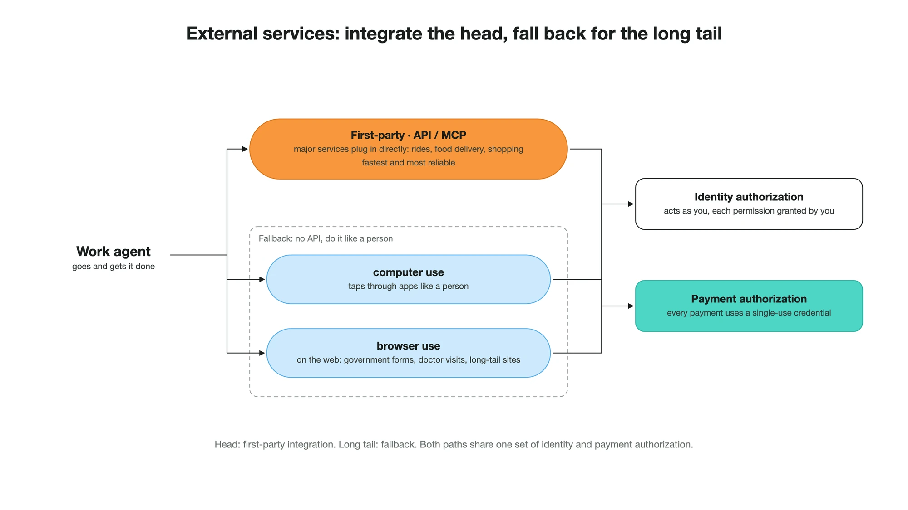

External services: first-party integration for the head, computer use and browser use for the long tail

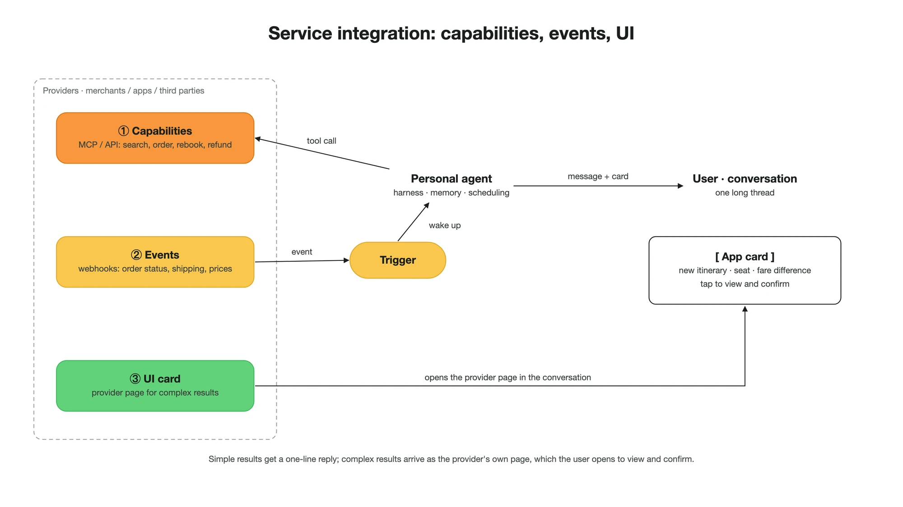

Service integration: capabilities, events, UI

**Payments use single-use credentials only.** Authorize, payment request, user confirms, single-use credential issued, merchant charges, transaction logged. The agent never touches the user's card at any point.

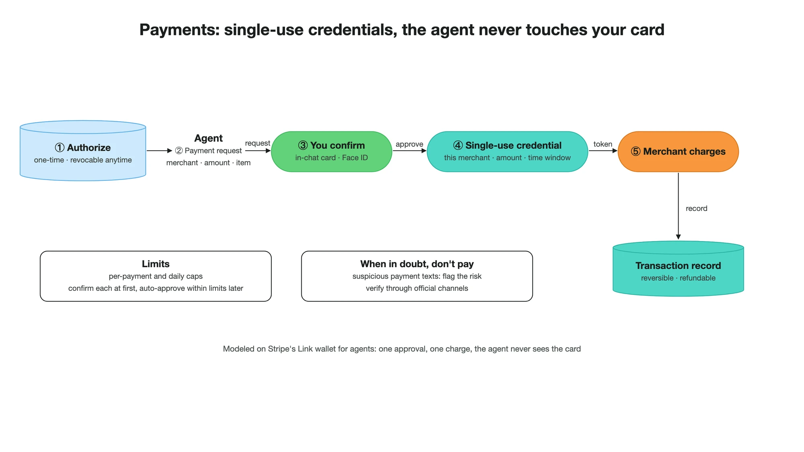

Payments: single-use credentials, the agent never touches your card

### Separate interaction from execution

A personal agent has to reply in seconds and also finish complicated work. In a single synchronous loop, those two goals conflict. The fix is to split it into two layers:

- **Interaction agent**: a low-latency model that only handles conversation and dispatches tasks, replying right away with "Got it, on it."
- **Work agents**: pull tasks from a queue and run them asynchronously and in parallel, each in its own sandbox. They record progress and delivery status, then report back to the user through the interaction agent. If there's nothing worth saying, they stay quiet.

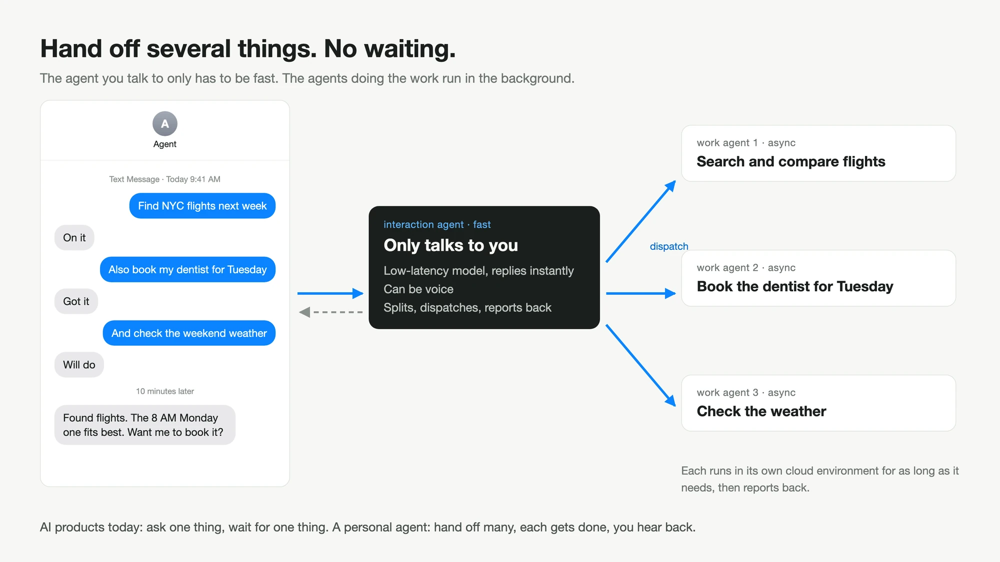

Hand off several things, no waiting

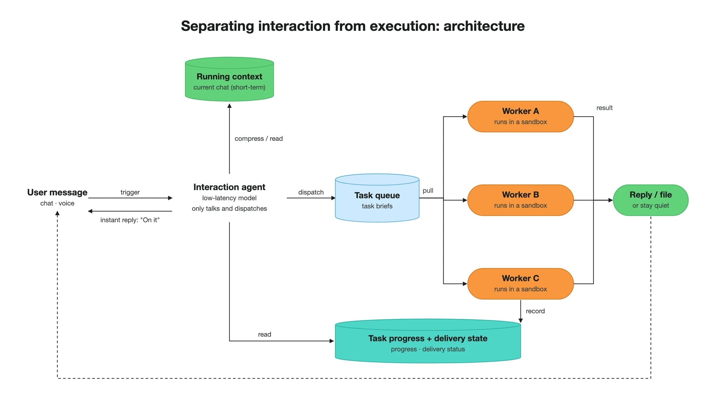

Separating interaction from execution: the architecture

### Runtime: harness, sandbox, and filesystem, separated

Past agents ran in a single execution environment whose lifetime equaled one task. A personal agent has to stay online, so the **agent runtime, execution environment, and storage** need to be separated. The agent's state is persistent (durable execution). Execution environments can be scheduled on demand in the cloud or on the device. Storage is independent of any single run. If any piece goes down, it still remembers you and picks up where it left off.

The most direct benefit of this split is **cost**. Giving every user an always-on cloud computer costs around $10 a month. Once the three are separated, the agent's state lives in durable storage, and execution environments spin up only when there's real work and shut down when it's done. That brings the cost to under $1 per user per month. For a product that has to stay always on for a huge number of users, that's the difference between possible and not.

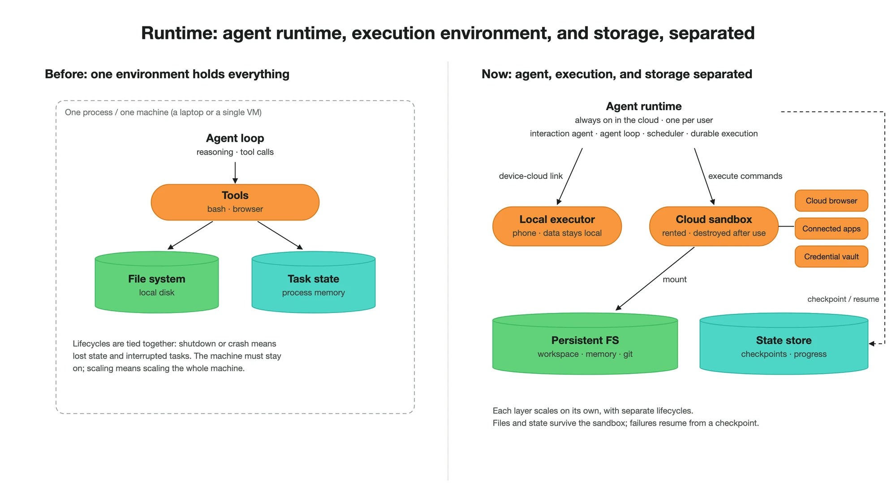

Agent runtime, execution environment, and storage, separated

### Context: layered around the person

A personal agent manages one conversation that never ends, so context can't be "stuff in all the history." It should be layered: persona, tools, the skills index, what it knows about you, relevant memories, what's in progress, the current conversation, and task instructions. The interaction agent and the work agents each take what they need.

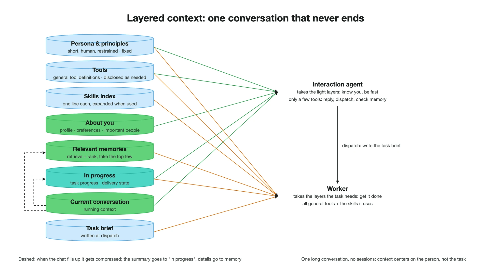

Layered context

### Memory: a knowledge graph of people and relationships

The old approach was memory isolated by task, plus one big file about the user. A personal agent needs a knowledge graph built around people and relationships: you, your family and friends, what you're working on, your preferences, all connected. A background process keeps curating it: merging, correcting, and forgetting.

Memory is really a recommendation problem: at this moment, what about you is most worth remembering?

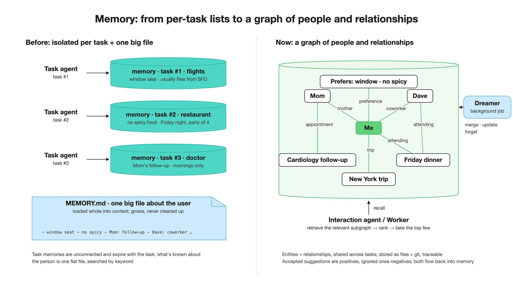

From memory isolated by task to a knowledge graph of people and relationships

### Proactivity: two-tier triggers

Proactivity can't mean having a big model watch everything all the time. That's too expensive and too noisy. Use two tiers of triggers:

1. **Fast rule filtering**: events (new email, new orders, new notifications) and scheduled jobs come in, and cheap rules decide whether to handle them.
2. **The agent decides when needed**: only what passes the filter goes to the agent, which decides whether to remind you, ask you, or stay quiet, and records its progress.

This is also how restraint is implemented in the tech: for most events, the final decision should be "don't interrupt."

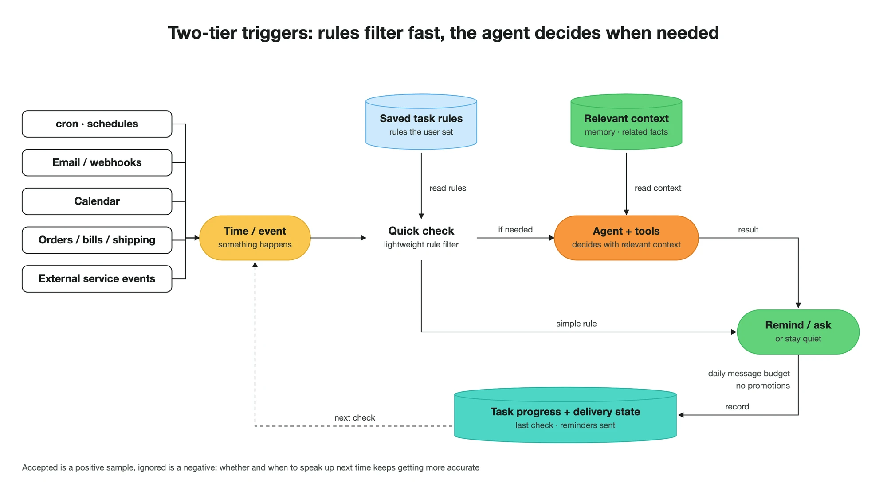

Two-tier triggers: rules filter, the agent decides when needed

### Self-improvement

Users run into small problems every day, and triaging them by hand can't keep up. So give the personal agent its own tool for reporting problems. When it can't do something well, it reports the issue with its context. A separate coding agent reads these issues and the run traces, then changes the harness. Changes are replayed against historical traces, and only those that pass go out in a staged rollout.

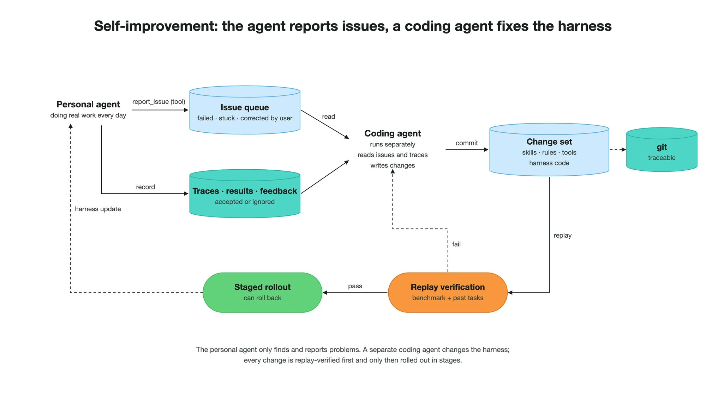

Self-improvement: report issues, a coding agent fixes, replay to verify, staged rollout

### Privacy: draw a clear line

The agent loop runs in the cloud. The most sensitive data, like message history, stays in a local execution environment on the phone and never crosses that line. The cloud only gets what the user has granted, item by item. The clearer the line, the more people are willing to hand over.

Muse's approach is a good reference (based on what Meta has published):

- **A separate review process**: a Sentinel isolated from the agent checks every outbound action against what the user authorized, and allows it, blocks it, or asks the user to confirm.
- **Credentials never enter the model**: account tokens and passwords live in a separate credential service and are issued to the execution environment only when needed. The model never sees them.
- **Sensitive actions ask first**: sending an email or placing an order needs the user's confirmation.
- **Users can see and revoke**: each connection can be read-only or read-write and revoked at any time, everything it did is logged and reviewable, and you can ask it to forget what it remembered.

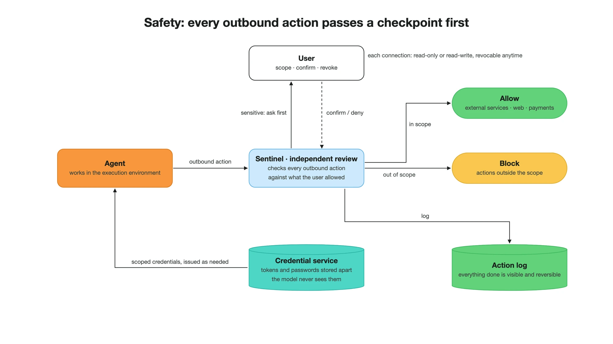

Safety: every outbound action passes a checkpoint first

## Conclusion

1. **Definition**: a personal agent is a way of living. Tools are defined by use case. A personal agent has no killer use case. It becomes an irreplaceable habit through many small things: everything goes to it first, by default.
2. **The 8P principles**: a good personal agent behaves like a person. It shows up like a person, talks like a person, is always around, knows you, thinks ahead, has judgment, gets things done, and can be trusted.
3. **The ceiling**: intelligence is already in surplus. The model sets the floor, and context and closed loops set the ceiling. The value of context grows exponentially.
4. **Team**: last generation's playbook can't build a personal agent. The owner should understand models, engineering, and product, and the org is made of atomic teams where evals, engineering, and model close the loop together.
5. **Product**: design the environment, not features. Give the agent general capabilities and let uses grow out of real usage. Design AX, not just UX.
6. **Tech**: separate interaction from execution, separate the runtime into three parts, layer the context, build memory as a knowledge graph, use two-tier triggers, let it improve itself, and draw a clear line for privacy.

So the hardest part isn't the tech. It's restraint in the product and an AI-native org: having the nerve to build only the environment, and letting one person who understands all three layers, with a small full-stack team, design the product, harness, and model together.

**When you stop feeling like you're using an AI product, it has worked.**

**Coming next.** This was Part 1 of "How to Build a Good Personal Agent," on product, team, and tech. Part 2 covers business model and strategy: whether the platform tax gets competed away, whether hardware or software becomes the entry point, and how big companies and startups each win.

<!--translation-->

> **这是《如何做出好的 Personal Agent 产品》的第一部分。** 这一篇从产品、团队和技术的角度，讲 personal agent 是什么、好的 personal agent 有哪八条原则、怎么把它做出来。第二部分讲商业模式和战略：平台税会不会被打下来，软件和硬件谁会成为入口，大公司和创业公司各自怎么赢。

上个月在旧金山，我还租来的车之前，给 Instinct 发了一句：「SFO 还车怎么导航？」

它的回复很直接：我租的是哪家，几点之前要还，进机场前最后一个顺路的加油站在哪，还完了去哪个航站楼。我从没告诉过它我今天要还车。两周前我和它聊过一次租车，它记住了；日历里有我的航班，它也看到了。

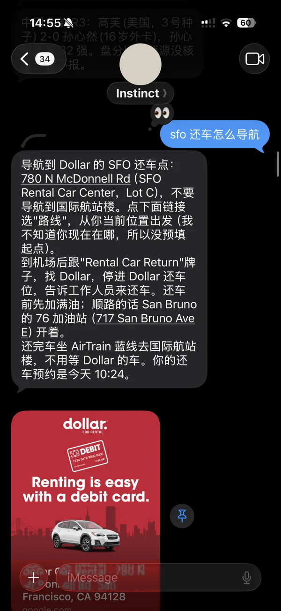

一句「SFO 还车怎么导航」，它把租车订单、航班、加油站都用上了，还告诉我还完车怎么去我的航站楼

那一刻我意识到，这个东西和我用过的所有 AI 产品都不一样。它更像一个一直在我身边、知道我在干什么的人。

从 8 月 19 日开始，我给它发了一千多条消息。这篇文章想把这件事从头讲清楚：一个好的 personal agent 应该遵循哪八条原则，决定它上限的是什么，以及组织、产品、技术上具体怎么做。所有判断都从同一句话出发：**personal agent 是一种生活方式**。

今年下半年，硅谷的 AI 产品几乎同时转向了这里：iMessage 里的 Instinct，Meta 的 Muse，OpenAI 的 Dots，Manus 的 Cue。**形态在收敛**：云端常驻，一直在线，有自己的身份。**分歧在入口**：做成通讯录里的一个联系人，还是一个独立 app。背后是三件事同时成熟了：云端常驻的基础设施，够快够便宜的模型，以及年初开源 agent 那一波验证过的需求。

## 一、定义：personal agent 是一种生活方式

2024 年是 chatbot，人和 AI 的关系是**提问**。2025 年是干活的 agent，以写代码为主，关系是**监督**。这两代都还是工具，各自解决一类问题。2026 年是 personal agent，它开始**改变人的生活方式**。

工具是按场景定义的：写作工具、翻译工具、订票工具，先有一件事，再去找它。personal agent 很难这样定义。

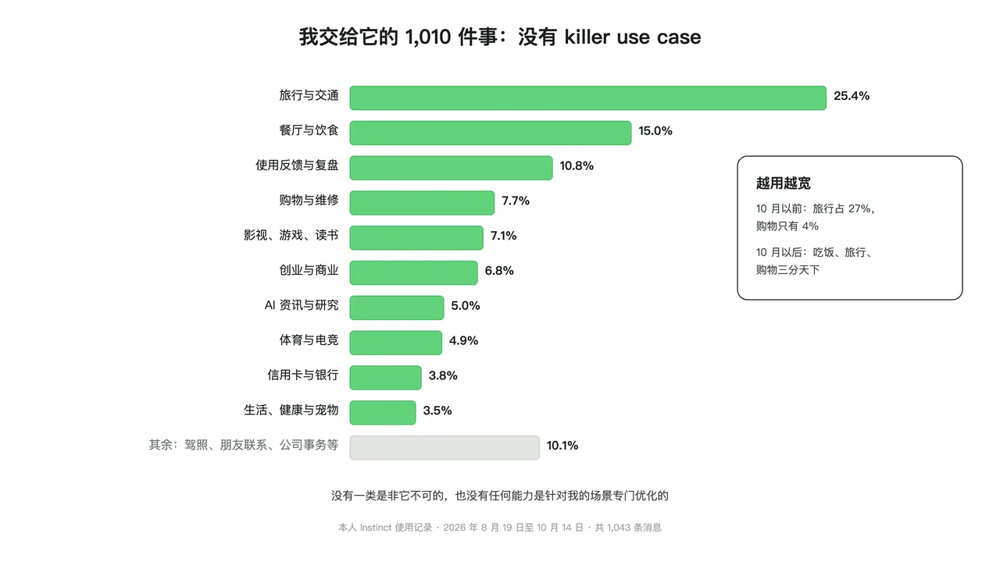

我交给它的 1,010 件事，分散在生活的各个角落，而且越用越宽

我回头看自己那一千多条消息，最直观的感受是「杂」：旅行和交通占四分之一，吃饭占一成多，剩下的是购物、银行卡、驾照、体育、资讯、闲聊。最早替掉的是我的搜索引擎，后来是订酒店、订餐厅，再后来是注册账号、处理账单。**没有哪一个是 killer use case**，也没有哪件事非它不可。可是一件一件攒起来，它就成了一个替代不掉的习惯。所以我更愿意这样定义它：

工具的用法是：**先有一件事，再想用什么来办**。生活方式的用法是：**任何事，默认先交给它，它办不了再说**。

这个默认是怎么形成的？委托一件事有两个成本：**说清楚**和**盯着办完**。两者加起来比自己干还麻烦，人就会自己干，所以大多数 AI 产品停在了「偶尔用一下」。personal agent 把这两个成本都压了下去：记忆让「说清楚」越来越短，能办完让「盯着」消失。成本过了某个临界点，人的默认动作就翻过去了。信任也跟着一级一级攒起来：从问答、建议，到替你下单、办要身份验证的正事，最后替你维护关系。

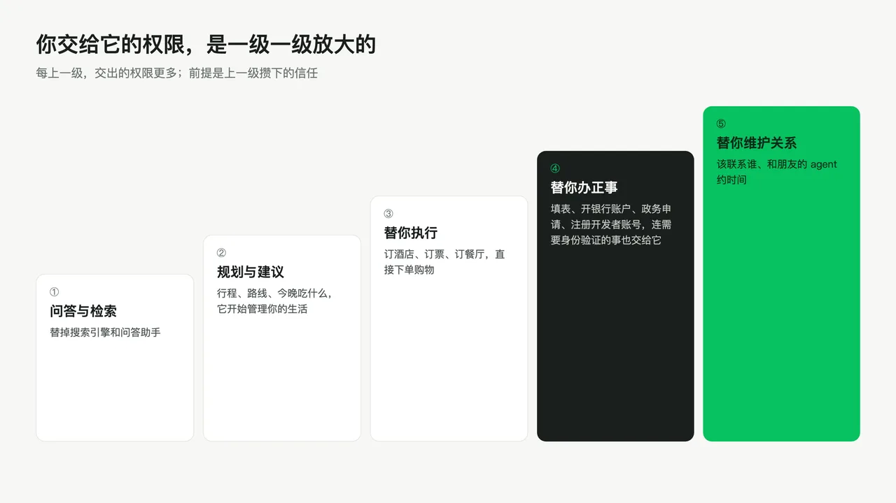

交给它的权限，是一级一级放大的

## 二、好的 Personal Agent 产品：8P 原则

这八条原则，是我高强度用过市面上所有主流 personal agent 之后总结出来的。最后留下来、每天在用的只有两家：Instinct 和 Muse。其余没留下来的，**每一个都至少违背了其中两条**。

下面这八条原则，说的就是怎么让人一级一级地愿意把生活交出去。它们环环相扣，前一条是后一条的前提。

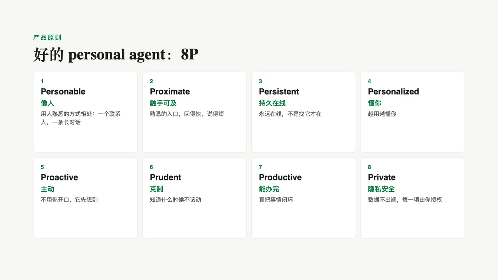

好的 personal agent：8P

### 原则一 · Personable：像人，而非人机

**对用户来说，它就是一个人**：说人话，像人一样交互。

它就是通讯录里的一个联系人，一条长对话，不分 session。你可以打断它，可以随时插一句别的事，就像和朋友聊天。

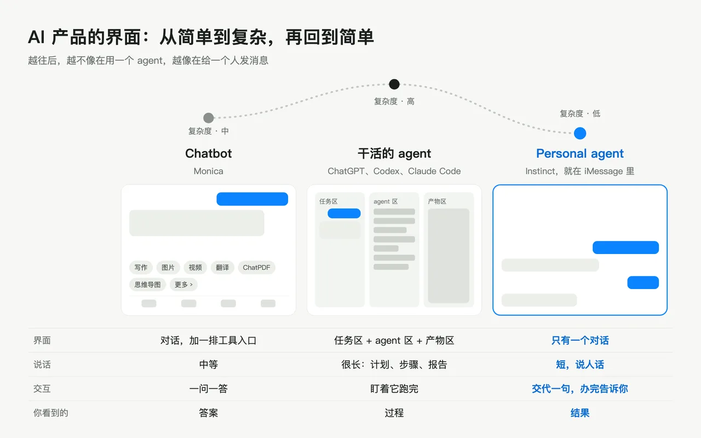

三代 AI 产品的交互：越往后，越不像在用一个 agent，越像在给一个人发消息

两个常见的反例：

- **工具类产品的多入口**：写作、翻译、生图、读 PDF 各占一个入口，用户得先想清楚该点哪一个。
- **coding agent 的人机味**：回一句话也要标题、分点、加粗，像在交一份报告。

所以第一条原则很简单：**入口就是原来的入口，交互就是人和人的交互**。人怎么和人相处，就怎么和它相处。

### 原则二 · Proximate：触手可及

**离你足够近：入口近，回得快，说得短。**

距离由三样东西决定。

**入口在哪。** Instinct 是 iMessage 里的一个联系人，消息都在本地，点开就是点开，不用等 app 加载。独立 app 就要多一步打开，用得就会少一大截。对一个要变成习惯的产品，多一步就是多一道坎。

反过来，有的产品一打开就是五个 tab，每个 tab 里又是一排分类和按钮。离用户越远，用户就越不会来。

**多快回你。** 速度是第一位的。先是产品本身要快：点开就能说话，不等启动画面，不等加载。再是回复要快。Instinct 和 Muse 都非常非常快：一方面交互用的是小而快的模型，另一方面靠架构设计，交互和执行分开（第六部分展开）。交代完一件事，它应该马上回一句「好，我去办」，然后在后台慢慢办，别让你盯着一个转圈的图标。你还可以一口气交代好几件事，它一件件去办。

**说话像不像人。** 很多 agent 回消息带着报告味：标题、分点、加粗，长篇大论。原因不难理解：今天最聪明的模型，都在为写代码和做复杂任务优化，交付越长越完整越好。但人和人发消息不是这样的。好的 personal agent 说话短、直接，像一个靠谱的朋友回你消息。

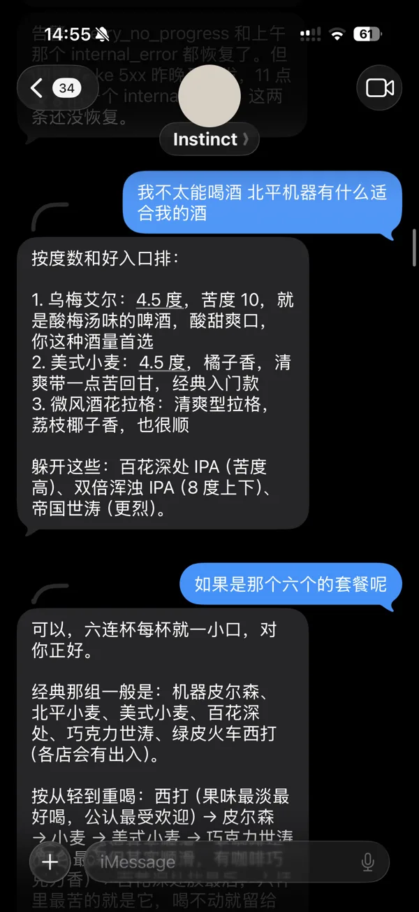

好的回复：短、直接，说人话

### 原则三 · Persistent：一直在线

**它是一直在的那个人，你不找它，它也在。**

过去的 AI 是找它的时候才在。一个会话一件事，聊完就忘，关掉页面事情就停了。

personal agent 是 7×24 在线的。你关了手机，它还在后台干活；你上周交代的事，它接着办；明天要做的事，它记着。

一直在，是后面几条原则的前提。先一直在，才谈得上懂你、主动、把事办完。

### 原则四 · Personalized：懂你，而且越用越懂

开头那个还车的例子就是这一条。我只问了一句「怎么导航」，它把租车订单、航班、位置、我的习惯全用上了。

订餐厅，它知道我爱吃什么，直接给我挑好；每天的资讯推送，我随口说一句「这类少推点」，它下次就改了。我没有配置过任何东西。

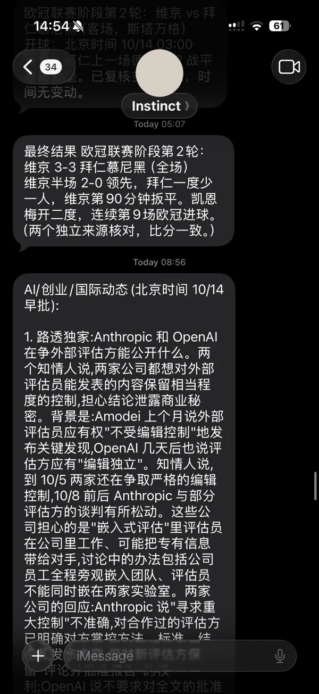

每天的资讯推送，随口反馈一句就越推越准

这有点像推荐系统：每一次互动都是一次反馈，它对你的理解是持续积累、持续修正的。

懂你之所以重要，第三部分会讲到：context 的价值是指数级增长的，懂得越全，它能办成的事就越多。

### 原则五 · Proactive：主动

用了一段时间以后，真正让我觉得「它懂我」的时刻，大多是它先开口的时候。

比如我邮箱里来了一封服务告警，我还没看到，它先提醒我了。

主动不等于打扰。你打开的时候，看到的是它替你想过的东西：今天的天气，一件可以替你办的事；你不打开，它也不来烦你。最好的主动，是只在真正重要的事情上先开口。

最好的触发源，是生活里本来就在发生的通知：邮件、订单、账单、日程。这些事本来就需要有人处理，agent 只是比你先看到。

### 原则六 · Prudent：克制

克制最常见的反面，是过于主动：太想表现自己，不停地猜用户想要什么，推一堆其实并不相关的建议，猜错的比猜对的多，最后用户只想把它关掉。好的 personal agent 正好相反：一天里发生的大部分事，它看过、记下、顺手办好，但不来烦你；只有真正改变你安排的事，它才开口。

这就是克制：不发推广，不炫耀自己做了什么，没把握的事不打扰，只在值得的时候开口。

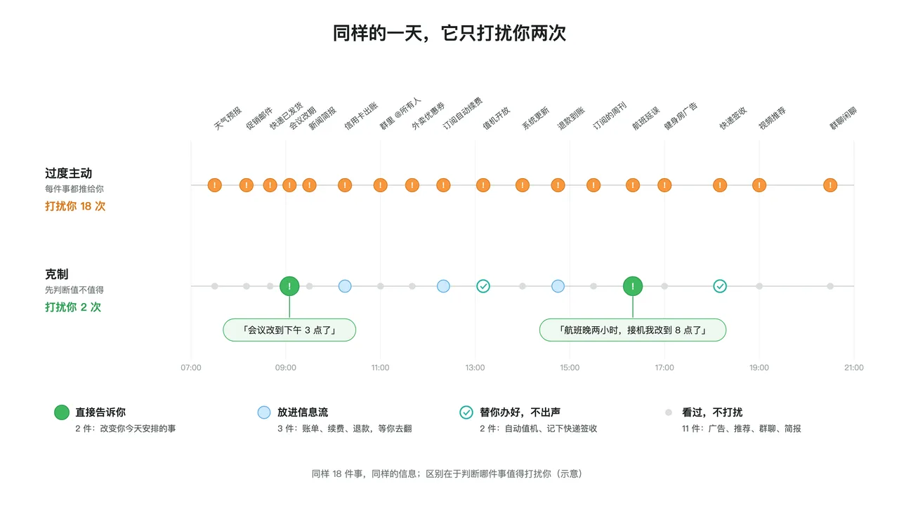

同样 18 件事：过度主动的 agent 每件都推给你，克制的 agent 只在两件事上开口

判断还不够准的时候，可以做一个折中。Muse 的信息流就是这样：主界面只放最重要的事，不那么重要的提醒和建议放进信息流。你去翻，它在；你不翻，它不打扰。

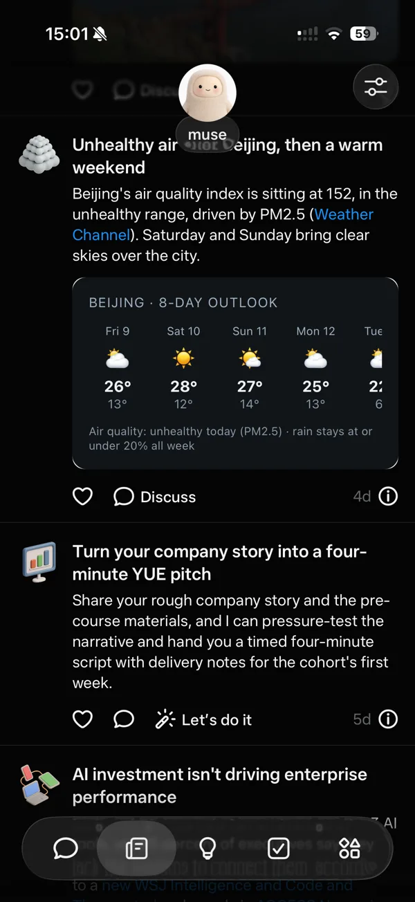

Muse 的信息流：次要的东西放在这里，等你去翻

主动和克制，其实是同一种能力：**判断一件事值不值得打扰你。** 做好了是一个懂分寸的人，做不好就是一个烦人的推销员。

这个判断靠的是一套足够好的、类似推荐系统的个性化机制。它得非常懂你，才知道什么时候该主动、什么时候该克制，哪些事该推给你、哪些不用。所以主动、克制和原则四的「懂你」是一体两面：**懂得越深，分寸越准。**

### 原则七 · Productive：能办完，真把事情闭环

我让 Instinct 帮我注册一个 Apple 开发者账号。这件事过去要折腾好久：公司信息、邓白氏编码、各种表。它一步步走了下来，只把付费和身份验证留给我。

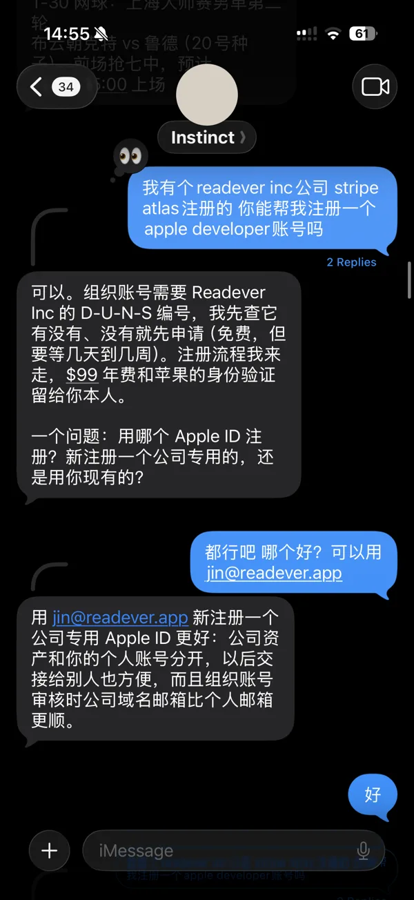

一句话，它把 Apple 开发者账号一步步走了下来

规划一条路线，它直接给我一张能用的导航，连文字说明都省了。

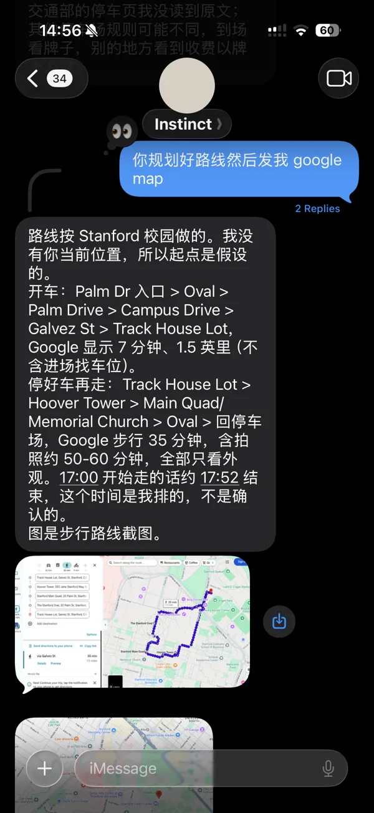

规划路线，直接给一张能用的导航

有意思的是，这些都不是专门为我优化过的功能。没有人提前想到「用户可能要注册 Apple 开发者账号」，然后去做一个功能。它能办成，是因为它有一组通用的底层能力（搜索、浏览器、邮箱、支付、执行环境），然后自己组合出了办法。

这引出了做 personal agent 产品最反直觉的一点：**不要设计功能，要设计环境。**

传统的产品经理习惯从场景出发，一个场景做一个功能。但 personal agent 面对的需求是无穷无尽的长尾，你设想出来的场景永远做不完，而且功能做得越多，产品越复杂，通用能力反而越弱。

正确的做法是先抽象再具体，先通用再专用：一百个需求，先分类，再抽象出背后需要的几样通用能力，然后把这些能力给到 agent，让用法自己涌现出来。产品团队定义的是「类型」，用户生成的是「实例」。

用户真正的底层需求其实就那么几种：懒，想有掌控感，想要信息，想要陪伴。满足这些底层需求，靠的是能力和环境。

### 原则八 · Private：隐私安全

交给它的事越多、越重要，越需要让人放心。

可托付至少意味着四件事：

- **数据不出端。** 最私密的数据，比如聊天记录，只在手机本地处理，不上云。
- **逐项授权。** 每一项能力、每一份数据，都由用户自己打开，装上时什么都不拿。
- **支付碰不到卡。** 每一笔由你确认，确认之后才签发一次性凭证，agent 自己从来接触不到你的卡号。
- **可追溯，可撤回。** 它做过的每件事都有记录，做错了可以回滚。

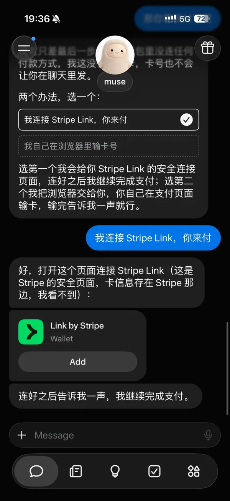

Muse 付款：用户连接 Stripe Link，卡信息存在 Stripe 那边，agent 自己看不到

隐私决定了信任能攒到第几级。没有这一条，前面七条做得再好，用户也只敢把小事交给它。

## 三、决定上限的：context 和闭环

### context 越全，价值指数级增长

personal agent 的价值来自 context 之间的组合。组合不止两两配对，任意几样都能凑在一起：n 类信息能凑出 2ⁿ 种组合，每多一类就翻一倍。所以只有一半 context 的 agent，拿到的远不到一半价值，差距是指数级的。这决定了用户会把 context 集中到一个 agent 上。

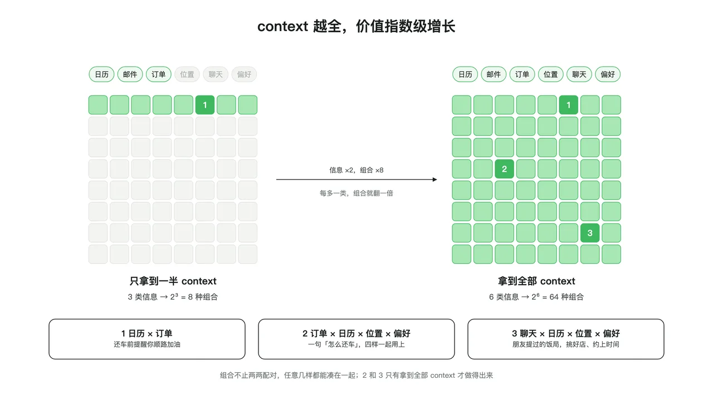

信息翻一倍，组合翻了三番：组合不止两两配对，任意几样都能凑在一起

### 上限由闭环决定，模型只决定下限

一个 personal agent 能做到多强，取决于它的 context 有多全、闭环有多完整：入口、个人 context、执行、支付、社交关系，是不是都在一处，能不能互相带动。

看看美国这一波是怎么拼出来的：入口借 iMessage 或 WhatsApp；个人 context 从 Gmail、日历一处处授权拼起来；执行靠浏览器模拟点击；支付再接一个 Stripe；社交关系散落在各个平台。每一样都是借来的，每一个接缝都是摩擦。

所以同样的模型，放进更全的 context、更完整的闭环，就是更强的 agent。**模型决定下限，闭环决定上限。**

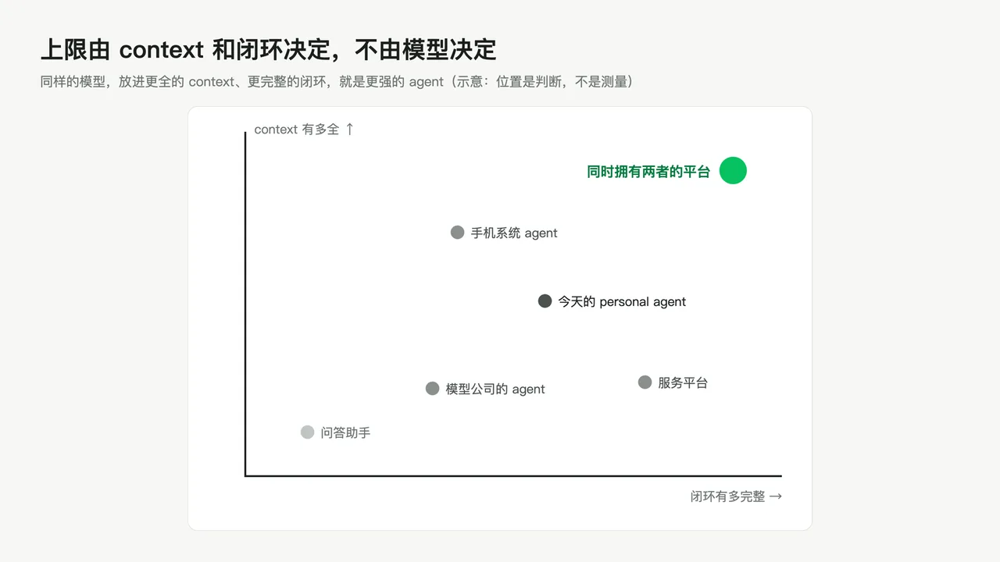

上限由 context 和闭环决定

## 四、组织：上一代的做法，做不出 personal agent

### 三个最常见的坑

| 上一代的做法 | 为什么行不通 | 这一代应该 |
| --- | --- | --- |
| 把 agent 做成功能的堆叠 | 体验来自通用能力和 context 的叠加 | 设计环境，让能力自己涌现 |
| 各个业务线各做一个 agent | context 被切碎，投入只能线性相加 | 一个中枢，所有业务合力 |
| 产品、工程、模型分头负责 | 「能不能做」要跨三层判断，交接成了瓶颈 | 一个全栈的负责人，原子化团队 |

问题出在上一代的产品方法和组织方式套不到 agent 上，跟哪个团队无关。创业公司天然小而全，反而不容易掉进这些坑；越大的公司，越容易用熟悉的方式去做一件不熟悉的事。

### 负责人：最好同时懂模型、工程和产品

AI 产品里，「能不能做」要跨三层判断：改 prompt、改 harness，还是做后训练。这三层如果分在三个人身上，一个功能就会在产品、工程、模型之间来回传，没人能拍板；每多一个交接点，迭代就慢一拍。

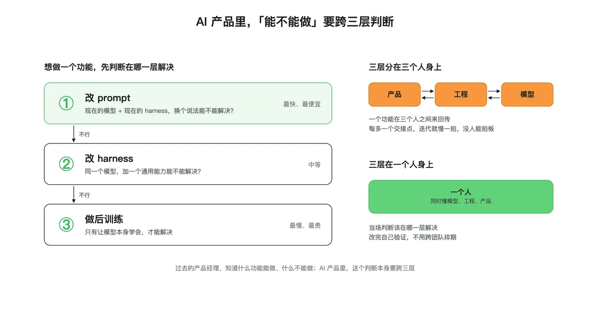

过去的产品经理知道什么能做；AI 产品里，这个判断要跨 prompt、harness、模型三层

所以**负责人最好同时懂模型、工程和产品**，自己就能判断一件事该在哪一层解决，当场拍板。这个人还需要两样东西：

- **产品品味**：克制、无形、简洁。同样做 personal agent，有的团队做成了进度看板，有的做成了一排页签和模板；好的 personal agent，打开就是一段对话。
- **学得极快**：agent 的做法几个月就换一代，判断只能来自一线：每天自己用、自己动手改。

### 原子化团队：效果、工程、模型自己闭环

组织的基本单元是一个个小的原子团队，取代「产品组、开发组、算法组」的分法，每个团队里有三种角色：

- **效果**：定 benchmark、看指标、从真实使用里找问题；
- **工程**：做 harness、接入和基础设施，把能力做出来；
- **模型**：做后训练，让模型适配 harness 和场景。

效果发现问题，工程和模型一起改，效果再验证，不用跨团队排期。中枢由几个这样的团队组成，人少、密度高，每个团队负责一块能力或一类场景：入口与交互、harness、memory、主动性、模型。每个人都带着 agent 干活，不靠堆人力。

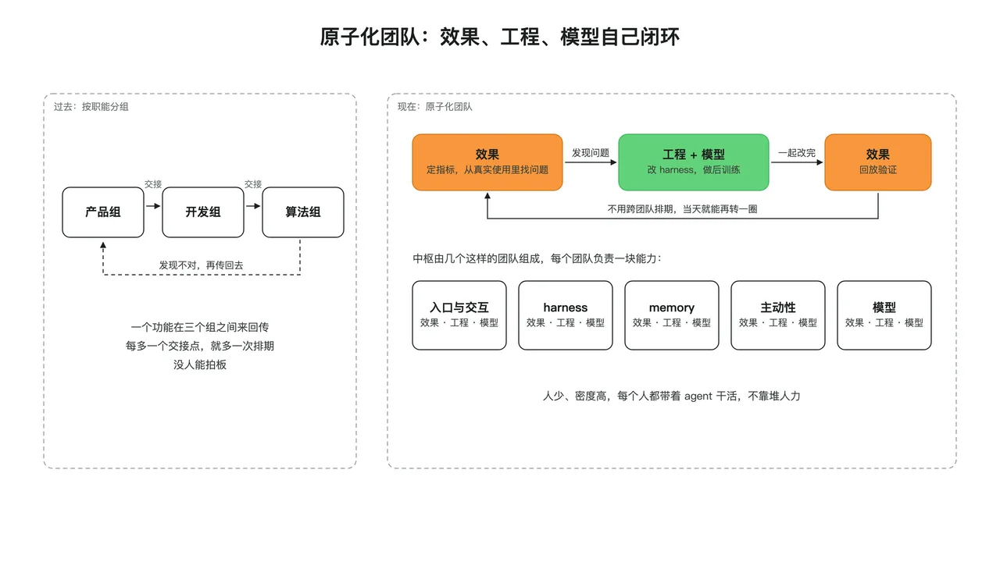

过去按职能分组，一个功能来回交接；现在每个小团队里效果、工程、模型自己闭环

### 产品、harness、模型一起设计

这三者构成一个飞轮：

- 产品上的新功能，沉淀成 harness 里的新 skill；用户使用中暴露的问题，反过来驱动 harness 自我迭代。
- harness 的进步，直接提升用户体验。
- 用户数据回流，用于模型训练；harness 运行时产生的 trace 和环境，成为后训练的题目。
- 模型的进步，又解锁产品的新场景。

每转一圈，产品就更好用、更懂人。

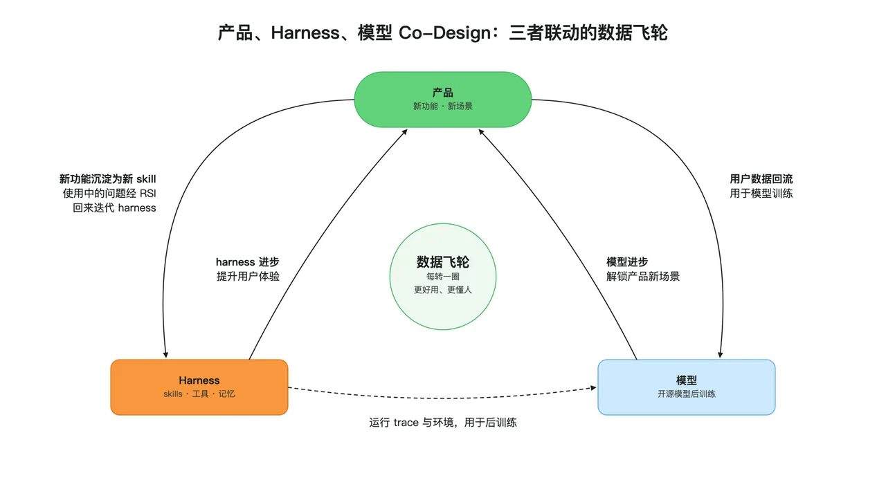

产品、harness、模型三者联动的数据飞轮

## 五、产品：面向 agent 设计

### 对人，越像一个人越好；对 agent，环境越通用越好

落到具体做法上，有六条：

1. **把它当成一个人**：它就是通讯录里的一个联系人，在聊天里说话；不做新 app，不加新 tab。
2. **一定要快**：秒回，说得短；慢的事交给后台，办完再告诉你。
3. **面向 agent 设计产品**：人在产品里能做的，它都能做。
4. **设计环境，不设计功能**：给通用能力，不为单个场景做定制 UI。
5. **做抽象，不做对接**：我们定义类型，用户生成实例。
6. **让功能自己涌现**：只有基础能力才有可泛化性，可泛化性才能涌现出玩法。

拿我自己用过的几件事来看，没有一件是专门做过的功能，都是几样通用能力加上模型自己组合出来的：

| 我让它做的事 | 背后组合的能力 |
| --- | --- |
| 注册一个 Apple 开发者账号 | 搜索查流程 + 浏览器填表 + 邮箱收验证 + 支付留给我确认 |
| 「SFO 还车怎么导航？」 | 记忆里的租车订单 + 日历里的航班 + 当前位置 + 搜索顺路的加油站 |
| 规划一条路线 | 搜索 + 产物：直接交付一张能用的导航 |
| 每天的资讯推送 | 定时触发 + 搜索 + 记忆，随口一句「这类少推点」就改 |

产品团队要做的，是把搜索、浏览器、邮箱、支付、产物、定时这些基础能力做扎实，剩下的交给模型去组合。一件事办成一次，这套做法就沉淀成 skill，下次更快更稳。

### 不设计 UX，设计 AX

每个 agent 产品都有两套界面：给人的，和给 agent 的。这两套界面应该统一。

agent 和人一样是用户：人能做的，它都能做，用的是同一套能力。人怎么发消息、怎么付钱、怎么看通知，它就怎么用。不要为 agent 做定制 UI：做定制 UI，说明你在替用户设想场景，而你设想出来的场景永远做不完。

好的 UX 让人不用思考，好的 AX 让 agent 不用猜。

### context 也是一级一级拿的

用户的信任是一级一级攒的，context 也应该一级一级拿，先用不敏感的，再碰私密的：

1. **用户主动给的**：对话里说的、转过来的文件和链接。
2. **用户已经公开的**：已经公开给朋友的动态和内容。
3. **平台内已经在用的兴趣标签**：内部推荐本来就在用的那些。
4. **逐项授权的**：通知、订单、日程，用户一项一项打开。
5. **最私密的**：聊天记录，只在手机本地读取，不上云；也可以不做。

前四级几乎不碰隐私，已经足够把「替你办事」做好。场景往上走一级，需要的 context 才往上加一级。

### A2A：它不只服务你一个人

personal agent 的下一步，是替你和别人打交道。

- **对商家的 AI**：退款、改签、售后，你的 agent 直接和商家的 AI 客服谈，两边都是 agent，说清楚就办完了。
- **和人在一个群里**：朋友约饭、家里安排出行，把它拉进群，它在群里一起商量，商量完顺手就办了。

在一个本来就承载着人与人关系、商家与用户关系的平台上，这两件事会比任何地方都更自然。

## 六、技术：模型和 harness

### 总览：技术上和过去的 agent 完全不同

| 维度 | Personal agent | 过去的 agent |
| --- | --- | --- |
| 模型 | 快、说人话、调用稳 | 通用大模型，慢 |
| 能力 | 通用能力 + 环境 | 每个场景写专属工具 |
| 执行 | 交互与执行分离，异步 | 同步执行，用户等待 |
| 运行时 | 云端常驻，三者分离 | 单体，随任务结束 |
| Context | 以人为中心，持续积累 | 以任务为中心，用完即丢 |
| 记忆 | 知识图谱，后台整理 | 按任务隔离 |
| 触发 | 事件 + 定时，主动唤醒 | 用户请求 |
| 迭代 | 自己发现问题，自己改 | 人工排查、发版 |
| 隐私 | 敏感数据不出本地，逐项授权 | 整体上传 |

一句话概括：**personal agent 是一个长期存在的进程。** 下面一项项展开。

### 模型：它要的模型，和写代码的 agent 几乎相反

今天最聪明的模型在为写代码优化：任务越复杂越好，交付越长越完整越好，说话像一份报告。personal agent 要的是另外四样东西：

- **快**：交互层必须低延迟。
- **说人话**：短、自然，不写报告。
- **工具调用稳**：智力可以一般，调用不能出错。
- **便宜**：它一直在线。

所以最合理的路线是：选一个快、便宜的开源模型做底座，自己做后训练。训练两类东西：

- **Harness 能力题库**：工具调用、在 app 和网页里操作、memory 读写、说人话。
- **场景题库**：订餐厅、挂号、改签、行程规划、替家人办事。

第一阶段用 SFT 做冷启动和蒸馏：强模型在环境里做题，筛出高质量轨迹，教会模型会用工具、会说人话。第二阶段用 RL：模型在模拟环境里做题，按「完成任务、调用正确、短而像人」拿 reward。上线之后，真实的 trace 和用户反馈回流，变成新的题目。能力是底座，场景是考题。

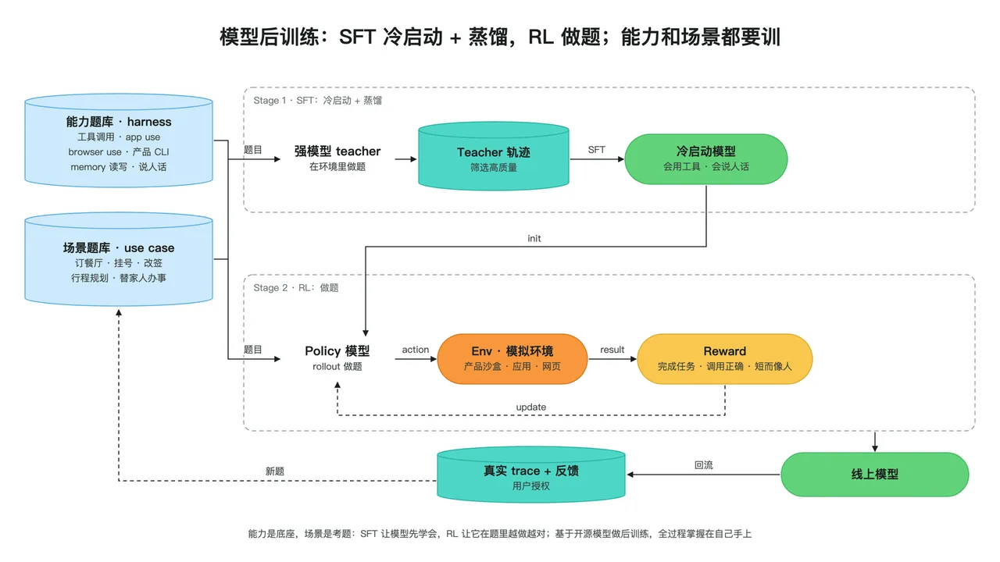

模型后训练：SFT 冷启动加蒸馏，RL 做题，真实 trace 回流成新题

### Harness：给通用能力，让用法自己涌现

agent 要的是一个足够通用的环境。从大量真实需求里抽象出来，大概是这几样：

- **搜索**：访问网络，查任何信息。
- **浏览器**：像人一样操作网页：挂号、预约、下单。
- **应用内操作**：直接用平台里已有的服务：下单、预约、缴费。
- **支付**：授权后替你付钱，碰不到你的卡。
- **多模态**：语音对话、打电话、看图。
- **产物**：直接交付能用的东西，比如一个网页、一张路线图。
- **执行环境**：一个 bash，最低的基础，什么任务都能跑。
- **外部连接器**：日历、文档等各种外部服务。

几个关键的设计：

**极简的 harness。** 一个 agent loop，加上一组通用工具。笨模型需要重 harness，好模型只需要轻 harness；模型每进步一次，harness 就应该删掉一些东西。

极简 harness：一个 loop，加一组通用工具

**把产品的每个操作，镜像成 agent 能用的命令。** 人在产品里能做的每一个操作（发消息、查记录、看通知、付钱）都镜像成一条命令行指令，渐进式披露，逐项授权，避免一次把几百个工具塞给模型。

把人能做的每个操作，镜像成 agent 用的命令

**skills 按需加载。** 把「怎么办成一件事」写成一份说明书，目录常驻在 context 里，用到时才读取全文；一件事办成之后，经验沉淀成新的 skill。

skills：目录常驻，按需读取，成功后沉淀

**外部服务：重要的服务一方接入，其余用 browser use 和 computer use 兜底。** 高频、重要的服务，比如出行、外卖、电商，由服务方自己接入，通过 API 或 MCP 暴露能力，最快最稳。剩下的长尾没有接口也没关系：agent 用 computer use 在 app 里、用 browser use 在网页上，像人一样去办。两条路共用同一套身份授权和支付授权。

对服务方来说，接得越深，越容易被 agent 选中。除了暴露能力，还可以通过 webhook 把事件（订单状态、到店提醒）推给 agent，用卡片把自己的界面带进对话。

外部服务：头部靠一方接入，长尾靠 computer use 和 browser use 兜底

服务方接入：能力、事件、界面

**支付只拿一次性凭证。** 授权 → 支付请求 → 用户确认 → 签发一次性凭证 → 商家扣款 → 留下交易记录。agent 自始至终碰不到用户的卡。

支付：一次性凭证，agent 碰不到卡

### 交互与执行分离

personal agent 必须同时做到「秒回」和「把复杂的事办完」，这两件事在一个同步的 loop 里是矛盾的。解法是把它拆成两层：

- **交互 agent**：用一个低延迟的模型，只负责对话和派发任务，立刻回一句「好，我去办」。
- **work agent**：从任务队列里取任务，在各自的 sandbox 里异步、并发地执行，把进度和交付状态记下来，办完再通过交互 agent 告诉用户；没必要说的，就不出声。

交代很多件事，不用等

交互与执行分离的架构

### Runtime：Harness, Sandbox, Filesystem三者分离

过去的 agent 是一个单体执行环境，生命周期等于一次任务。personal agent 要一直在线，所以要把 **agent runtime、执行环境、存储**三者分开：agent 的状态是持久化的（durable execution），执行环境可以按需在云端或本地调度，存储独立于任何一次执行。任何一块挂掉，都不影响它记得你、接着办。

这样拆开，最直接的好处是**成本**。如果给每个用户配一台一直开着的云端电脑，一个月要 10 美元左右；三者分开以后，agent 的状态存在持久化的存储里，执行环境只在真正有活的时候才拉起来，办完就释放，一个用户一个月可以压到 1 美元以下。对一个要一直在线、服务海量用户的产品，这是能不能做的前提。

agent runtime、执行环境、存储三者分离

### Context：围绕人，分层加载

personal agent 管理的是一条永远不结束的对话，所以 context 不能是「把所有历史塞进去」。它应该分层：人设、工具、skills 目录、关于你、相关记忆、正在进行的事、当前对话、任务说明。交互 agent 和 work agent 各取所需。

分层 context

### Memory：围绕人和关系的知识图谱

过去的做法是按任务隔离的记忆，加一个关于用户的大文件。personal agent 需要的是一张围绕人和关系的知识图谱：你、你的家人朋友、你正在办的事、你的偏好，彼此连在一起；后台还有一个持续整理记忆的进程，合并、修正、遗忘。

记忆本质上是一个推荐问题：在这一刻，哪些关于你的信息最值得被想起来。

从按任务隔离的记忆，到围绕人和关系的知识图谱

### 主动性：两级触发

主动不能靠让大模型一直盯着，那太贵也太吵。做法是两级触发：

1. **规则快速过滤**：事件（新邮件、新订单、新通知）和定时任务进来，先用便宜的规则判断要不要处理。
2. **agent 按需判断**：通过过滤的，才交给 agent 去判断：提醒你、问你，还是不出声，并且把进度记下来。

这也是克制在技术上的实现：大部分事件，最后的结论都应该是「不打扰」。

两级触发：规则过滤，agent 按需判断

### 自我迭代

用户每天都会遇到各种小问题，靠人工一条条排查是跟不上的。做法是让 personal agent 自己有一个上报问题的工具：遇到做不好的事，它把问题和上下文报上来；一个独立的 coding agent 读这些 issue 和运行 trace，去改 harness；改完在历史 trace 上回放验证，通过之后才灰度上线。

自我迭代：上报问题、coding agent 修改、回放验证、灰度上线

### 隐私：画一条清楚的线

agent loop 在云端，最敏感的数据留在手机上的本地执行环境里，比如聊天记录，不越过这条线。云端需要的，是经过用户逐项授权的那部分。这条线画得越清楚，用户敢交出来的就越多。

Muse 的做法可以参考（据 Meta 公开的说明）：

- **独立的审查进程**：一个和 agent 隔离的 Sentinel，检查 agent 的每一个对外动作是否在用户授权范围内，放行、拦截，或者交给用户确认。
- **凭证不进模型**：账号的 token 和密码存在单独的凭证服务里，按需发给执行环境，模型本身看不到。
- **敏感动作先问**：发邮件、下单这类动作，先经用户确认。
- **用户能看、能收回**：每个连接可以选只读还是可写，随时撤销；做过的事有记录可查；也可以让它忘掉记住的信息。

安全：agent 的每个对外动作，都要先过一道关

## 结语

1. **定义**：personal agent 是一种生活方式。工具按场景定义，它没有 killer use case，靠一件件小事攒成替代不掉的习惯：任何事，默认先交给它。
2. **8P 原则**：好的 personal agent 就是做一个人。像人一样出现，像人一样说话，一直在，懂你，先想到，有分寸，能办事，靠得住。
3. **上限**：智力已经溢出，模型决定下限，context 和闭环决定上限；context 的价值是指数级增长的。
4. **组织**：上一代的做法做不出 personal agent。负责人最好同时懂模型、工程和产品，团队是效果、工程、模型自己闭环的原子团队。
5. **产品**：不设计功能，设计环境。给 agent 通用能力，让用法从真实使用里自己长出来；不设计 UX，设计 AX。
6. **技术**：交互与执行分离，runtime 三者分离，context 分层，memory 做成知识图谱，两级触发，自我迭代，隐私画一条清楚的线。

所以最难的部分不在技术，在产品上的克制和 AI Native 组织：敢于只做环境，并且让一个懂三层的人、一支小而全的团队，把产品、harness 和模型放在一起设计。

**当你不再觉得自己在用一个 AI 产品的时候，它就成了。**

**下一篇预告。** 这是《如何做出好的 Personal Agent 产品》的第一部分，讲的是产品、团队和技术。第二部分讲商业模式和战略：平台税会不会被打下来，软件和硬件谁会成为入口，大公司和创业公司各自怎么赢。
