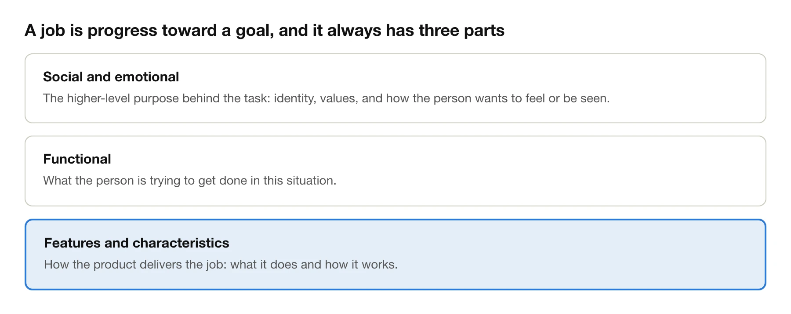
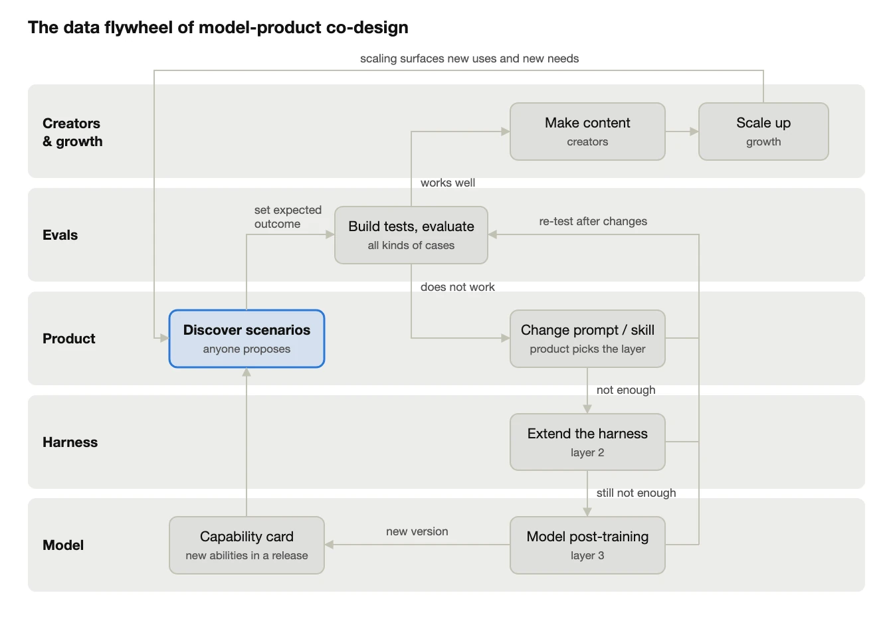
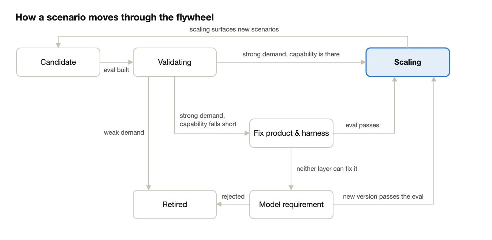

Every time GPT or Claude ships a new model, X fills up with jaw-dropping work: nine casual photos turned into a 3D studio you can walk through, a paper turned into an eight-minute explainer video, one person building an original game in 24 hours.

Look again a few months later, and most AI products are the same as before.

The model made the demo. It did not make the product. The gap between the two is what this essay is about: in the age of AI, a product has to be designed together with the model.

*I'm Jin Shang, CEO of Offloop. This essay comes out of our recent work at Offloop on co-designing models and products.*

## Key takeaways

**Designing the product is designing the scenario. Designing the scenario is designing the eval. Designing the eval is designing the model.**

- An AI product's capability comes from the model, so the product has to be designed together with the model: growth, evals, product, harness, and model all iterate around the same scenario.
- Two things are the hardest: finding the scenario users actually want, and turning it into a good eval.

## 1. How AI products differ from traditional products

- A traditional product goes from requirement to feature. Engineers write the feature, and once it is written it stays fixed.
- An AI product's capability comes from the model, and the model changes every few months. What it cannot do today, the next version may do. A feature you force together with prompts today, the next version may simply know how to do.
- So an AI product cannot be built from a feature list. A better way is to first write down who it is for, what they want done, and how good counts as done, and then see which part the model, the harness, and the product each need to fill in. That is the scenario described below.

## 2. Model-product co-design around the scenario

The scenario is the basic unit for designing an AI product:

> **Scenario = People × Task × Capability × Expected outcome**

For example: figure collectors × turn a character image into a figure × 3D generation × a printable model with correct anatomy within a day.

The examples in the table below all come from real work people posted on X using new models such as GPT and Claude.

| People | Task | Capability | Expected outcome | Source |
| --- | --- | --- | --- | --- |
| Real estate agents, landlords | Turn a few listing photos into a walkable 3D home and a promo video | 3D reconstruction | Listing prep drops from days to hours; the layout matches the photos | [Zillow listing](https://x.com/realYunfanYe/status/2095612137582526615), [studio from 9 photos](https://x.com/rpnickson/status/2097488440489116111) |
| Robotics researchers | Watch a video of a person demonstrating a task and have a robot arm do the same | Robot control | Gets it right on the first try; success rate meets the bar | [learning from physical demonstration](https://x.com/_wenlixiao/status/2097801944119349455) |
| Researchers, students | Turn a paper into an eight-minute explainer video | Rendering video with code | The main thread is clear and there are no factual errors | [3Blue1Brown style](https://x.com/deedydas/status/2103141339651350646) |
| Parents with kids | Build a playable open-world game from the kid's ideas | Game generation | Done in an afternoon, and the kid wants to keep playing | [making a game with my son](https://x.com/DannyLimanseta/status/2104215873120764032) |
| Indie developers | Build an original game alone | Game generation | A playable version within 24 hours | [full workflow](https://x.com/xikhar/status/2117776295534997818) |
| Patients | Understand what their injury actually is | Interactive 3D explanation | Can explain the injury in their own words, matching the doctor's conclusion | [ankle anatomy](https://x.com/Emanuel_Andre7/status/2096528986390085696) |
| Busy urban professionals | Send a voice message to buy daily goods, order groceries, book a cleaner | Personal errands | The right things get bought, without placing the order yourself | [Meta Muse](https://x.com/nicbstme/status/2101738613851803877) |
| Travelers abroad | Book a full itinerary and talk to hotels in the local language | Personal errands | Every meal is booked, without making a single call yourself | [Japan itinerary](https://x.com/Han_Fang_/status/2101874865385169348) |

- Jobs-to-be-Done, a framework widely used in consumer goods, is a good way to analyze a scenario.
- A need can be functional, and it can also be social or emotional.
- JTBD comes down to: **who**, in **what situation**, **wants to do what**, to get **what outcome**.

A job has three parts: the functional need, the social and emotional need, and the product's features.

## 3. Why the eval is the core

- If the expected outcome cannot be written as a test you can run again and again, you cannot tell whether a change made things better or worse, and the product cannot iterate.
- The reverse also holds. With a good enough eval, and a model whose basic ability is at a passing level, raising that capability becomes very easy: changing prompts, extending the harness, and post-training all have a clear target.
- Shunyu Yao makes the same point in *The Second Half*: the first half of AI was about who had the better training method, and the second half is about who can define the right problem and design a good eval.

## 4. The team

- Product leads everything. The product lead decides which scenarios to bet on first and which layer to change, and coordinates the other roles. Product and harness can be the same group of people.
- Model, evals, and growth each have their own team. Evals are best kept black-box.

| Role | What it takes in practice |
| --- | --- |
| Product lead | A lot: has to understand product, engineering, models, and growth, and lead the whole thing |
| Product manager | User research skills and hands-on engineering ability |
| Harness engineering | Abstraction and system design |
| Model | Technical judgment and data skills |
| Evals | Independence, rigor, organizational efficiency |
| Growth | Strong execution and solid data |
| Creators | Heavy model users with taste |

| Role | Dimensions it cares about | Scenario leads it can provide | What it owns |
| --- | --- | --- | --- |
| Growth | People, task | New needs and new uses in community, user, and content feedback | Amplifying once the eval passes |
| Evals | Task, expected outcome | Unexpected failures or unexpectedly high scores | Building tests for each new scenario and judging whether each change passes |
| Product | All four | User analysis, community content, an understanding of the model | Deciding which scenarios to bet on first and which layer to change: prompts and skills, the harness, or the model |
| Harness | Capability | After a new tool or environment is connected, the model can do things it could not do before | Providing the runtime, tools, and context, and filling in general capabilities |
| Model | Capability | New capabilities that show up during training | A capability card before each release; taking scenario packs for post-training or model selection |

The product lead is the biggest single point of failure in this setup. They need product design ability and an understanding of engineering, models, and growth at the same time.

## 5. The workflow

- Anyone can discover a scenario, and product collects them into a scenario table. Product finds scenarios in the unexpected ways users use the product. The other roles provide leads: community and customer needs that growth sees, unexpected results in evals, tools and environments newly connected to the harness, new capabilities that show up in model training.
- A new scenario gets an eval first: the expected outcome is written as repeatable tests with scoring criteria. (This is very hard!)
- If the eval passes, creators make content around the scenario and growth scales it up. If it does not pass, it goes back to product, which decides which layer to change, and it is evaluated again after the change.

The data flywheel of model-product co-design

- Changes come in three layers, from easy to hard: prompts and skills; the harness; model post-training.
- Each time the model iterates, the first two layers get simpler.
- Most scenarios can be made to work in the first two layers. Only the ones neither layer can solve go to model post-training.
- Keep the model and the harness as general as possible. The product layer can be customized to the product's form. General things stay at the bottom and specific things go on top, which follows the end-to-end principle (the classic 1984 system design paper by Saltzer, Reed, and Clark).
- The new uses and new needs that scaling brings out become new scenarios in turn.

How a scenario moves through the flywheel

## Closing

Models will keep getting stronger, and demos will keep getting easier to make. Two things are truly scarce: knowing what outcome users actually want, and being able to turn that outcome into a test you can run again and again.

The next time a new model ships, do not rush to build a demo. First write down your scenario: who it is for, what they want done, and how good counts as done. If you can write it, you have a starting point for a product. If you cannot, no number of demos will amount to more than noise.

## References

- Shunyu Yao, [The Second Half](https://ysymyth.github.io/The-Second-Half/)
- J. H. Saltzer, D. P. Reed, D. D. Clark, *End-to-End Arguments in System Design* (1984)
