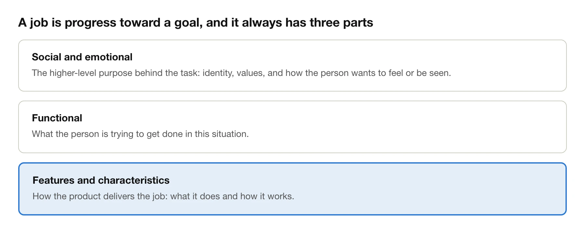
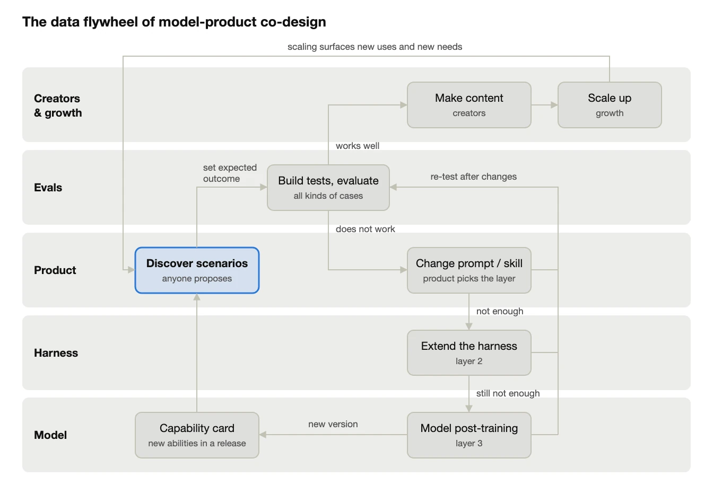
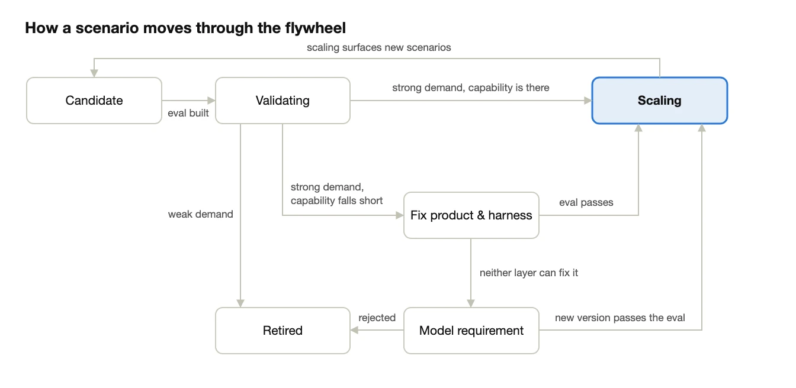

Every time GPT or Claude ships a new model, X fills up with jaw-dropping work: nine casual photos turned into a 3D studio you can walk through, a paper turned into an eight-minute explainer video, one person building an original game in 24 hours.

Look again a few months later, and most AI products are the same as before.

The model made the demo. It did not make the product. The gap between the two is what this essay is about: in the age of AI, a product has to be designed together with the model.

*I'm Jin Shang, CEO of Offloop. This essay comes out of our recent work at Offloop on co-designing models and products.*

## Key takeaways

**Designing the product is designing the scenario. Designing the scenario is designing the eval. Designing the eval is designing the model.**

- An AI product's capability comes from the model, so the product has to be designed together with the model: growth, evals, product, harness, and model all iterate around the same scenario.
- Two things are the hardest: finding the scenario users actually want, and turning it into a good eval.

## 1. How AI products differ from traditional products

- A traditional product goes from requirement to feature. Engineers write the feature, and once it is written it stays fixed.
- An AI product's capability comes from the model, and the model changes every few months. What it cannot do today, the next version may do. A feature you force together with prompts today, the next version may simply know how to do.
- So an AI product cannot be built from a feature list. A better way is to first write down who it is for, what they want done, and how good counts as done, and then see which part the model, the harness, and the product each need to fill in. That is the scenario described below.

## 2. Model-product co-design around the scenario

The scenario is the basic unit for designing an AI product:

> **Scenario = People × Task × Capability × Expected outcome**

For example: figure collectors × turn a character image into a figure × 3D generation × a printable model with correct anatomy within a day.

The examples in the table below all come from real work people posted on X using new models such as GPT and Claude.

| People | Task | Capability | Expected outcome | Source |
| --- | --- | --- | --- | --- |
| Real estate agents, landlords | Turn a few listing photos into a walkable 3D home and a promo video | 3D reconstruction | Listing prep drops from days to hours; the layout matches the photos | [Zillow listing](https://x.com/realYunfanYe/status/2095612137582526615), [studio from 9 photos](https://x.com/rpnickson/status/2097488440489116111) |
| Robotics researchers | Watch a video of a person demonstrating a task and have a robot arm do the same | Robot control | Gets it right on the first try; success rate meets the bar | [learning from physical demonstration](https://x.com/_wenlixiao/status/2097801944119349455) |
| Researchers, students | Turn a paper into an eight-minute explainer video | Rendering video with code | The main thread is clear and there are no factual errors | [3Blue1Brown style](https://x.com/deedydas/status/2103141339651350646) |
| Parents with kids | Build a playable open-world game from the kid's ideas | Game generation | Done in an afternoon, and the kid wants to keep playing | [making a game with my son](https://x.com/DannyLimanseta/status/2104215873120764032) |
| Indie developers | Build an original game alone | Game generation | A playable version within 24 hours | [full workflow](https://x.com/xikhar/status/2117776295534997818) |
| Patients | Understand what their injury actually is | Interactive 3D explanation | Can explain the injury in their own words, matching the doctor's conclusion | [ankle anatomy](https://x.com/Emanuel_Andre7/status/2096528986390085696) |
| Busy urban professionals | Send a voice message to buy daily goods, order groceries, book a cleaner | Personal errands | The right things get bought, without placing the order yourself | [Meta Muse](https://x.com/nicbstme/status/2101738613851803877) |
| Travelers abroad | Book a full itinerary and talk to hotels in the local language | Personal errands | Every meal is booked, without making a single call yourself | [Japan itinerary](https://x.com/Han_Fang_/status/2101874865385169348) |

- Jobs-to-be-Done, a framework widely used in consumer goods, is a good way to analyze a scenario.
- A need can be functional, and it can also be social or emotional.
- JTBD comes down to: **who**, in **what situation**, **wants to do what**, to get **what outcome**.

A job has three parts: the functional need, the social and emotional need, and the product's features.

## 3. Why the eval is the core

- If the expected outcome cannot be written as a test you can run again and again, you cannot tell whether a change made things better or worse, and the product cannot iterate.
- The reverse also holds. With a good enough eval, and a model whose basic ability is at a passing level, raising that capability becomes very easy: changing prompts, extending the harness, and post-training all have a clear target.
- Shunyu Yao makes the same point in *The Second Half*: the first half of AI was about who had the better training method, and the second half is about who can define the right problem and design a good eval.

## 4. The team

- Product leads everything. The product lead decides which scenarios to bet on first and which layer to change, and coordinates the other roles. Product and harness can be the same group of people.
- Model, evals, and growth each have their own team. Evals are best kept black-box.

| Role | What it takes in practice |
| --- | --- |
| Product lead | A lot: has to understand product, engineering, models, and growth, and lead the whole thing |
| Product manager | User research skills and hands-on engineering ability |
| Harness engineering | Abstraction and system design |
| Model | Technical judgment and data skills |
| Evals | Independence, rigor, organizational efficiency |
| Growth | Strong execution and solid data |
| Creators | Heavy model users with taste |

| Role | Dimensions it cares about | Scenario leads it can provide | What it owns |
| --- | --- | --- | --- |
| Growth | People, task | New needs and new uses in community, user, and content feedback | Amplifying once the eval passes |
| Evals | Task, expected outcome | Unexpected failures or unexpectedly high scores | Building tests for each new scenario and judging whether each change passes |
| Product | All four | User analysis, community content, an understanding of the model | Deciding which scenarios to bet on first and which layer to change: prompts and skills, the harness, or the model |
| Harness | Capability | After a new tool or environment is connected, the model can do things it could not do before | Providing the runtime, tools, and context, and filling in general capabilities |
| Model | Capability | New capabilities that show up during training | A capability card before each release; taking scenario packs for post-training or model selection |

The product lead is the biggest single point of failure in this setup. They need product design ability and an understanding of engineering, models, and growth at the same time.

## 5. The workflow

- Anyone can discover a scenario, and product collects them into a scenario table. Product finds scenarios in the unexpected ways users use the product. The other roles provide leads: community and customer needs that growth sees, unexpected results in evals, tools and environments newly connected to the harness, new capabilities that show up in model training.
- A new scenario gets an eval first: the expected outcome is written as repeatable tests with scoring criteria. (This is very hard!)
- If the eval passes, creators make content around the scenario and growth scales it up. If it does not pass, it goes back to product, which decides which layer to change, and it is evaluated again after the change.

The data flywheel of model-product co-design

- Changes come in three layers, from easy to hard: prompts and skills; the harness; model post-training.
- Each time the model iterates, the first two layers get simpler.
- Most scenarios can be made to work in the first two layers. Only the ones neither layer can solve go to model post-training.
- Keep the model and the harness as general as possible. The product layer can be customized to the product's form. General things stay at the bottom and specific things go on top, which follows the end-to-end principle (the classic 1984 system design paper by Saltzer, Reed, and Clark).
- The new uses and new needs that scaling brings out become new scenarios in turn.

How a scenario moves through the flywheel

## Closing

Models will keep getting stronger, and demos will keep getting easier to make. Two things are truly scarce: knowing what outcome users actually want, and being able to turn that outcome into a test you can run again and again.

The next time a new model ships, do not rush to build a demo. First write down your scenario: who it is for, what they want done, and how good counts as done. If you can write it, you have a starting point for a product. If you cannot, no number of demos will amount to more than noise.

## References

- Shunyu Yao, [The Second Half](https://ysymyth.github.io/The-Second-Half/)
- J. H. Saltzer, D. P. Reed, D. D. Clark, *End-to-End Arguments in System Design* (1984)

<!--translation-->

每次 GPT 或 Claude 发新模型，X 上都会冒出一批“惊掉下巴”的作品：9 张随手拍的照片变成能漫游的 3D 工作室，一篇论文变成 8 分钟的讲解视频，一个人 24 小时做出一款原创游戏。

但过几个月再看，大部分 AI 产品还是老样子。

demo 是模型做出来的，产品不是。中间差的这一截，就是这篇文章要讲的：AI 时代的产品，得和模型一起设计。

*本文作者是 Offloop 的 CEO 尚晋，本文基于过去一段时间 Offloop 在模型产品 Co-design 上的探索。*

## 核心结论

**设计产品就是设计场景，设计场景就是设计评测，设计评测就是设计模型。**

- AI 产品的能力来自模型，所以产品要和模型一起设计：增长、评测、产品、Harness 和模型围绕同一个场景一起迭代。
- 最难的是两件事：找到用户真正想要的场景，把它变成好的评测。

## 一、AI 产品和传统产品哪里不一样

- 传统产品是“需求 → 功能”：功能是工程师写出来的，写完就固定了。
- AI 产品的能力来自模型，而模型每几个月就变一次。今天做不到的事，下个版本可能就能做；今天靠 Prompt 硬凑的功能，下个版本可能直接就会了。
- 所以 AI 产品没法照着功能清单做。更好的做法是先写清楚“谁、要做成什么、做到什么程度算成”，再看模型、Harness、产品各补哪一块。这就是下面说的场景。

## 二、围绕场景的模型-产品 Co-design

场景是设计 AI 产品的基本单位：

> **场景 = 人群 × 任务 × 能力 × 期望结果**

比如“手办爱好者 × 把角色图做成手办 × 3D 生成 × 一天内拿到能打印、人物结构正确的模型”。

下表的例子都来自 X（Twitter）上大家用 GPT、Claude 等新模型做出来的真实作品。

| 人群 | 任务 | 能力 | 期望结果 | 出处 |
| --- | --- | --- | --- | --- |
| 房产中介、房东 | 几张房源照片变成可漫游的 3D 房子和宣传片 | 3D 重建 | 挂牌准备从几天缩到几小时，空间布局和照片一致 | [Zillow 房源](https://x.com/realYunfanYe/status/2095612137582526615)、[9 张照片的工作室](https://x.com/rpnickson/status/2097488440489116111) |
| 机器人研究者 | 看一段人的示范视频，让机械臂照着做 | 机器人控制 | 第一次就能照做，成功率达标 | [物理示范学习](https://x.com/_wenlixiao/status/2097801944119349455) |
| 研究者、学生 | 一篇论文变成 8 分钟讲解视频 | 写代码渲染视频 | 讲清主线，内容没有事实错误 | [3Blue1Brown 风格](https://x.com/deedydas/status/2103141339651350646) |
| 带孩子的家长 | 按孩子的想法做一个能玩的开放世界小游戏 | 游戏生成 | 一个下午做出来，孩子愿意反复玩 | [和儿子一起做游戏](https://x.com/DannyLimanseta/status/2104215873120764032) |
| 独立开发者 | 一个人做出一个原创游戏 | 游戏生成 | 24 小时内做出能玩的版本 | [完整工作流](https://x.com/xikhar/status/2117776295534997818) |
| 患者 | 看懂自己的伤病是怎么回事 | 交互式 3D 讲解 | 能用自己的话讲清伤情，和医生的结论一致 | [踝关节解剖图](https://x.com/Emanuel_Andre7/status/2096528986390085696) |
| 忙碌的城市白领 | 发条语音就买日用品、订菜、约保洁 | 个人代办 | 买对东西，不用自己下单 | [Meta Muse](https://x.com/nicbstme/status/2101738613851803877) |
| 出境游客 | 订完整行程，用当地语言和酒店沟通 | 个人代办 | 每顿饭都订到位，不用自己打电话 | [日本行程](https://x.com/Han_Fang_/status/2101874865385169348) |

- 可以通过消费行业常用的 Job-To-Be-Done 来分析场景。
- 需求可以是功能性的，也可以是来自社交/情感的。
- JTBD 就是【谁】在【什么情景】下【希望做什么】来获取【什么结果】。

Job 由功能需求、社交/情感需求和产品特性三部分组成

## 三、为什么评测是核心

- 期望结果写不成能反复测的题，就没法判断一次修改是变好还是变坏，产品也就没法迭代。
- 反过来，只要有足够好的评测，模型又有及格线的基础能力，就能非常容易地把这项能力提上去：改 Prompt、补 Harness、做后训练，都有了明确的目标。
- 姚顺雨在 *The Second Half* 里讲的也是这件事：AI 的上半场比的是谁的训练方法好，下半场比的是谁能定义对问题、设计好评测。

## 四、团队配置

- 产品统领全局：产品负责人决定先押哪些场景、改哪一层，并协调其他角色。产品和 Harness 可以是同一组人。
- 模型、评测、增长各由单独的团队负责。评测最好是黑箱的。

| 角色 | 现实要求 |
| --- | --- |
| 产品负责人 | 很高，产品、工程、模型、增长都要懂，统领全局 |
| 产品经理 | 用户研究能力、Hands on 工程能力 |
| Harness 工程 | 抽象能力、系统设计能力 |
| 模型 | 技术判断力、数据能力 |
| 评测 | 独立、严谨、组织效率 |
| 增长 | 执行力强，数据扎实 |
| 创作者 | 重度用模型，有审美 |

| 角色 | 看重的维度 | 能提供的场景线索 | 负责什么 |
| --- | --- | --- | --- |
| 增长 | 人群、任务 | 社区、用户和内容反馈里的新需求、新玩法 | 评测达标后放大声量 |
| 评测 | 任务、期望结果 | 意外的失败或意外的高分 | 给每个新场景建题，判断每次修改是否达标 |
| 产品 | 四个都管 | 用户分析、社区内容、对模型的理解 | 决定先押哪些场景，选择改哪一层，改 Prompt 和 Skill、改 Harness 还是改模型 |
| Harness | 能力 | 接入新工具或环境后，模型能做以前做不了的事 | 提供运行环境、工具和上下文，补通用能力 |
| 模型 | 能力 | 训练中出现的新能力 | 发布前给能力卡，接场景包做后训练或选型 |

产品负责人是这套机制最大的单点，必须有产品设计能力的同时懂工程、模型和增长。

## 五、工作流

- 任何人都可能发现场景，由产品汇总进场景表：产品自己从用户的意外用法里找，其他角色提供线索，比如增长看到的社区和客户需求、评测里意外的结果、Harness 新接入的工具和环境、模型训练中出现的新能力。
- 新场景先建评测，把期望结果写成能反复测的题目和打分标准（非常难！）
- 评测达标，创作者围绕场景做内容，增长去放量；评测不达标，打回产品，由产品决定改哪一层，改完重新评测。

模型产品 Co-design 的数据飞轮

- 修改分三层，从简单到难：Prompt 和 Skill；Harness；模型后训练。
- 模型每迭代一次，前两层就简化一次。
- 大多数场景在 Prompt、Skill 和 Harness 这两层就能做成，只有这两层都做不到的，才进模型后训练。
- 模型和 Harness 尽量做通用；产品层可以按产品形态做定制。通用的留在底层，专用的放在上层，这符合 end-to-end principle（1984 年 Saltzer、Reed、Clark 的经典系统设计论文）。
- 放大后带出的新玩法和新需求，又会变成新的场景。

场景流转的数据飞轮

## 写在最后

模型会越来越强，demo 会越来越容易做。真正稀缺的是两件事：知道用户到底想要什么结果，并且能把这个结果变成一道能反复测的题。

下次新模型发布，先别急着做 demo，先写下你的场景：谁、要做成什么、做到什么程度算成。写得出来，就有了产品的起点；写不出来，做多少 demo 都只是热闹。

## 参考

- 姚顺雨，[The Second Half](https://ysymyth.github.io/The-Second-Half/)
- J. H. Saltzer、D. P. Reed、D. D. Clark，*End-to-End Arguments in System Design*（1984）
