At nine in the morning, Loopie sends me its daily brief on WeChat: two new candidates are waiting for my call. My co-founder is traveling for the next two days, so it suggests I look at them directly. Each candidate comes with one line: the screening score, what they have built, and which interview round it recommends. At the end it reminds me that a candidate from the day before is still undecided.

I reply with one sentence: "I'll interview both. Send me the résumés." A few minutes later both résumés are in my hands, and Loopie has already gone into each candidate's channel to tell the HR agent and the recruiter to find a time. The next day it simply sends the candidates my calendar booking link and lets them pick a slot. It only comes back to me when no time works at all.

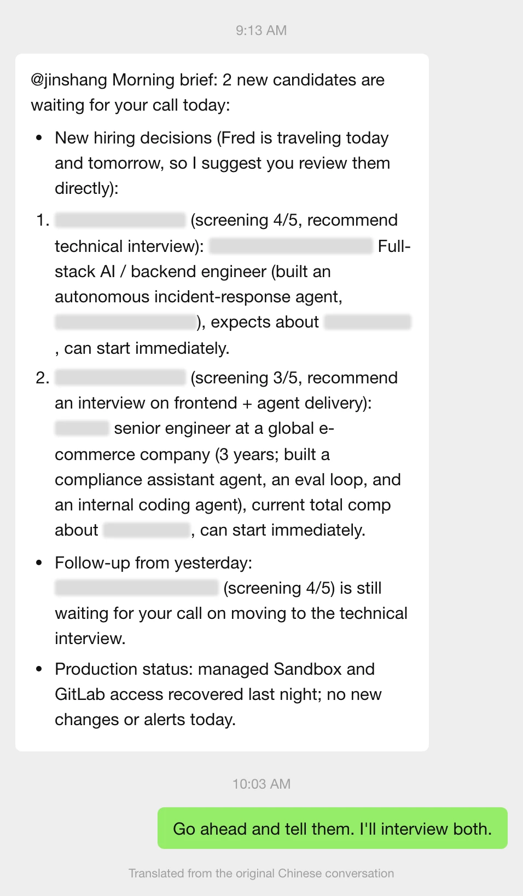

The morning brief, translated from Chinese, with candidate details blurred: two new candidates, a screening score and a recommended next round for each, and a reminder about one left over from the day before.

From sourcing and screening to background checks and scheduling, I made exactly one decision in this whole process: interview or not.

We get messages like this every day. Our company has no full-time HR person and no full-time finance person. Agents do the recruiting and the bookkeeping. We also have a product called Readever that is run entirely by agents, from growth to product iteration, without a single dedicated employee.

Offloop is the product we are building: a workspace where agent employees and people work together. An agent employee has its own role and responsibilities. It stays on the job, moves work forward on its own, and comes to a person only when a judgment is needed. For the past year we have been building this product and running our own company on it at the same time.

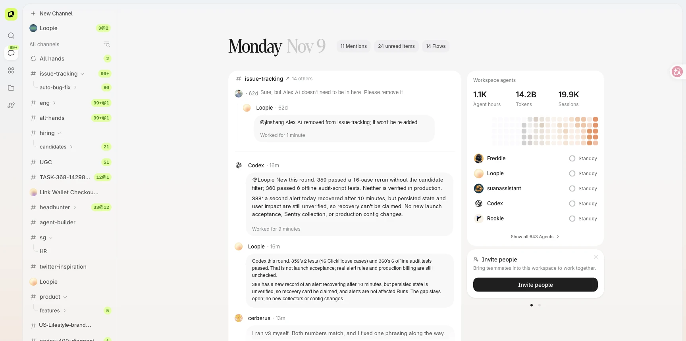

The Offloop workspace home: channels organized by function on the left, the messages that need my attention in the middle, and the agent employees on duty on the right. Message text translated from Chinese.

All of this kept me thinking about one question: what should an AI-native organization actually look like? This essay is my answer. It starts from a very old question: why do organizations divide labor at all?

## 1. Why we divided labor in the first place

### Two reasons to divide labor

- **Ability.** No one can do everything.
- **Time.** One person can do it, but cannot do all of it. This is often the real constraint. Someone who understands product, engineering, algorithms, and evaluation still has only a dozen or so working hours in a day, so the work gets split into four jobs.

### What each split costs

In *The Mythical Man-Month*, Fred Brooks wrote down the observation that later became known as Brooks's law:

> Adding manpower to a late software project makes it later.

The reason is communication. Among n people there are n(n−1)/2 lines of communication. Triple the headcount and the number of lines grows roughly tenfold. New people first need time to learn the project's context, and the people already on it have to stop working to explain it.

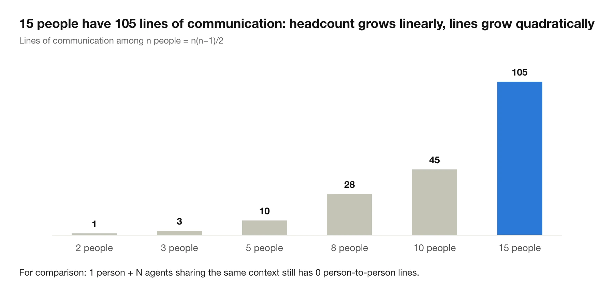

Brooks's answer was the "surgical team": one chief surgeon who owns the core design and the key decisions, with everyone else in a supporting role. That gives up some parallelism in exchange for conceptual integrity. The system has one person's thinking in it from start to finish, and is not stitched together from many. In his view that mattered more than a few extra pairs of hands.

Later, in *No Silver Bullet*, he separated two kinds of complexity. One comes from tools and implementation: languages, compilers, debugging. The other comes from the problem itself: what exactly to build, and how the parts fit together. Better tools keep reducing the first kind. The second kind does not go away. What AI solves today is mostly the first kind too.

Brooks was writing about a single team. Scale the same cost up to a whole company and it decides where the company's boundary sits. In 1937 Ronald Coase asked a very basic question: if markets can coordinate the division of labor through prices, why do firms exist at all? His answer in *The Nature of the Firm*:

> The main reason why it is profitable to establish a firm would seem to be that there is a cost of using the price mechanism.

Getting something done through the market means finding people, negotiating, signing contracts, and monitoring delivery. When those costs are higher than the cost of arranging the work inside a company, the work moves inside. Put another way, work that needs context passed back and forth all the time ends up inside the firm.

Oliver Williamson built on Coase and spelled out which work belongs inside: the more specific it is to this company (knowledge and relationships that are only useful here), the more uncertain, the more frequent, and the harder to measure, the more reason to do it yourself. In today's terms, the more a piece of work depends on internal context, the more it should stay in the company.

From one team to one company, the conclusion is the same. Dividing labor adds capacity, but every additional split adds another round of passing context. We accepted that cost because without the split, the work would never get done.

## 2. Have these constraints been lifted?

The time constraint is mostly gone. The ability constraint is partly gone. The cost of dividing labor has not moved at all.

| | Before | Now |
| --- | --- | --- |
| Time | Could do it, but not all of it | Mostly lifted: execution goes to agents, and one person can move two or three things forward at once |
| Ability | No one can do everything | Partly lifted: agents cover the weak spots |
| Cost of dividing labor | Every handoff means passing the context again | Unchanged: people still hold meetings, write documents, and confirm things over and over |

The reasons for dividing labor are disappearing. The cost of dividing labor is still here.

This means that, for the first time, a highly capable person can be used in full. Take product and engineering. These used to be two people: product wrote a requirements document and handed it to engineering, and if engineering understood it slightly differently, the result had to be redone. Now one person reads the user feedback, works out what to change, has an agent write the code and run the tests, and then judges the result. There is no handoff in the middle, so there is nothing to misunderstand.

Hire one more person and you add a pile of communication. Add one more agent and you only add capacity. The condition is that all of these agents see the same context.

## 3. The new bottlenecks

Once execution is no longer scarce, three other things are.

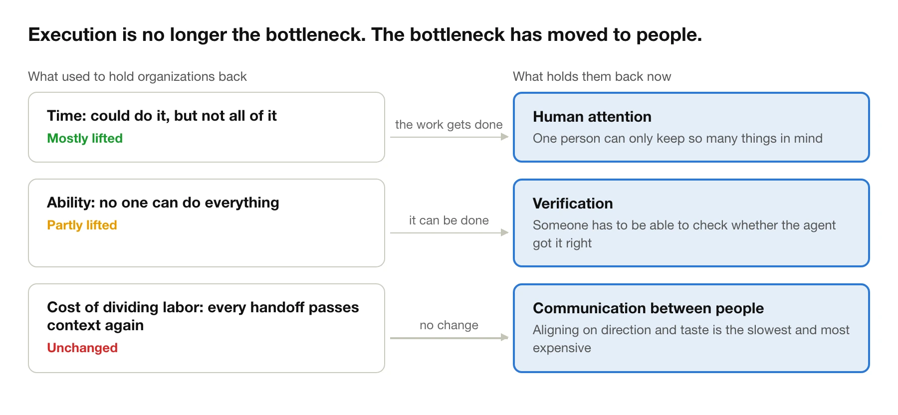

1. **Human attention.** There is a limit to how many things one person can keep in mind at once. With agents that number goes from one to maybe two or three. Beyond that, judgment starts to slip.
2. **Communication between people.** Agents share context with each other at almost no cost. An agent coming to a person takes up that person's attention. People aligning with each other on direction and taste is the slowest and most expensive of all.
3. **Verification.** Agents produce more and more, and the people and standards that can tell good from bad do not keep up. Whether you can hand a piece of work to an agent with confidence depends on whether its correctness can be checked.

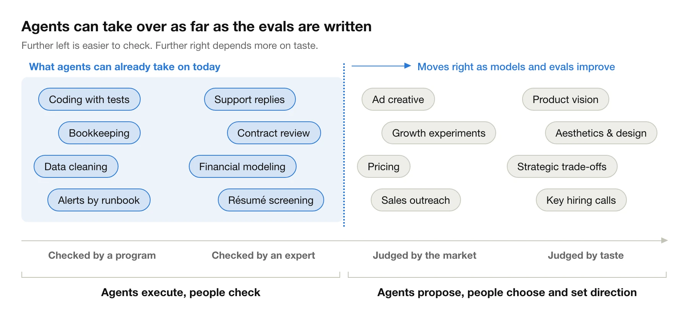

The further left a piece of work sits, the more it has a right answer, and the more it can already be handed to agents. The further right, the more it depends on taste, and the harder it is to know quickly whether it was done well, so people still have to do it. Agents can take over exactly as far as the evals have been written. That is why the scarcest people in an organization are the ones on the right: those who can set direction and make trade-offs.

## 4. Do the old organizational practices still hold?

Treating the cost of passing context as the central problem of organization is not a new idea. For decades good companies have used management systems to push that cost down. They differ only in the means. I count five kinds of practice:

| Practice | Who does it | What it depends on |
| --- | --- | --- |
| Write the context down and make it public | Netflix talks about "context, not control"; Amazon reads a six-page memo before every meeting; Meta's code and documents are open to almost every employee | Someone willing to write and someone with time to read; documents go stale and need a maintainer |
| Keep teams small | Amazon's two-pizza teams; Basecamp staffs a project with one designer and one or two engineers | Everyone has to be very good; Netflix hiring only the best is the price of this |
| One owner for each thing | Amazon's single-threaded owner; Apple's DRI; Netflix names one person to make each major call | That person's energy decides how much they can own |
| Teams connect only through interfaces | Amazon requires teams to work with each other only through APIs; Netflix talks about "highly aligned, loosely coupled" | The interfaces must be well designed; alignment on direction still happens person to person |
| Fewer layers, decisions pushed down | Amazon sorts decisions into one-way and two-way doors; in 2023 Meta cut layers of middle management under "flatter is faster" | The front line needs enough context; managers take on more direct reports and more information |

All of these work, but all of them rest on the same assumption: people write the context, people read it, people pass it on. So all of them hit the same ceiling, which is human time and attention. Netflix's "give context" requires managers to spend a great deal of time explaining background. Amazon's six-page memos need someone to write them and someone to read them. After Meta cut its middle layers, each manager had more people to manage directly.

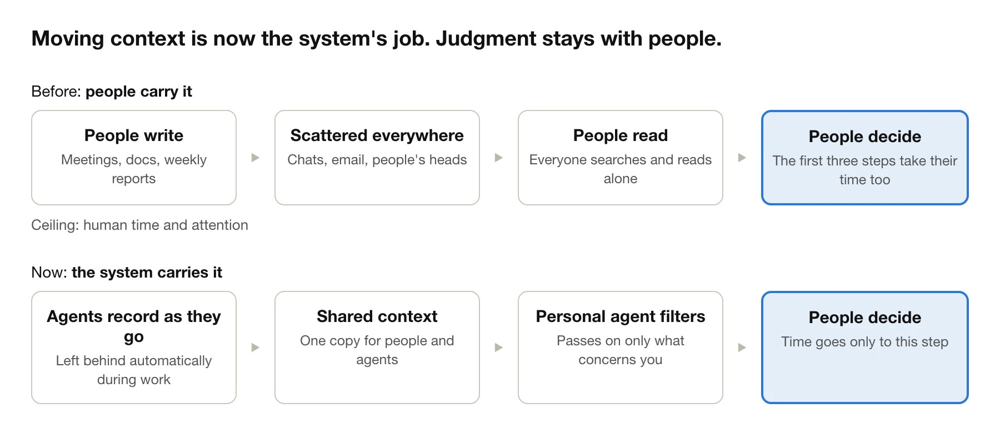

### What AI changes

**Sharing context goes from culture to system.** "Write the context down" used to be a cultural demand that relied on people's discipline. Now agents can record decisions, the reasons behind them, and progress as they work, and they can read the relevant parts for a person and boil them down. What Netflix and GitLab pushed hard for and found difficult to really achieve becomes the default behavior of the infrastructure.

**The size of a "small team" changes.** A two-pizza team is six to ten people, and that number was propped up by the amount of execution. With execution handed to agents, two or three people plus a group of agents can own the same scope. The scope a single-threaded owner can handle grows with it.

**Decisions can be pushed down to agents, not only to front-line employees.** Amazon says to hand reversible decisions to the front line quickly. Some of those can now go to agents. The test has not changed. It only gains one more item: can the correctness of the result be checked?

**Flattening is no longer limited by human bandwidth.** Meta cut its middle layers at the price of each manager handling more people and more information. Now each person's personal agent can pick out the relevant parts of the shared context for them. There can be fewer layers without people drowning in information.

### What does not change

**Each thing still needs one person who owns it.** DRI, single-threaded owner, informed captain: none of these designs is out of date in the age of AI. They matter more. An agent can move things forward, but someone has to set the goal and someone has to answer for the outcome.

**Talent density matters more.** Netflix hires only the best because each person's judgment affects a large part of the business. Now each person has a group of agents behind them, one judgment reaches further, and the bar for people only goes up.

**Alignment on direction and taste still happens only between people.** The "highly aligned" half was never accomplished through documents. It comes from people talking things through again and again. AI does not bring this cost down. Organizational design can only reduce the number of people who need to align this way.

**What is not written down, the agent cannot see.** Amazon's six-page memo forces people to write their thinking out clearly. This matters more in the age of AI: agents can only use the context that has been written down.

So what AI changes is who carries the load. Recording, organizing, and distributing context can be handed to the system. What does not change is judgment and accountability. They stay with people, and they become more concentrated.

## 5. What the new organization should look like

Very few people, each able to play several roles. All context is shared. Any execution work whose correctness can be checked goes to agents, and people sign off on it. Each person has a personal agent that guards their attention.

Concretely, that comes to six practices. The first three are things the companies in section 4 have long been doing, except that the system now carries them and not people. The last three only became possible with agents.

| Practice | Bottleneck it addresses |
| --- | --- |
| All context is shared, and written down | Communication |
| Few people, and each block of context has exactly one owner | Communication |
| If you must split, split where the two sides need to talk least, and connect them through explicit deliverables | Communication |
| Execution work that can be checked goes to agents that stay on the job | Verification |
| One personal agent per person, which passes along only what needs their judgment and does not interrupt them with progress updates | Attention |
| Whether to let an agent act on its own depends on two things: can the result be checked, and can a mistake be undone | Verification |

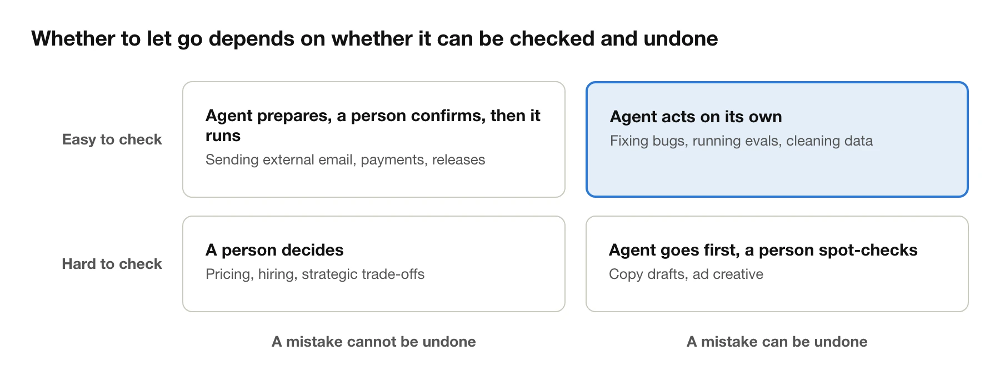

What kind of work suits an agent that stays on the job? I use four criteria: the work recurs; whether it was done right can be checked; the context it needs sits in one place; and one person is accountable for it. Evaluation is an example: after every code change, an agent runs the eval suite, pulls out the failing samples, and hands them to the product owner.

## 6. Offloop: designed around this idea

We call the agents in Offloop "agent employees." An agent employee is not a tool that waits to be called. It is a colleague that stays on the job around one role and one set of responsibilities. It knows what it owns, starts on its own when an event arrives, and keeps pushing the work forward without being chased until there is a result. It comes to a person only when a human judgment is needed. Today's chat assistants, coding agents, and workflow automations all still need a person to trigger them.

The precondition is to bring the context together first. The product has four layers, which map directly onto the practices above:

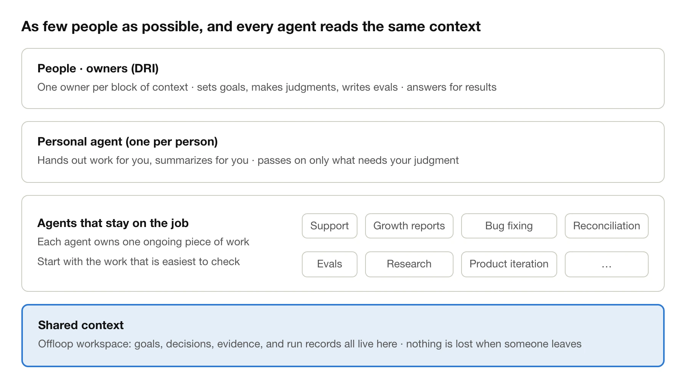

- **Shared context.** A team's conversations, tasks, files, decisions, and every run record live in the same workspace, and people and agents look at the same copy. Shared does not mean without boundaries: memory is split into public and private, and a person's email can be read only by their own personal agent.
- **Agents that stay on the job.** Each agent has its own role, job description, skills, and permissions. It can be woken by an email, a schedule, a production alert, or another agent. Nobody has to call it.
- **Personal agents.** One per person. As we designed it, it watches its owner's email and calendar and speaks up only when something needs their attention. Anything it prepares on their behalf needs their approval before it goes out. The principle we set for it is "delegate, don't impersonate."
- **People.** They set goals, make judgments, and answer for results. When a human judgment is needed, the agent delivers the question and the evidence together to that person's Inbox.

Our own company runs this way.

Offloop has no full-time HR or finance staff. The recruiting agent sources continuously, scores candidates against the role, and hands a summary to the founders. A person decides only whether to interview. Sending the invitation and scheduling go back to the agent. The finance agent does everything from syncing transactions, bookkeeping, and reconciliation through monthly close and tax filing. A person authorizes access once, at the very beginning.

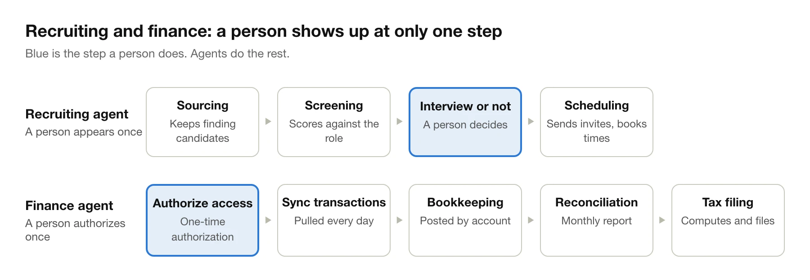

Engineering works the same way. Every bug has its own thread in a channel. The bug-fixing agent claims the bug, writes the fix, adds tests, and says plainly which parts are not finished yet. Teammates can drop a screenshot or an instruction into the same thread at any time, and it carries on from there.

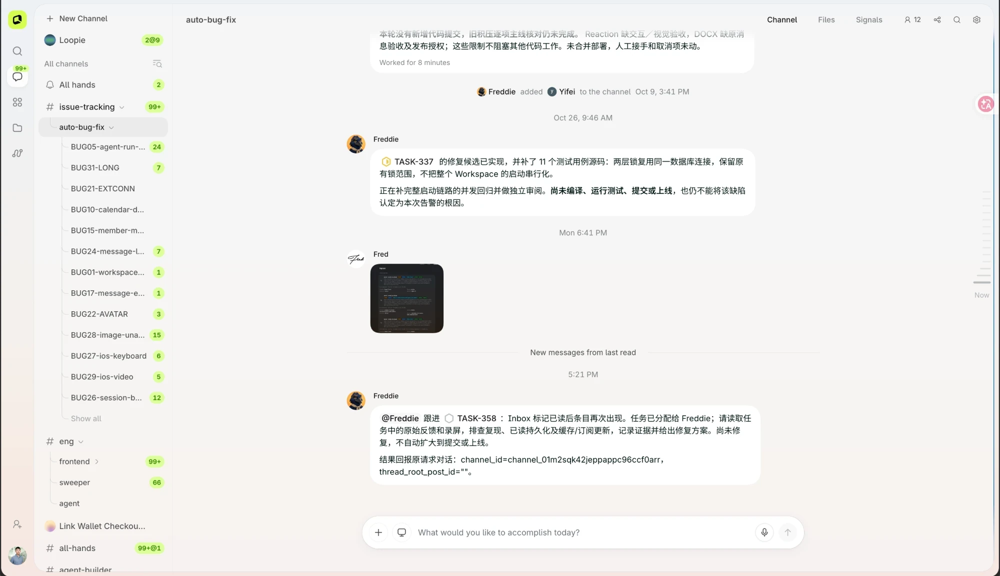

The auto-bug-fix channel in the Offloop workspace: one thread per bug on the left, the agent's execution reports and teammates' follow-ups on the right. Message text translated from Chinese.

## Closing

Fifty years ago Brooks said that adding people to a late project only makes it later. Since then almost every effort in organization has been a fight against the cost of passing context. Splitting into small teams, writing memos, naming owners, cutting middle layers: all of them try to make context travel fewer times.

AI lets us add capacity without adding people for the first time. It also lets context travel without people carrying it for the first time. That brings the question of organization back to its most basic form: who makes the judgment, and who is accountable.

Go back to the morning brief at the start. From sourcing and screening to scheduling, I made exactly one decision in the whole process: interview or not. This is what I understand an AI-native organization to be: very few people, each person's judgment used in full, and everything else handed to agent employees that stay on the job.

The best companies of the future will not be the ones with the most people, or the ones with the most agents. They will be the ones where every person's judgment is used in full. We are building Offloop so that more teams can run this way, and we are a team that runs this way ourselves.

## References

- Frederick Brooks, *The Mythical Man-Month* (1975) and *No Silver Bullet* (1986)
- Ronald Coase, *The Nature of the Firm* (1937); Oliver Williamson, transaction cost economics
- Netflix Culture: context, not control; highly aligned, loosely coupled; informed captain
- Jeff Bezos, 2015 letter to shareholders (one-way and two-way door decisions); Amazon's two-pizza teams, single-threaded owners, and six-page memos

<!--translation-->

早上九点，我在微信上收到 Loopie 的早报：今天有两位新候选人等我拍板。因为合伙人这两天出差，它建议我直接看。每位候选人后面跟着一行字：初评几分、做过什么、建议进哪一轮面试。最后还提醒我，前一天的另一位候选人也还没定。

我在微信里回了一句：「两个我都面一下，简历发我看看。」几分钟后，两份简历发到了我手上，它也已经去两位候选人各自的频道里，通知 HR agent 和猎头顾问约时间。第二天，它干脆把我的日历预约链接发给对方，让候选人自己挑空档，只有时间完全对不上的时候才来找我。

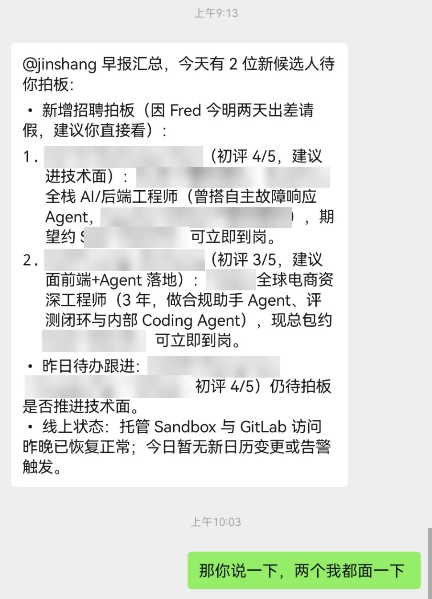

从找到候选人、初评、背调到约面试，这件事里我只做了一个决定：面不面。

这样的消息，我们每天都会收到。我们公司没有专职的 HR，也没有专职的财务，招聘和记账都是 agent 在做；我们还有一款叫 Readever 的产品，从增长到产品迭代全部由 agent 运营，没有一个专职员工。

Offloop 是我们在做的产品：一个让 agent 员工和人在同一个工作空间里协作的平台。agent 员工有自己的岗位和职责，长期在岗、主动推进工作，只在需要判断的时候来找人。这一年，我们一边做这个产品，一边用它来运转自己的公司。

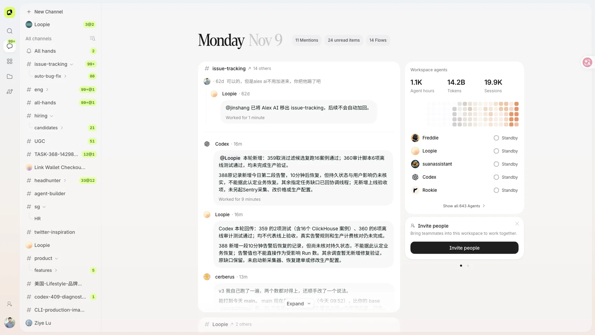

Offloop 工作区首页：左侧是按职能组织的频道，中间是需要我关注的消息，右侧是在岗的 agent 员工

这个过程让我一直在想一个问题：AI native 的组织，到底应该长什么样？这篇文章是我的回答。它要从一个很老的问题讲起：组织为什么要分工。

## 一、过去为什么要分工

### 分工的两个原因

- **能力**：一个人不可能什么都会。
- **时间**：一个人会做，但做不过来。很多时候真正卡住的是这一条：一个产品、工程、算法、评测都懂的人，一天也只有十几个小时，只能把自己拆成四个岗位。

### 每次分工的代价

布鲁克斯在《人月神话》里写下了一条后来被叫作布鲁克斯定律的经验：

> Adding manpower to a late software project makes it later.（给已经延期的软件项目加人，只会让它更晚。）

原因在于沟通。n 个人之间有 n(n−1)/2 条沟通线，人数翻三倍，沟通线大约翻十倍。新加进来的人要先花时间了解项目的 context，老成员还要停下手里的活给他讲。

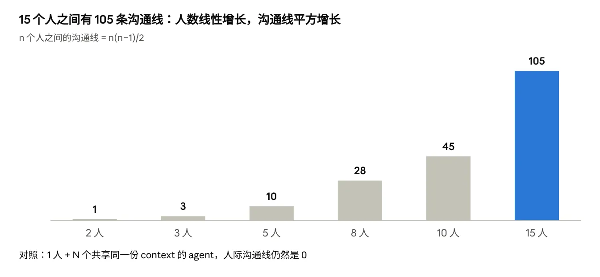

布鲁克斯给出的解法是「外科手术队」：一个团队里只有一个主刀医生，负责核心设计和关键决定，其他人都围绕他做辅助。这样做牺牲了一部分并行，换来的是概念完整性：系统从头到尾只有一个人的思路，不会东拼西凑。在他看来，这比多几个人手更重要。

后来他在《没有银弹》里又区分了两种复杂度：一种来自工具和实现，比如语言、编译、调试；另一种来自问题本身，比如到底要做什么、各部分怎么配合。前一种可以靠更好的工具不断降低，后一种降不下来。今天 AI 解决的，主要也是前一种。

布鲁克斯讨论的是一个团队内部。同样的成本放大到整个公司，就决定了公司的边界。科斯在 1937 年问了一个很基本的问题：既然市场可以靠价格协调分工，为什么还需要公司？他在《企业的性质》里给出的回答是：

> The main reason why it is profitable to establish a firm would seem to be that there is a cost of using the price mechanism.（建立企业之所以有利可图，主要原因似乎在于使用价格机制是有成本的。）

通过市场做事，要找人、谈判、签合同、监督执行。当这些成本高过在公司内部直接安排的成本，事情就会被放进公司里做。换句话说，需要频繁传递 context 的事，会被圈在公司内部。

威廉姆森在科斯的基础上，说清楚了哪些事更该留在内部：越是专用的（只对这家公司有用的知识和关系）、越不确定的、越频繁发生的、越难衡量好坏的事，越应该自己做。放到今天，就是越依赖内部 context 的事，越应该留在公司里。

从一个团队到一家公司，结论是一样的：分工带来产能，但每多分一次工，就要多付一次传递 context 的成本。过去我们接受这些代价，是因为不分工，活就干不完。

## 二、这些瓶颈被解除了吗

时间的瓶颈基本被解除了，能力的瓶颈解除了一部分，但分工的代价一点没少。

| | 过去 | 现在 |
| --- | --- | --- |
| 时间 | 会做，但做不过来 | 基本解除：执行交给 agent，一个人可以同时推进两三件事 |
| 能力 | 一个人不会所有事 | 部分解除：短板由 agent 补上 |
| 分工的代价 | 每次交接都要重新传一遍 context | 没有变：人和人之间照样要开会、写文档、反复确认 |

分工的理由在消失，分工的代价还在。

这意味着，一个能力强的人第一次可以被完整地用起来。以产品和开发为例：过去这是两个人，产品写需求文档交给开发，开发理解一旦有偏差，做出来的东西就要返工。现在一个人看到用户反馈，自己想清楚要改什么，让 agent 把代码写出来、把测试跑完，再自己判断结果对不对。中间没有交接，也就没有理解偏差。

多招一个人，就多出一堆沟通；多加一个 agent，只是多了产能。前提是这些 agent 看到的是同一份 context。

## 三、新的瓶颈

执行不再稀缺以后，稀缺的变成了三样东西。

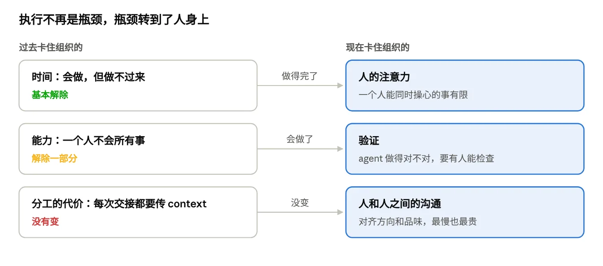

1. **人的注意力**：一个人能同时操心的事情是有限的。有了 agent，大概能从一件变成两三件，再多，判断就开始出错。
2. **人和人之间的沟通**：agent 之间共享 context 几乎没有成本；agent 来找人，要占用人的注意力；人和人之间对齐方向和品味，最慢也最费劲。
3. **验证**：agent 生成的东西越来越多，能判断好坏的人和标准却跟不上。一件事能不能放心交给 agent，取决于它做得对不对能不能被检查出来。

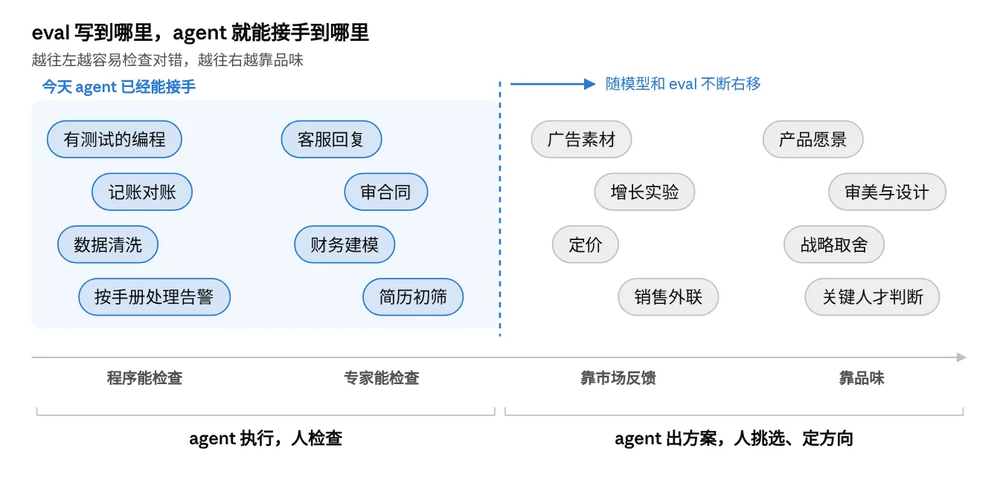

越往左的事，越有标准答案，今天已经可以交给 agent；越往右的事，越依赖品味，也很难马上知道做得好不好，还得人来做。eval 写到哪里，agent 就能接手到哪里。所以组织里最稀缺的，是右边那些能定方向、做取舍的人。

## 四、过去的组织实践，还成立吗

把传递 context 的成本当成组织的核心问题，并不是新想法。过去几十年里，好公司一直在用制度压低这部分成本，只是手段不同。归纳起来是五类做法：

| 做法 | 谁在这么做 | 靠什么撑着 |
| --- | --- | --- |
| 把 context 写下来、公开 | Netflix 讲「Context, not control」；亚马逊开会前先读六页备忘录；Meta 内部的代码和文档几乎对所有员工开放 | 有人愿意写，有人有时间读；文档会过时，需要有人维护 |
| 让团队变小 | 亚马逊的两个披萨团队；Basecamp 一个项目只配一个设计加一两个工程师 | 每个人都得很强；Netflix 只要最好的人，就是在为此付钱 |
| 一件事只有一个人负责 | 亚马逊的单线程负责人；苹果的 DRI；Netflix 为每个重大决定指定一个拍板的人 | 这个人的精力决定了他能管多大的范围 |
| 团队之间只靠接口对接 | 亚马逊要求团队之间只通过 API 协作；Netflix 讲「highly aligned, loosely coupled」 | 接口要设计得好；方向上的对齐仍然要靠人和人谈 |
| 减少层级，把决定权往下放 | 亚马逊把决定分成单向门和双向门；Meta 2023 年砍掉多层中层管理，提出「flatter is faster」 | 一线要有足够的 context；经理要直接带更多人、看更多信息 |

这些做法都成立，但都建立在同一个前提上：context 由人来写、人来读、人来传。所以它们都碰到了同一个天花板：人的时间和注意力。Netflix 的「给 context」要求管理者花大量时间解释背景；亚马逊的六页备忘录要有人写、有人读；Meta 砍掉中层以后，每个经理要直接带更多人。

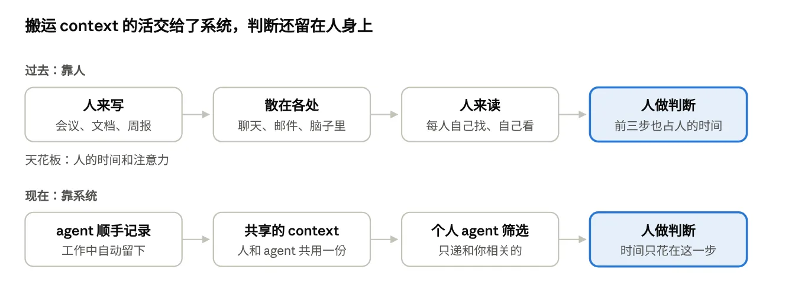

### AI 改变了什么

**context 共享从文化变成了系统。** 过去「把 context 写下来」是一种文化要求，靠人自觉。现在 agent 可以在工作过程中顺手把决策、依据和进展记下来，也可以替人把需要的部分读完、提炼好。Netflix 和 GitLab 当年努力推动、却很难真正做到的事情，变成了基础设施的默认行为。

**「小团队」的尺寸变了。** 两个披萨团队是 6 到 10 个人，这个数字本身是被执行量撑起来的。执行交给 agent 以后，同样范围的事情，两三个人加一组 agent 就能负责。单线程负责人能管的范围也随之变大。

**决定权可以下放给 agent，而不只是一线员工。** 亚马逊说「能撤回的决定尽快放给一线」，现在其中一部分可以放给 agent。判断标准没变，只多了一条：做得对不对能不能被检查。

**扁平化不再受限于人的带宽。** Meta 砍掉中层，代价是每个经理要带更多人、看更多信息。现在每个人的 personal agent 可以从共享的 context 里挑出和他相关的部分，层级可以更少，人却不会被信息淹没。

### 什么没变

**一件事仍然需要一个人负责。** DRI、单线程负责人、informed captain，这些设计在 AI 时代不但没有过时，反而更重要。agent 可以推进事情，但目标得有人定，后果得有人担。

**人才密度更重要了。** Netflix 只要最好的人，是因为每个人的判断会影响很大一块业务。现在每个人背后有一组 agent，一个判断影响的范围更大，对人的要求只会更高。

**方向和品味上的对齐，仍然只能靠人和人。** 「highly aligned」那一半从来不是靠文档完成的，靠的是人和人之间反复的讨论。这部分成本 AI 降不下来，组织设计只能尽量减少需要这样对齐的人数。

**没写下来的东西，agent 也看不见。** 亚马逊的六页备忘录逼着人把想法写清楚，这件事在 AI 时代更重要了：只有写下来的 context，agent 才能用。

所以 AI 改变的是承担者：context 的记录、整理和分发可以交给系统。没变的是判断和问责，它们仍然在人身上，而且更集中了。

## 五、新的组织应该长什么样

人很少，每个人都能身兼几个角色；context 全部共享；能检查对错的执行工作都交给 agent，人来验收；每个人有一个自己的 personal agent，帮他管住注意力。

具体来说是下面六条。前三条是第四节里那些公司早就在做的，只是现在承担者从人变成了系统；后三条，是有了 agent 才做得到的。

| 做法 | 解决哪个瓶颈 |
| --- | --- |
| context 全部共享，而且写下来 | 沟通 |
| 人少，一块 context 只交给一个人负责 | 沟通 |
| 如果一定要拆，就拆在两边最不需要沟通的地方，用明确的交付物对接 | 沟通 |
| 能检查对错的执行工作，交给长期在岗的 agent | 验证 |
| 每人一个 personal agent，只把需要他判断的事递给他，不拿进度打扰他 | 注意力 |
| 放不放手给 agent，看两点：结果能不能检查，做错了能不能撤回 | 验证 |

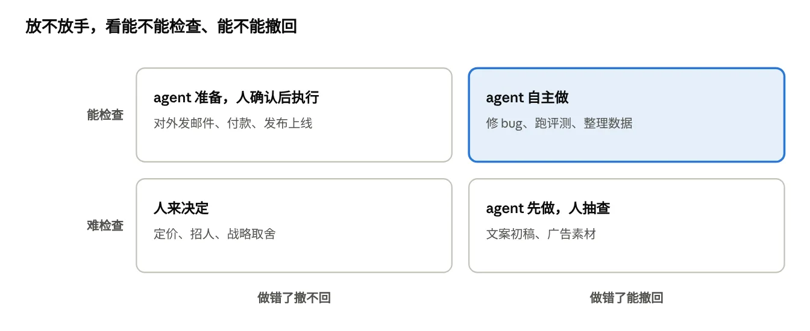

什么样的工作适合交给一个长期在岗的 agent？我的标准有四条：这件事会反复发生；做得对不对可以检查；需要的 context 集中在一处；有一个人对它负责。比如评测：每次改完代码，agent 自动跑一遍评测集，把失败的样本挑出来，交给产品负责人看。

## 六、Offloop：为这个理念而设计

我们把 Offloop 里的 agent 定义为「agent 员工」。agent 员工不是等人来叫的工具，而是围绕一个岗位、一份职责长期在岗的同事：它知道自己负责什么，事件来了会自己启动，没人催也会主动把事情往前推，直到有结果；只有需要人判断的时候，它才来找人。现在的对话助手、编程 agent 和工作流自动化，都还需要人来触发。

做到这一点的前提，是先把 context 聚到一起。产品分四层，和上面的做法一一对应：

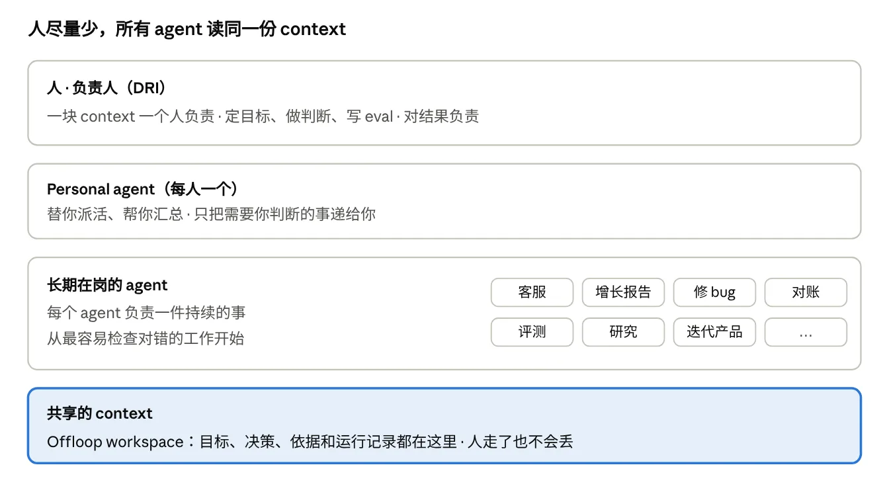

- **共享的 context**：一个团队的对话、任务、文件、决策和每一次运行记录都在同一个 workspace 里，人和 agent 看的是同一份。共享并不等于没有边界：记忆分公开和私有，一个人的邮件只有他自己的 personal agent 能看。
- **长期在岗的 agent**：每个 agent 有自己的岗位、职责说明、技能和权限，可以被邮件、定时任务、线上告警或其他 agent 唤醒，不需要有人去叫它。
- **Personal agent**：每人一个。按我们的设计，它替主人盯着邮件和日程，平时只在有事需要主人注意时才开口；替主人准备好的东西，发出去之前要主人点头。我们给它定的原则是「委托，不是冒充」。
- **人**：定目标、做判断、对结果负责。需要人判断的时候，agent 会把问题和依据一起送到这个人的 Inbox。

我们公司自己就是这样运转的。

Offloop 没有专职的 HR 和财务。招聘 agent 持续寻源、按岗位要求给候选人打分，汇总后交给创始人，人只决定要不要面试，之后发邀请、约时间又回到 agent 手里。财务 agent 从同步流水、记账、对账一直做到月结报税，人只在最开始授权一次。

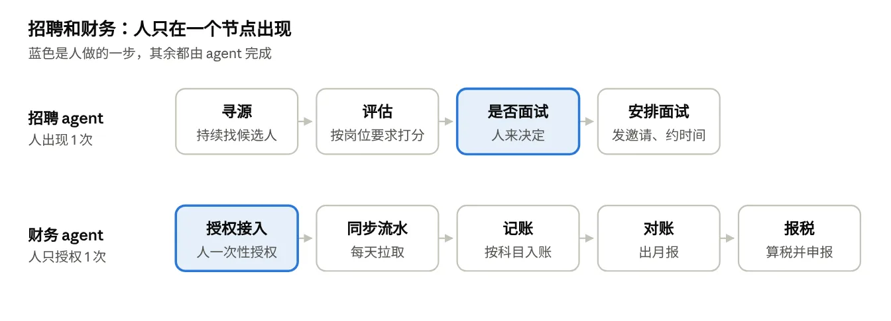

研发也一样。每个缺陷在频道里有自己的线程，负责修 bug 的 agent 领取缺陷、写修复、补测试，并主动说明还没做完的部分；同事随时在同一个线程里补截图或指令，它接着往下做。

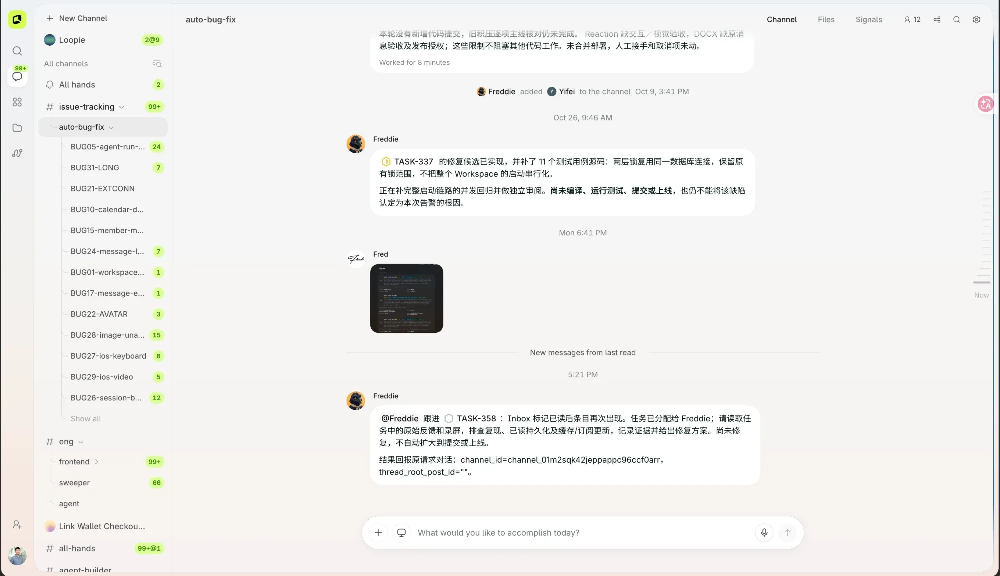

Offloop 工作区里的 auto-bug-fix 频道：左侧每个缺陷一个线程，右侧是 agent 的执行汇报和同事的补充

## 结语

五十年前，布鲁克斯说，给延期的项目加人只会更晚。在那之后，几乎所有关于组织的努力，都是在和传递 context 的成本作斗争：拆小团队、写备忘录、设负责人、砍掉中间层，本质上都是想让 context 少搬几次。

AI 第一次让我们可以不靠加人来增加产能，也第一次让 context 的传递可以不靠人来完成。组织的问题由此回到了最本质的地方：谁来判断，谁来负责。

回到开头那条早报。从找人、初评到约面试，整件事里我只做了一个决定：面不面。这就是我理解的 AI native 组织：人很少，每个人的判断都被完整地用起来，其余的事交给长期在岗的 agent 员工。

未来最好的公司，不是人最多的公司，也不是 agent 最多的公司，而是每一个人的判断都能被完整用起来的公司。我们做 Offloop，就是想让更多团队这样运转，而我们自己，就是一个这样运转的团队。

## 参考

- Frederick Brooks，《人月神话》（1975）与《没有银弹》（1986）
- Ronald Coase，*The Nature of the Firm*（1937）；Oliver Williamson 交易成本经济学
- Netflix Culture：Context, not control；highly aligned, loosely coupled；informed captain
- Jeff Bezos，2015 年致股东信（单向门与双向门决策）；亚马逊的两个披萨团队、单线程负责人与六页备忘录
